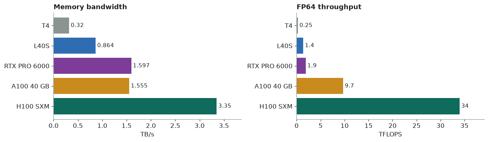

# GPU spec sheets

!!! info "Interactive version"
    An interactive version with bar charts is
    **[on Claude](https://claude.ai/artifact/TMvw41QWkQS1HHFvvfZArN)**.

Five NVIDIA data-center GPUs side by side, from the low-cost T4 to the H100. Specs are
vendor datasheet peaks (dense, no sparsity).

## Side by side

| | Tesla T4 | L40S | RTX PRO 6000 Blackwell | A100 SXM4 40 GB | H100 SXM5 80 GB |
|---|---|---|---|---|---|
| **Silicon** | | | | | |
| Architecture | Turing (TU104) | Ada Lovelace (AD102) | Blackwell (GB202) | Ampere (GA100) | Hopper (GH100) |
| Compute capability | sm_75 | sm_89 | sm_120 | sm_80 | sm_90 |
| CUDA cores | 2,560 | 18,176 | 24,064 | 6,912 | 16,896 |
| Tensor cores | 320 (gen 2) | 568 (gen 4) | 752 (gen 5) | 432 (gen 3) | 528 (gen 4) |
| L2 cache | 4 MB | 96 MB | 128 MB | 40 MB | 50 MB |
| **Memory** | | | | | |
| Capacity | 16 GB GDDR6 | 48 GB GDDR6 ECC | **96 GB GDDR7 ECC** | 40 GB HBM2 | 80 GB HBM3 |
| Bandwidth | 320 GB/s | 864 GB/s | 1,597 GB/s | 1,555 GB/s | **3,350 GB/s** |
| **Compute (TFLOPS)** | | | | | |
| FP64 | 0.25 | ~1.4 | ~1.9 | 9.7 | **34** |
| FP64 tensor | — | — | — | 19.5 | **67** |
| FP32 | 8.1 | 91.6 | **~120** | 19.5 | 67 |
| TF32 tensor | — | 183 | — | 156 | **495** |
| FP16/BF16 tensor | 65 | 362 | — | 312 | **989** |
| **System** | | | | | |
| Board power | 70 W | 350 W | up to 600 W | 400 W | 700 W |
| Host bus | PCIe 3.0 x16 | PCIe 4.0 x16 | PCIe 5.0 x16 | PCIe 4.0 | PCIe 5.0 |
| GPU–GPU link | none (PCIe) | none (PCIe) | none (PCIe) | NVLink 3 · 600 GB/s | **NVLink 4 · 900 GB/s** |
| MIG partitions | no | no | up to 4 | up to 7 | up to 7 |
| **Cloud and quantum simulation** | | | | | |
| AWS instance | g4dn.xlarge, g4dn.12xlarge (4×) | g6e.2xlarge, g6e.12xlarge (4×) | g7e.2xlarge | p4d.24xlarge (8×) | p5.4xlarge (1×), p5.48xlarge (8×) |
| Statevector ceiling, double/single | 29 / 30 qubits | 31 / 32 qubits | **32 / 33 qubits** | 31 / 32 qubits | **32 / 33 qubits** |
| Supported by cuStateVec | yes | yes | yes (CUDA ≥ 12.8) | yes | yes |

## Memory bandwidth

*Memory bandwidth (left) and FP64 throughput (right) from the datasheets.*

Stencils, LBM steps and statevector updates are all bandwidth-bound, so bandwidth is
the spec that best predicts their speed.

| GPU | GB/s | Relative to H100 |
|---|---:|---|
| T4 | 320 | `█` 9.6% |
| L40S | 864 | `███` 25.8% |
| RTX PRO 6000 | 1,597 | `█████` 47.7% |
| A100 40 GB | 1,555 | `█████` 46.4% |
| H100 SXM | 3,350 | `██████████` 100% |

## FP64 throughput

The T4, L40S and RTX PRO 6000 run FP64 at 1/32 to 1/64 of FP32. A100 and H100 run
FP64 at full rate. Keep this in mind for any double-precision scientific code. The
figures below are non-tensor.

| GPU | TFLOPS | Relative to H100 |
|---|---:|---|
| T4 | 0.25 | 0.7% |
| L40S | ~1.4 | 4.2% |
| RTX PRO 6000 | ~1.9 | 5.6% |
| A100 40 GB | 9.7 | `███` 28.5% |
| H100 SXM | 34 | `██████████` 100% |

## Per GPU

### NVIDIA Tesla T4

- **Instance:** g4dn.xlarge · g4dn.12xlarge (4× T4)
- **Memory:** 16 GB GDDR6 · 320 GB/s
- **Arch:** Turing, sm_75

The cheapest card to get, especially on spot, and good for development and for
validating kernels. It has the least memory, so it is the first to run out of room
for a statevector or a large grid. FP64 is very slow.

### NVIDIA L40S

- **Instance:** g6e.2xlarge · g6e.12xlarge (4× L40S)
- **Memory:** 48 GB GDDR6 · 864 GB/s (~46 GB usable)
- **Arch:** Ada Lovelace, sm_89

Strong FP32 and tensor throughput at moderate bandwidth. A good fit for FP32 and
mixed-precision work; weak for FP64. Multi-GPU instances can be hard to get in some
regions.

### RTX PRO 6000 Blackwell Server Edition

- **Instance:** g7e.2xlarge
- **Memory:** 96 GB GDDR7 ECC · 1,597 GB/s
- **Arch:** Blackwell, sm_120 (needs CUDA ≥ 12.8)

It has more memory than any other card here, so it fits the largest statevector on
a single card. Its bandwidth is close to the A100's, but its FP64 is much lower.

### NVIDIA A100

- **Instance:** p4d.24xlarge (8× A100 40 GB, EFA 4×100 Gb); p4de.24xlarge for the
  80 GB part
- **Memory:** 40 GB HBM2 · 1,555 GB/s (80 GB variant: HBM2e · 2,039 GB/s)
- **Arch:** Ampere, sm_80

- Full-rate FP64 (9.7 TFLOPS, 19.5 on tensor cores), about 5× the RTX PRO 6000.
- NVLink 3 between GPUs on p4d.
- Its bandwidth is close to the RTX PRO 6000's, so expect similar times for
  bandwidth-bound kernels.

### NVIDIA H100

- **Instance:** p5.4xlarge (1×) · p5.48xlarge (8×)
- **Memory:** 80 GB HBM3 · 3,350 GB/s
- **Arch:** Hopper, sm_90

- About 2.1× the RTX PRO 6000's bandwidth, the biggest lever for a bandwidth-bound
  kernel.
- Full-rate FP64 (34 TFLOPS, 67 on tensor cores).
- NVLink 4 at 900 GB/s between GPUs. The PCIe-only cards above use PCIe for halo
  exchange and collectives instead.
- The PCIe H100 is a different part: 2.0 TB/s HBM2e, 26 TFLOPS FP64, 350 W.

## Notes on the numbers

- All compute figures are vendor peaks without sparsity. "~" marks a figure derived
  from the FP64:FP32 ratio or rounded from the datasheet. "—" means the datasheet
  gives no figure, or the format isn't a headline spec for that part.
- Statevector ceiling = the largest $W$ such that the statevector fits in 85% of
  device memory. A double statevector takes $2^W \times 16$ bytes and a single one
  $2^W \times 8$ bytes.
- Prices are left out because they vary by region and spot market.
