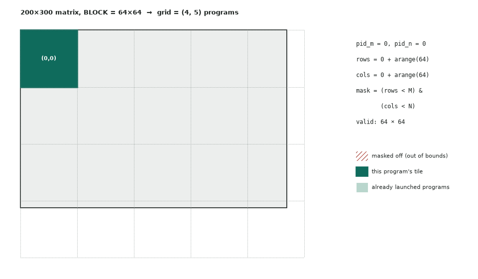

# 01. Vector addition

| | |
|---|---|
| **Question** | *Vector Addition* (easy) on [LeetGPU](https://leetgpu.com/challenges) · [official spec and reference](https://github.com/AlphaGPU/leetgpu-challenges/tree/main/challenges/easy/1_vector_add) |
| **Solution** | [01_vector_add.py](01_vector_add.py) |
| **Task** | `C = A + B`, float32, 1 ≤ N ≤ 100M; perf N = 25M; tolerance 1e-5 |
| **Bound by** | memory bandwidth (1 FLOP per 12 bytes) |

## Idea

One program per `BLOCK_SIZE` contiguous elements. Lane `i` of program `pid` handles element
`pid * BLOCK_SIZE + i`, so a warp touches 32 consecutive floats: one 128-byte coalesced
transaction. The last block is partial, so every load and store is **masked**.



## Code

```python
--8<-- "docs/leetgpu/01_vector_add.py"
```

## Why it is already near the limit

Bytes moved = 2 reads + 1 write = $12N$ = 300 MB at N = 25M. Arithmetic intensity is
$1/12 \approx 0.08$ FLOP/byte, far left of the ridge point, so time = bytes / bandwidth:

| | T4 | H100 SXM |
|---|---|---|
| Roofline floor (300 MB) | 0.94 ms | 0.09 ms |
| Realistic (80–90% of peak) | ~1.1–1.2 ms | ~0.10–0.11 ms |

A profile showing DRAM throughput ~85% and SM throughput ~2% is the *expected* healthy
signature: the SMs are idle because there is nothing to compute. The real optimization
is not in this kernel. It is **fusing the add into the neighbouring operation** so the
300 MB round trip disappears.

## T4 vs H100

| | T4 | H100 |
|---|---|---|
| `BLOCK_SIZE`, `num_warps` | 1024, 4 is fine | try 2048–4096 with 8 warps: more bytes in flight per SM to cover HBM latency |
| Programs | 24K blocks ≫ 40 SMs: no tail problem | same |
| Expect from tuning | < 5% | 5–10% |

Nothing has to change for correctness on either GPU.

## Benchmark and profile

```bash
python docs/leetgpu/01_vector_add.py            # prints GB/s vs torch.add
PROFILE=1 python docs/leetgpu/01_vector_add.py  # one kernel per call, no gaps
ncu --kernel-name regex:vector_add --launch-count 1 --section SpeedOfLight --section MemoryWorkloadAnalysis \
    python docs/leetgpu/01_vector_add.py
```

Check: achieved GB/s vs peak; *sectors per request* = 4 (fully coalesced fp32); DRAM
bytes ≈ 300 MB.

## Scaling up

- **N > 2^31 elements:** `pid * BLOCK_SIZE` overflows int32. Use
  `pid.to(tl.int64) * BLOCK_SIZE`.
- **Many small vectors:** launch overhead (~3–5 µs) dominates below ~1 MB on H100. Batch
  them into one launch, or capture with CUDA Graphs.
- **In a real model:** fuse it (bias add, residual, activation) into the producer or
  consumer kernel. That is pages 08 and 17.

## Watch and read

- [GPU MODE Lecture 3: Getting Started With CUDA for Python Programmers](https://www.youtube.com/watch?v=4sgKnKbR-WE)
- [GPU MODE Lecture 14: Practitioner's Guide to Triton](https://www.youtube.com/watch?v=DdTsX6DQk24): programs, masks, pointer arithmetic
- [freeCodeCamp CUDA course](https://www.youtube.com/watch?v=86FAWCzIe_4): GPU fundamentals and first kernels chapters
- [Triton tutorial 01: Vector addition](https://triton-lang.org/main/getting-started/tutorials/01-vector-add.html)
- Notes: [Execution model](../notes/01-execution-model.md), [Memory hierarchy](../notes/02-memory-hierarchy.md#global-memory-and-coalescing)
