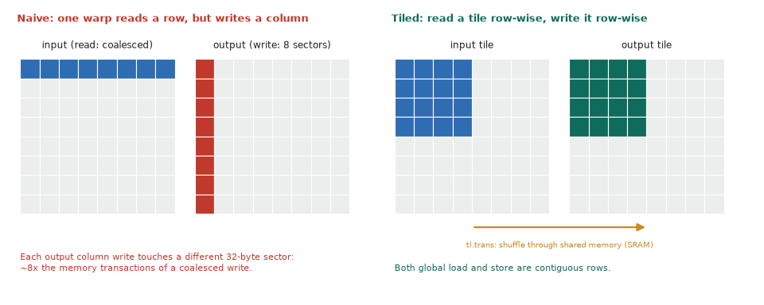

# 02. Matrix transpose

| | |
|---|---|
| **Question** | *Matrix Transpose* (easy) on [LeetGPU](https://leetgpu.com/challenges) · [official spec and reference](https://github.com/AlphaGPU/leetgpu-challenges/tree/main/challenges/easy/3_matrix_transpose) |
| **Solution** | [02_matrix_transpose.py](https://github.com/Prakash-sa/GPU-Codes/blob/main/docs/leetgpu/02_matrix_transpose.py) |
| **Task** | `output[c, r] = input[r, c]`, float32, up to 8192²; perf 7000 × 6000; tolerance 1e-5 |
| **Bound by** | memory bandwidth, if both sides are coalesced |

## Idea

The starter launches **one program per element** (`grid = (rows, cols)`): 42M programs
that each move 8 bytes. Even a one-thread-per-element CUDA kernel has a deeper
problem: reading a row is coalesced, but the same threads write a **column**, so every
4-byte write lands in a different 32-byte sector.

The fix is to move a **tile** per program. Read a `BLOCK × BLOCK` tile row by row
(coalesced), transpose it **on chip**, and write it row by row to the output (coalesced).
In Triton, `tl.trans(tile)` plus the transposed output pointers is enough. The compiler
stages the tile through shared memory and picks conflict-free layouts.



## Code

```python
--8<-- "docs/leetgpu/02_matrix_transpose.py"
```

## Performance

Bytes = read + write = $2 \cdot 4 \cdot 7000 \cdot 6000$ = 336 MB.

| | T4 | H100 SXM |
|---|---|---|
| Roofline floor | 1.05 ms | 0.10 ms |
| Element-per-program starter | many × slower (launch + uncoalesced writes) | same |

A good transpose reaches roughly the same GB/s as a plain copy (`output.copy_(input)`).
That copy is the right baseline to compare against.

## T4 vs H100

| | T4 | H100 |
|---|---|---|
| Tile | `BLOCK=32`, `num_warps=4` is often best (64 KB shared memory per SM, fewer warps) | `BLOCK=64`, `num_warps=8`; try 128 × 64 tiles |
| Shared memory per tile | 64² × 4 B = 16 KB: fits 3–4 programs per SM | same tile fits 14 per SM |

Autotune `BLOCK` over {32, 64} and `num_warps` over {4, 8}. The best choice differs
between the two GPUs.

## Benchmark and profile

```bash
python docs/leetgpu/02_matrix_transpose.py
ncu --kernel-name regex:transpose --launch-count 1 --section MemoryWorkloadAnalysis \
    python docs/leetgpu/02_matrix_transpose.py
```

In Memory Workload Analysis, global store *sectors per request* should be 4. With the
naive pattern it is ~32. Also check **shared memory bank conflicts** (should be ~0).

## Scaling up

- Non-square and very thin matrices (1 × 8192): tiles are mostly masked. A 1-D copy is
  better there.
- **Batched transposes** (e.g. `[B, H, S, D] → [B, S, H, D]` in attention): add the batch
  to grid axis 0, or better, **fuse the transpose into the consumer**. Load with
  transposed strides inside the next kernel and never materialize the transpose.
- Offsets above 2^31 elements need int64 row indices.

## Watch and read

- [GPU MODE Lecture 4: Compute and Memory Basics](https://www.youtube.com/watch?v=lTmYrKwjSOU)
- [GPU MODE Lecture 8: CUDA Performance Checklist](https://www.youtube.com/watch?v=SGhfUhlowB4): coalescing, shared memory tiling
- [NVIDIA blog: An Efficient Matrix Transpose in CUDA C/C++](https://developer.nvidia.com/blog/efficient-matrix-transpose-cuda-cc/): the classic shared-memory version in CUDA
- Notes: [Coalescing and bank conflicts](../notes/02-memory-hierarchy.md)
