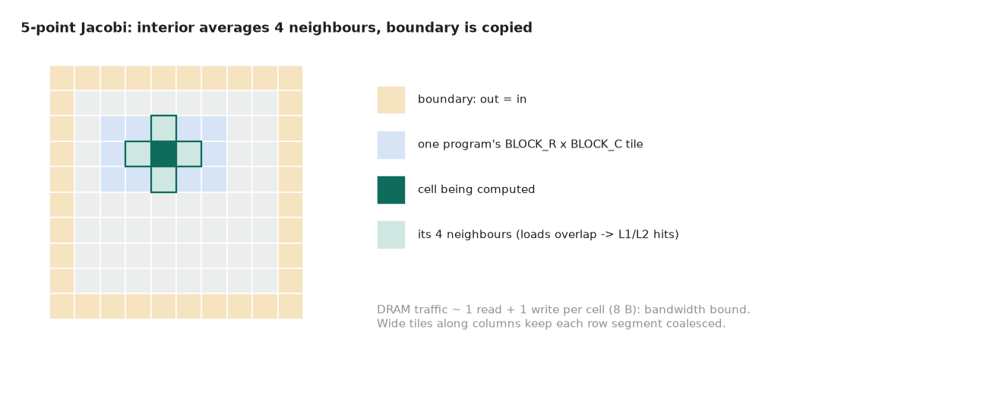

# 14. 2-D Jacobi stencil

| | |
|---|---|
| **Question** | *2D Jacobi Stencil* (medium) on [LeetGPU](https://leetgpu.com/challenges) · [official spec and reference](https://github.com/AlphaGPU/leetgpu-challenges/tree/main/challenges/medium/69_jacobi_stencil_2d) |
| **Solution** | [14_jacobi_stencil_2d.py](14_jacobi_stencil_2d.py) |
| **Task** | interior: average of 4 neighbours; boundary: copy; up to 16,384²; perf 8192²; tolerance 1e-5 |
| **Bound by** | memory bandwidth |

## Idea



One program per `BLOCK_R × BLOCK_C` tile issues four shifted loads (up, down, left,
right) with an `interior` mask. The shifted loads overlap almost entirely: the "left"
tile is the "right" tile moved by one column. So after the first load they hit L1/L2,
and DRAM sees ~one read and one write per cell. Boundary cells take the `center` load
and are copied.

The tiles are wide along columns (16 × 128), so every row segment is a 512-byte
coalesced access.

## Code

```python
--8<-- "docs/leetgpu/14_jacobi_stencil_2d.py"
```

## Performance

Bytes ≈ $2 \cdot 4 \cdot 8192^2$ = 537 MB.

| | T4 | H100 SXM |
|---|---|---|
| Floor | 1.7 ms | 0.16 ms |
| PyTorch slicing reference | clone + 4 slice reads + adds: 3–5× the traffic | same |

## T4 vs H100

| | T4 | H100 |
|---|---|---|
| Tile | 16 × 128, 4 warps | 32 × 256, 8 warps (more bytes in flight) |
| Halo reuse | 4 MB of L2: neighbouring tiles' rows may be evicted, so explicit shared-memory tiling helps more | 50 MB of L2 holds many rows: implicit reuse works well |

## Benchmark and profile

```bash
python docs/leetgpu/14_jacobi_stencil_2d.py
ncu --kernel-name regex:jacobi --launch-count 1 --section MemoryWorkloadAnalysis python docs/leetgpu/14_jacobi_stencil_2d.py
```

Compare DRAM bytes against 537 MB. If they are ≫ 537 MB, the halo reloads are
missing in L2. Also check the L1 hit rate (should be high for the shifted loads).

## Scaling up

This is the pattern behind CFD and LBM solvers:

- **Many iterations**: a time loop of one-step kernels is bandwidth bound at 8 B/cell
  per step. **Temporal blocking** (several steps per tile with a wider halo, kept in
  shared memory) cuts DRAM passes. Ping-pong buffers avoid copies.
- **3-D stencils** (7- or 27-point, D3Q27 LBM): use 2.5-D blocking. March along z, keep
  three planes in registers or shared memory.
- **Convergence checks** need a residual reduction. Do it every k steps, and on the
  device, to avoid `.item()` syncs.
- **Multi-GPU**: domain decomposition with halo exchange, overlapping the exchange with
  the interior update. See [Multi-GPU: halos](../notes/05-multi-gpu.md).

## Watch and read

- [GPU MODE Lecture 4: Compute and Memory Basics](https://www.youtube.com/watch?v=lTmYrKwjSOU)
- [GPU MODE Lecture 8: CUDA Performance Checklist](https://www.youtube.com/watch?v=SGhfUhlowB4)
- Notes: [2-D Jacobi stencil in Triton](../notes/08-triton.md), [halo exchange](../notes/05-multi-gpu.md)
