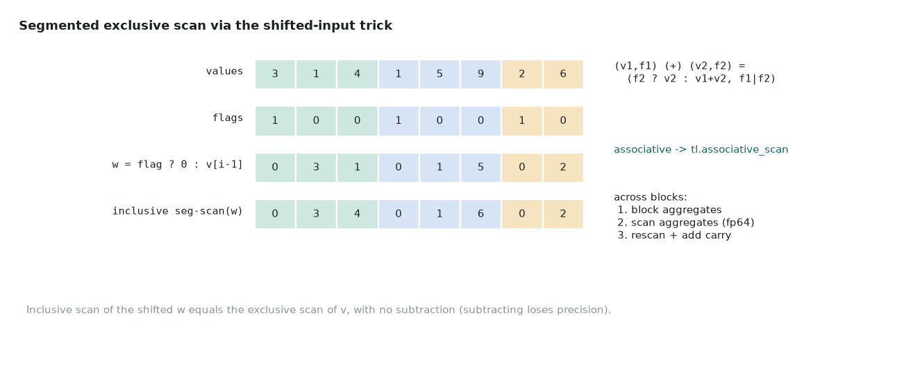

# 16. Segmented exclusive prefix sum

| | |
|---|---|
| **Question** | *Segmented Exclusive Prefix Sum* (medium) on [LeetGPU](https://leetgpu.com/challenges) · [official spec and reference](https://github.com/AlphaGPU/leetgpu-challenges/tree/main/challenges/medium/70_segmented_prefix_sum) |
| **Solution** | [16_segmented_prefix_sum.py](https://github.com/Prakash-sa/GPU-Codes/blob/main/docs/leetgpu/16_segmented_prefix_sum.py) |
| **Task** | `flags[i] = 1` starts a segment; `out[i]` = sum of the earlier values in i's segment; N ≤ 100M; perf N = 50M (segments of 256); tolerance 1e-3 |
| **Bound by** | memory bandwidth (H100); FP64 throughput risk on T4 |

## Idea



**Trick 1: exclusive without subtracting.** Define `w[i] = 0 if flags[i] else
values[i-1]`. An *inclusive* segmented scan of `w` is exactly the *exclusive* scan of
`values`. This avoids `incl[i] - values[i]`, which loses precision.

**Trick 2: a segmented scan is a normal scan with another operator.**

$$
(v_1, f_1) \oplus (v_2, f_2) = \big(f_2\ ?\ v_2 : v_1 + v_2,\ \ f_1 \lor f_2\big)
$$

It is associative, so `tl.associative_scan((w, f), 0, seg_combine)` runs it in parallel
within a block.

**Across blocks, three phases** ("reduce, then scan"):

1. `block_aggregate_kernel`: scan each block and write its last element (tail sum, any flag).
2. `carry_scan_kernel`: one program scans the ~12K aggregates in chunks, using the same
   operator, to get the carry into every block.
3. `block_scan_kernel`: rescan each block and add the carry to the elements *before* the
   block's first flag.

**Precision.** One segment can span all 100M elements, and FP32 running sums over 50K
values already drift by ~0.02 (the first test run failed exactly this way). Everything
is therefore scanned in **FP64**.

## Code

```python
--8<-- "docs/leetgpu/16_segmented_prefix_sum.py"
```

## Performance

Traffic: phase 1 reads values + flags (8 B/elem), phase 3 reads them again and writes
(12 B/elem): 20 B/elem = 1 GB at N = 50M. The minimum is 12 B/elem.

| | T4 | H100 SXM |
|---|---|---|
| Floor (1 GB) | 3.1 ms | 0.30 ms |
| FP64 scan work (~25 adds/elem × 2 passes ≈ 2.5 GFLOP) | **~10 ms at 0.25 TFLOP/s: compute bound!** | < 0.1 ms at 34 TFLOP/s |

## T4 vs H100

| | T4 | H100 |
|---|---|---|
| FP64 cost | dominant | negligible |
| Suggested change | scan in FP32 within the block (BLOCK = 1024) and keep only carries in FP64. Validate against the 1e-3 tolerance with your longest segments. Or use Kahan-compensated FP32 pairs | keep FP64 |
| BLOCK | 1024–2048 | 4096 |

This is a good example of a "correct on H100, slow on T4" kernel. The fix is a
precision decision, so make it explicit and measure it. Don't change it silently.

## Benchmark and profile

```bash
python docs/leetgpu/16_segmented_prefix_sum.py
PROFILE=1 python docs/leetgpu/16_segmented_prefix_sum.py   # 3 kernels; carry_scan should be tiny
```

In ncu, compare DRAM % between phases 1 and 3. On T4 also look at the **FP64 pipe**
utilization.

## Scaling up

- **Single pass**: *decoupled look-back* (Merrill & Garland) does it in one kernel. Each
  block publishes its aggregate and then its inclusive prefix, and later blocks look
  back at their predecessors. That gives 12 B/elem and one launch. CUB's `DeviceScan`
  does this.
- Segmented scans power **ragged batches**: variable-length sequences, per-molecule
  sums in a batched graph, CSR row offsets (`row_ptr`), stream compaction.
- Very large N: offsets above 2^31 need int64 (`offs` here is int32: fine up to 100M).

## Watch and read

- [GPU MODE Lecture 20: Scan Algorithm](https://www.youtube.com/watch?v=ZKrWyEqqPVY)
- GPU MODE Lecture 24: Scan at the Speed of Light (decoupled look-back): see the [lectures repo](https://github.com/gpu-mode/lectures). The video is on the [GPU MODE channel](https://www.youtube.com/@GPUMODE).
- [GPU Gems 3, Chapter 39: Parallel Prefix Sum (Scan) with CUDA](https://developer.nvidia.com/gpugems/gpugems3/part-vi-gpu-computing/chapter-39-parallel-prefix-sum-scan-cuda)
