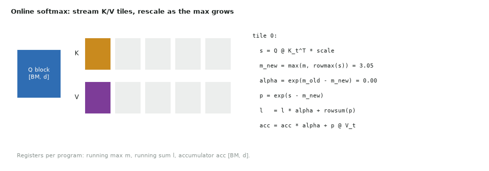

# 18. Softmax attention (FlashAttention-style)

| | |
|---|---|
| **Question** | *Softmax Attention* (medium) on [LeetGPU](https://leetgpu.com/challenges) · [official spec and reference](https://github.com/AlphaGPU/leetgpu-challenges/tree/main/challenges/medium/6_softmax_attention) |
| **Solution** | [18_softmax_attention.py](https://github.com/Prakash-sa/GPU-Codes/blob/main/docs/leetgpu/18_softmax_attention.py) |
| **Task** | $\text{softmax}(QK^T/\sqrt d)\,V$; Q: M × d, K, V: N × d; d ≤ 128; float32; perf M = 512, N = 256, d = 128; tolerance 1e-4 |
| **Bound by** | latency at the perf size; compute (`tl.dot`) at large sizes |

## Idea

The naive version writes the M × N score matrix, reads it back for the softmax, and
writes the probabilities, then runs a third pass for $PV$. FlashAttention never stores
scores:

- a program owns `BLOCK_M` query rows (Q tile in registers);
- it streams K and V in `BLOCK_N` tiles: $s = QK_t^T$, then updates the running row max
  $m$ and sum $\ell$;
- when the max grows, it **rescales** the partial results by $\alpha = e^{m_{old}-m_{new}}$;
- at the end, `out = acc / l`.



Small details that matter:

- the $1/\sqrt d$ scale and $\log_2 e$ are folded into one constant, so the kernel uses
  `exp2` (a single hardware instruction);
- `BLOCK_D = max(16, next_pow2(d))` with masks, since `tl.dot` needs every dimension ≥ 16
  and d can be 1;
- padded K columns get score `-inf`, so they contribute `exp2(-inf) = 0`.

## Code

```python
--8<-- "docs/leetgpu/18_softmax_attention.py"
```

## Performance

FLOPs = $4MNd$ = 67 MFLOP, which is tiny. With BLOCK_M = 64 only 8 programs run.

| | T4 | H100 SXM |
|---|---|---|
| Problem | 8–32 programs for 40 SMs | 8–32 programs for 132 SMs: mostly idle |
| Fix | autotune includes BLOCK_M = 16 (32 programs) | also **split N** across programs (flash-decoding) and merge the partial $(m, \ell, acc)$ with the page-05 rule |

At the perf size the kernel is **latency bound**. Expect a few µs, dominated by launch
and the serial K loop. The algorithm pays off at long sequences (N in the thousands),
where the naive version's $O(MN)$ memory traffic explodes.

## T4 vs H100

| | T4 | H100 |
|---|---|---|
| Dot precision (auto) | `"ieee"` (no TF32) | `"tf32x3"` for the 1e-4 tolerance |
| Real-model dtype | FP16 Q/K/V, FP32 softmax state | BF16 Q/K/V, FP32 state; FlashAttention-3 uses wgmma + TMA + warp specialization |
| d = 128 tiles | BLOCK_M × BLOCK_D FP32 accumulator = 32 KB at 64 × 128: watch registers | fine |

## Benchmark and profile

```bash
python docs/leetgpu/18_softmax_attention.py        # vs torch scaled_dot_product_attention
PROFILE=1 python docs/leetgpu/18_softmax_attention.py
```

Benchmark a sweep of N (256 → 16K) with M = N. The naive torch version's time and
memory grow as N², while the fused kernel's memory stays $O(Nd)$.

## Scaling up

- **Batch × heads** on grid axis 1 (and int64 offsets).
- **Causal masking**: skip K tiles entirely above the diagonal, which halves the work.
- **Backward pass**: recompute scores from the saved $(m, \ell)$ instead of storing $P$.
- **Long N, small M (decoding)**: split-K over N, then a combine kernel (flash-decoding).
- Variable-length sequences: a `cu_seqlens` offsets array (a scan, see 16) per batch.

## Watch and read

- [FlashAttention, Tri Dao (Stanford MedAI #54)](https://www.youtube.com/watch?v=FThvfkXWqtE)
- [GPU MODE Lecture 12: Flash Attention](https://www.youtube.com/watch?v=zEuwuCTEf_0)
- [Triton tutorial 06: Fused attention](https://triton-lang.org/main/getting-started/tutorials/06-fused-attention.html)
- [Milakov & Gimelshein, *Online normalizer calculation for softmax*](https://arxiv.org/abs/1805.02867)
