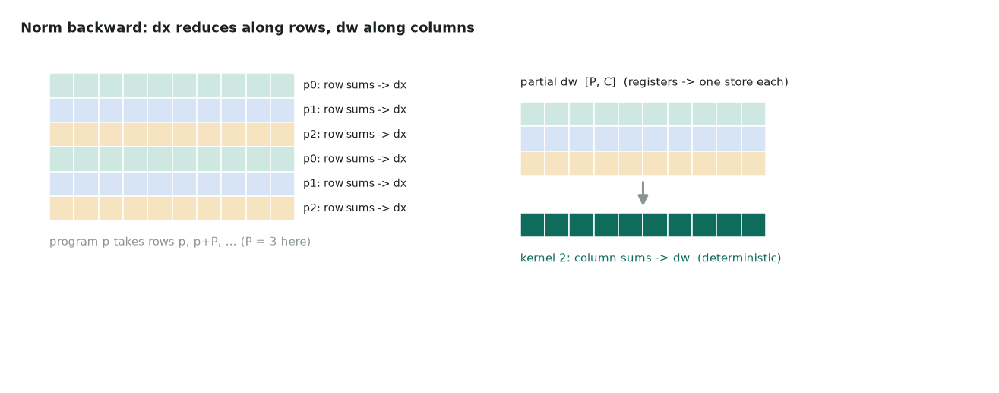

# 19. RMS norm backward

| | |
|---|---|
| **Question** | *RMS Norm Backward* (medium) on [LeetGPU](https://leetgpu.com/challenges) · [official spec and reference](https://github.com/AlphaGPU/leetgpu-challenges/tree/main/challenges/medium/142_rms_norm_backward) |
| **Solution** | [19_rms_norm_backward.py](https://github.com/Prakash-sa/GPU-Codes/blob/main/docs/leetgpu/19_rms_norm_backward.py) |
| **Task** | given x, w, dy, compute dx and dw; N ≤ 65,536, C ≤ 16,384; perf 16384 × 4096; tolerance 1e-3 |
| **Bound by** | memory bandwidth |

## Idea

With $\hat x = x \cdot r$, $r = 1/\sqrt{\text{mean}(x^2)+\epsilon}$, and $g = dy \odot w$:

$$
dx = r\,\big(g - \hat x \cdot \text{mean}(g \odot \hat x)\big) \qquad
dw = \sum_{\text{rows}} dy \odot \hat x
$$

`dx` needs a reduction **along each row**. `dw` needs a reduction **down each column**,
across all rows. That is the whole difficulty:



- **Kernel 1 (persistent):** P = 2 × SMs programs. Program `p` processes rows
  `p, p+P, p+2P, …`. Each row is loaded once and gives `dx` from registers. Meanwhile
  `dy * xhat` is accumulated into a **C-wide register vector** across the program's
  rows. At the end each program stores one partial-dw row: a `[P, C]` buffer.
- **Kernel 2:** sum the P partial rows per column.

There are no atomics, so dw is bitwise reproducible. The extra traffic, P × C floats
(~2 MB), is negligible next to 800 MB.

## Code

```python
--8<-- "docs/leetgpu/19_rms_norm_backward.py"
```

## Performance

Bytes = read x, dy + write dx = $3 \cdot 4 \cdot 16384 \cdot 4096$ = 805 MB.

| | T4 | H100 SXM |
|---|---|---|
| Floor | 2.5 ms | 0.24 ms |
| PyTorch autograd | recomputes rstd, several elementwise kernels + a column `sum`: ~2–3× the bytes | same |

## T4 vs H100

| | T4 | H100 |
|---|---|---|
| P | 80 | 264 |
| `BLOCK_C` at C = 16,384 | 16K floats per tensor per program: **register spills likely**. Use a chunked two-pass row loop | same risk; check `n_spills` |
| `num_warps` | 16 for C ≥ 4096 | 16 |

Check with `k = rmsnorm_bwd_kernel[(P,)](...)` and then `print(k.n_regs, k.n_spills)`. If
it spills, chunk the row: pass 1 accumulates `sum(x²)` and `sum(g·x)` over chunks, and
pass 2 writes dx per chunk. The dw accumulator no longer fits in registers, so each
program adds into its own row of the `[P, C]` buffer chunk by chunk (no atomics needed,
because the row belongs to that program).

## Benchmark and profile

```bash
python docs/leetgpu/19_rms_norm_backward.py      # vs torch.autograd.grad of F.rms_norm
PROFILE=1 python docs/leetgpu/19_rms_norm_backward.py
```

## Scaling up

- **Fuse with the forward's saved state**: save `rstd` (N floats) in the forward pass to
  skip one reduction here (LayerNorm backward on page 20 gets mean/rstd as inputs).
- **Fuse with the residual-add backward** (the gradient flows to both branches).
- **BF16 activations / FP32 accumulators** halve the dominant traffic.
- For data-parallel training, dw is then all-reduced across GPUs. Keeping it FP32 and
  deterministic makes runs reproducible.

## Watch and read

- [GPU MODE Lecture 28: Liger Kernel](https://www.youtube.com/watch?v=gWble4FreV4): fused norm forward and backward kernels in Triton
- [Triton tutorial 05: Layer normalization](https://triton-lang.org/main/getting-started/tutorials/05-layer-norm.html): its backward uses partial-dw buffers with locks, a different trade-off
