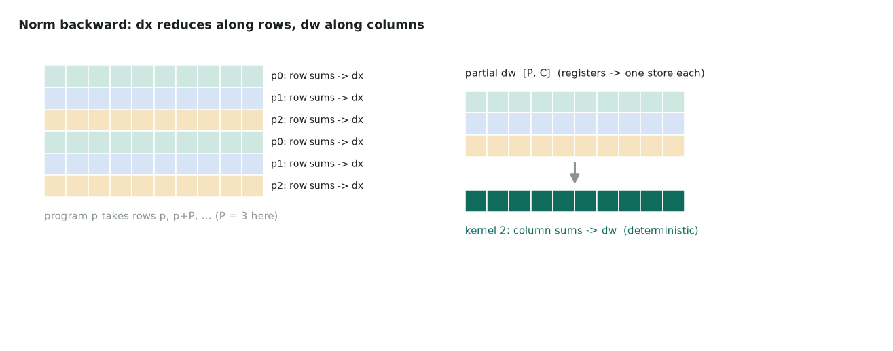

# 20. Layer norm backward

| | |
|---|---|
| **Question** | *Layer Norm Backward* (medium) on [LeetGPU](https://leetgpu.com/challenges) · [official spec and reference](https://github.com/AlphaGPU/leetgpu-challenges/tree/main/challenges/medium/144_layer_norm_backward) |
| **Solution** | [20_layer_norm_backward.py](https://github.com/Prakash-sa/GPU-Codes/blob/main/docs/leetgpu/20_layer_norm_backward.py) |
| **Task** | given x, γ, the saved mean and rstd, and dy: compute dx, dγ, dβ; perf 16384 × 4096; tolerance 1e-3 |
| **Bound by** | memory bandwidth |

## Idea

With $\hat x = (x-\mu)\,r$ and $g = dy \odot \gamma$:

$$
dx = r\,\big(g - \text{mean}(g) - \hat x\cdot\text{mean}(g\odot\hat x)\big),\qquad
d\gamma = \sum_{\text{rows}} dy\odot\hat x,\qquad d\beta = \sum_{\text{rows}} dy
$$

This is the structure of [19. RMS norm backward](19-rms-norm-backward.md) with one more
row statistic (`mean(g)`) and **two** column accumulators per program. Partials go into
a `[2, P, C]` buffer. Then the same column-sum kernel runs once for dγ and once for dβ.



The forward pass saved `mean` and `rstd`, so dx needs no extra pass over x to recompute
them. That is the payoff of saving statistics in the forward.

## Code

```python
--8<-- "docs/leetgpu/20_layer_norm_backward.py"
```

## Performance

Bytes = read x, dy + write dx ≈ 805 MB (the γ, mean and rstd reads are tiny).

| | T4 | H100 SXM |
|---|---|---|
| Floor | 2.5 ms | 0.24 ms |
| Launches | 3 (main + 2 column sums) | 3: fold the two column sums into one launch with a 2-D grid if launch time shows up |

## T4 vs H100

Same as page 19:

- P = 2 × SMs (80 on T4, 264 on H100), read at run time.
- C = 16,384 risks register spills. Check `n_spills` and switch to the chunked
  two-pass row loop if needed.
- On T4, two FP32 accumulators of BLOCK_C each add register pressure. Try `num_warps=16`
  and a smaller P.

## Benchmark and profile

```bash
python docs/leetgpu/20_layer_norm_backward.py
PROFILE=1 python docs/leetgpu/20_layer_norm_backward.py
```

Compare against `torch.autograd.grad` of `F.layer_norm` (CUDA's native kernel). Also
compare the dγ/dβ column-sum time against the main kernel: it should be < 5%.

## Scaling up

- **Very large N** with small C: the `[P, C]` partials stay small, but each program
  loops over many rows. Raise P (more programs) until the per-SM loop is short.
- **Very large C**: chunked rows; dγ/dβ partials per chunk.
- **Fuse backward chains**: LayerNorm backward + residual gradient + dropout backward in
  one kernel is common in production (Liger, Apex).
- Determinism matters for reproducible training. The two-pass column sum gives it with
  no atomics.

## Watch and read

- [GPU MODE Lecture 28: Liger Kernel](https://www.youtube.com/watch?v=gWble4FreV4)
- [Triton tutorial 05: Layer normalization](https://triton-lang.org/main/getting-started/tutorials/05-layer-norm.html): forward and backward
