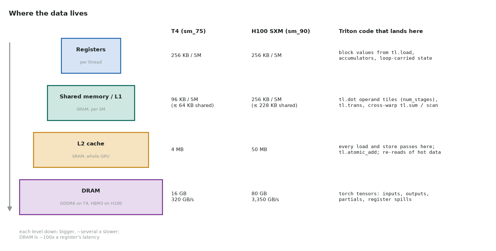

# Where the data lives

Every solution page has a **Where the data lives** section. It says which values sit in
registers, which pass through shared memory or L1, what L2 catches, and what has to go
to DRAM. This page explains the levels and how Triton code maps onto them.



## The levels

First, the names:

- **DRAM** and **HBM** are the same level: the GPU's device memory, where every
  `torch.Tensor` on `cuda` lives. HBM (High Bandwidth Memory) is the kind of DRAM on the
  H100. The T4 uses GDDR6, which is slower DRAM. The CPU's RAM is a different memory
  again: the kernels here never touch it.
- **SRAM** is the fast on-chip memory. Registers, shared memory/L1 and L2 are all SRAM.
  When people say "keep it in SRAM" (as the FlashAttention paper does) they usually mean
  shared memory and registers.

| Level | Scope | T4 (sm_75) | H100 SXM (sm_90) | Rough latency |
|---|---|---|---|---|
| Registers | one thread | 256 KB per SM (64 K × 32-bit), ≤ 255 per thread | same | ~1 cycle |
| Shared memory / L1 (SRAM) | one program (CTA) for shared; one SM for L1 | 96 KB per SM, of which ≤ 64 KB shared | 256 KB per SM, of which ≤ 228 KB shared | ~20–40 cycles |
| L2 (SRAM) | whole GPU | 4 MB | 50 MB | ~200 cycles |
| DRAM | whole GPU | 16 GB GDDR6, 320 GB/s | 80 GB HBM3, 3.35 TB/s | ~400–800 cycles |

The latencies are orders of magnitude, not datasheet values. The point is the ratio:
each level down is several times slower, and DRAM is ~100× slower than a register.

## How Triton code maps onto the levels

In CUDA you choose the level yourself (`__shared__`, `__ldg`, register arrays). Triton
has no shared-memory API: the compiler decides. Knowing what it decides is how you read
the code.

| In the Triton code | Where it lives or runs |
|---|---|
| `x`, `mask`, `out_ptr` arguments | pointers and scalars are kernel parameters: constant cache, then registers |
| `tl.load(ptr + offs)` | reads **DRAM**, through **L2** and normally **L1** into **registers** |
| `tl.store(ptr + offs, v)` | writes from registers to **L2**, which writes back to **DRAM** later. Stores skip L1 |
| A block value (`v = tl.load(...)`, `acc = tl.zeros(...)`) | **registers**, spread across the program's threads. A `[4096]` fp32 block with `num_warps=8` (256 threads) is 16 registers per thread |
| `tl.sum`, `tl.max`, `tl.min` along an axis | registers inside each thread, warp shuffles across the 32 lanes, then **shared memory** to combine warps |
| `tl.associative_scan` | same: shuffles within warps, shared memory across warps |
| `tl.trans`, any layout change | **shared memory**: threads write in one layout and read in another |
| `tl.dot(a, b)` | operand tiles staged in **shared memory**, fed to the tensor cores; accumulator in **registers** |
| `num_stages=k` with `tl.dot` in a loop | k shared-memory buffers per operand, filled by async copies (`cp.async` on sm_80+, TMA on sm_90) while the tensor cores work on the previous one. T4 has no `cp.async`, so deep pipelining does little there |
| `tl.atomic_add` | executed by the atomic units in **L2**. Contended addresses serialize there |
| Register spills (`k.n_spills > 0`) | "local memory": per-thread, but physically in **DRAM** (cached in L1/L2). Spills turn register traffic into memory traffic |
| `cache_modifier=".cg"` / `eviction_policy="evict_first"` on a load | hints: skip L1, or mark the line as first to evict from L2. Use them for data read exactly once |

The tensor-core path differs by generation:

- **T4 (sm_75):** `mma` instructions take operands from registers. Tiles go DRAM →
  registers → shared memory → registers (`ldmatrix`) → tensor core.
- **A100 / sm_80:** `cp.async` copies DRAM → shared memory without passing through
  registers, which makes multi-stage pipelines work.
- **H100 / sm_90:** TMA copies whole tiles into shared memory, and `wgmma` reads its
  operands **directly from shared memory**. Triton uses `wgmma` automatically for
  suitable `tl.dot`s.

## What to check on a real GPU

```python
k = gemm_kernel[grid](...)        # a launch returns the compiled kernel
print(k.n_regs, k.n_spills)       # registers per thread; spills go to DRAM
print(k.metadata.shared)          # shared memory bytes per program
```

- **Shared memory per program × programs per SM** must fit the SM (64 KB or 228 KB). A
  config that needs more fails with `OutOfResources`, which `triton.autotune` skips.
- **DRAM bytes** in Nsight Compute's Memory Workload Analysis vs your estimate. More
  than your estimate means a level above leaked: spills, L2 misses, uncoalesced access.
- **L2 hit rate** in the same section. It shows whether reuse you planned (grouped
  GEMM order, stencil halos, re-reading a small array) actually happened.
- When you benchmark a small problem, the input may already be in L2 from the last run
  (the H100's 50 MB L2 holds a 16 MB array). `triton.testing.do_bench` flushes L2
  between runs for this reason. Your own timing loop should too.

## Reading

- [GPU memory hierarchy](../notes/02-memory-hierarchy.md) in this site's notes
- [GPU MODE Lecture 4: Compute and Memory Basics](https://www.youtube.com/watch?v=lTmYrKwjSOU)
- [CUDA C++ Best Practices Guide: Memory Optimizations](https://docs.nvidia.com/cuda/cuda-c-best-practices-guide/index.html#memory-optimizations)
