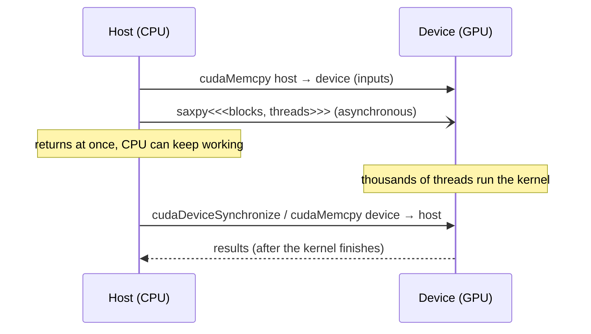
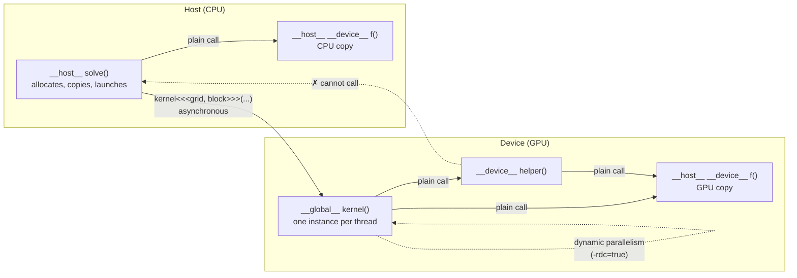
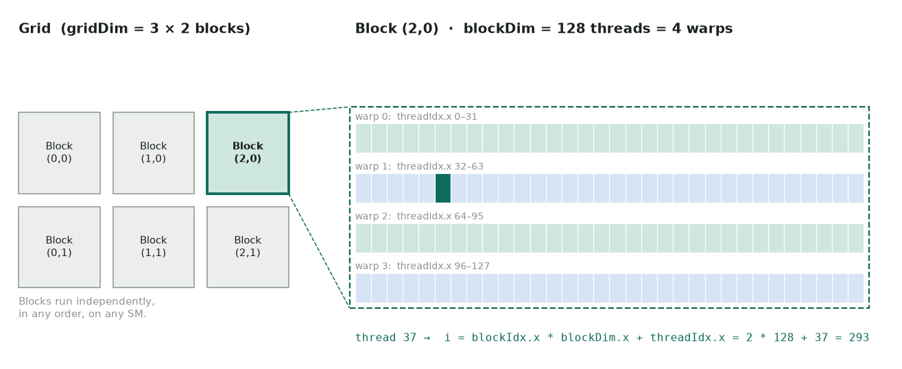
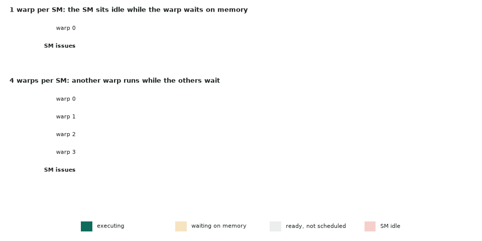
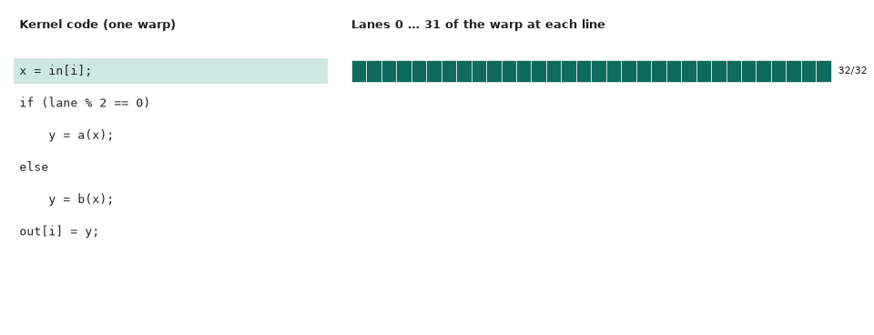

# 1. Execution model

## Host and device

- **Host** = CPU + system RAM. **Device** = GPU + its own memory (HBM/GDDR).
- The host launches **kernels** (functions marked `__global__`) on the device. Launches
  are **asynchronous**: control returns to the CPU immediately.
- Data must be on the device before the kernel reads it, either through explicit
  `cudaMemcpy` or through unified memory.



```cpp
__global__ void saxpy(int n, float a, const float* x, float* y) {
    int i = blockIdx.x * blockDim.x + threadIdx.x;   // global thread index
    if (i < n) y[i] = a * x[i] + y[i];               // guard: grid may overshoot n
}

int threads = 256;
int blocks  = (n + threads - 1) / threads;           // ceil-divide
saxpy<<<blocks, threads>>>(n, 2.0f, d_x, d_y);
cudaDeviceSynchronize();                              // wait + surface errors
```

## Function qualifiers: `__global__`, `__device__`, `__host__`

A qualifier on a function says two things: **where it runs** (CPU or GPU) and **who may
call it**. nvcc splits a `.cu` file along these lines: host code goes to the normal C++
compiler, device code is compiled to PTX/SASS for the GPU.

| Qualifier | Runs on | Called from | Returns | Typical use |
|---|---|---|---|---|
| `__global__` | GPU | CPU, with `kernel<<<grid, block>>>(...)`; also GPU code under dynamic parallelism | `void` only | The kernel: the entry point every thread runs |
| `__device__` | GPU | GPU code only (kernels and other `__device__` functions) | Anything | Helpers inside kernels: `warp_sum`, `block_sum`, math |
| `__host__` | CPU | CPU code only | Anything | Ordinary C++; the default when no qualifier is written |
| `__host__ __device__` | Both | Both | Anything | One function compiled twice: shared math for the CPU reference and the kernel |



*Solid arrows are allowed calls. The only way across the CPU → GPU boundary is a kernel
launch; there is no way back except the kernel finishing and the host synchronizing.*

All four in one file:

```cpp
#include <cuda_runtime.h>

__host__ __device__ inline float axpy(float a, float x, float y) {   // CPU and GPU
    return a * x + y;
}

__device__ float clamp01(float v) {                                  // GPU helper
    return fminf(fmaxf(v, 0.0f), 1.0f);
}

__global__ void saxpy_clamped(int n, float a, const float* x, float* y) {   // kernel
    int i = blockIdx.x * blockDim.x + threadIdx.x;
    if (i < n) y[i] = clamp01(axpy(a, x[i], y[i]));
}

void solve(int n, float a, const float* d_x, float* d_y) {           // __host__ by default
    int threads = 256, blocks = (n + threads - 1) / threads;
    saxpy_clamped<<<blocks, threads>>>(n, a, d_x, d_y);              // returns at once
    cudaDeviceSynchronize();
}

float cpu_reference(float a, float x, float y) {                     // reuses axpy on the CPU
    return axpy(a, x, y);
}
```

`solve` expects `d_x` and `d_y` to be device pointers (from `cudaMalloc`). Passing a
host pointer compiles fine and fails at run time with an illegal-address error. Every
[LeetGPU CUDA solution](../leetgpu/index.md) follows this shape:
`extern "C" void solve(...)` is a host function (the `extern "C"` only switches off C++
name mangling), it launches one or more `__global__` kernels, and those call `__device__`
helpers such as `warp_sum` in [the reduction](../leetgpu/03_reduction.cu).

### Rules worth remembering

**`__global__` (kernels)**

- Must return `void`; results go out through pointer arguments.
- Arguments are copied by value into constant memory at launch. Pass device pointers,
  not host pointers, references or `std::vector`.
- A launch is **asynchronous** and returns no error code itself: check with
  `cudaGetLastError()` right after the launch (bad configuration) and with the next
  synchronizing call (faults during execution). See [Error checking](#error-checking).
- Cannot be a class member function; can be a template.

**`__device__` (GPU helpers)**

- Called with ordinary function syntax; can return values, take references, recurse.
- Usually inlined by the compiler, so a small helper costs nothing. `__forceinline__`
  and `__noinline__` override that choice.
- Can only call other device code. Most of the C++ standard library is host-only;
  `printf`, `malloc`/`free`, and the CUDA math functions (`sinf`, `fmaf`, …) work on the
  device.
- Calling a `__device__` function defined in **another** `.cu` file needs separate
  compilation: `nvcc -rdc=true`.

**`__host__` (CPU code)**

- The default, so it is almost never written alone. It matters only in the combination
  `__host__ __device__`.
- It is the only side that can allocate device memory (`cudaMalloc`), copy
  (`cudaMemcpy`) and launch kernels, apart from dynamic parallelism.

**`__host__ __device__` (both)**

- Compiled once for each side, so the body may only use what both sides support.
- Inside it, `#ifdef __CUDA_ARCH__` is true only in the GPU copy, which lets one function
  take a different path on each side:

```cpp
__host__ __device__ int lane_or_zero() {
#ifdef __CUDA_ARCH__
    return threadIdx.x & 31;      // GPU build
#else
    return 0;                     // CPU build: no threads here
#endif
}
```

### The same words on variables mean something else

On a function, `__device__` means "runs on the GPU". On a **variable**, the qualifiers
choose a memory space:

| Variable qualifier | Lives in | Lifetime | Visible to |
|---|---|---|---|
| (none, inside a kernel) | Registers (or local memory if spilled) | One thread | That thread |
| `__shared__` | Shared memory on the SM | One block | Threads of that block |
| `__device__` | Global memory (HBM) | The program | All threads; host via `cudaMemcpyToSymbol` |
| `__constant__` | Constant memory (cached, read-only on GPU) | The program | All threads; host writes with `cudaMemcpyToSymbol` |
| `__managed__` | Unified memory | The program | Host and device, migrated on demand |

`cudaMalloc` is the usual way to get global memory at run time; a `__device__` variable
is the static, file-scope version of the same thing. See
[Memory hierarchy](02-memory-hierarchy.md).

## The thread hierarchy



*A grid is made of blocks; each block is split into warps of 32 threads. The global index combines blockIdx and threadIdx.*

| Level | Built-in | Runs on | Can cooperate via |
|---|---|---|---|
| Thread | `threadIdx` | one CUDA core lane | registers |
| Warp (32 threads) | `threadIdx.x / 32` | one SM scheduler, in lockstep | warp shuffles, `__syncwarp()` |
| Block (≤ 1024 threads) | `blockIdx`, `blockDim` | one SM, for the block's whole life | shared memory, `__syncthreads()` |
| Cluster (sm_90+) | `cluster.block_rank()` | a group of SMs (GPC) | distributed shared memory |
| Grid | `gridDim` | the whole GPU | global memory, atomics, separate launches |

- Blocks are **independent**. The hardware may run them in any order, so never assume
  block A finishes before block B starts within one launch.
- To sync the whole grid, end the kernel and launch another one (or use cooperative
  groups' `grid.sync()` with a cooperative launch).

## SMs, warps and SIMT

- A GPU is a set of **Streaming Multiprocessors (SMs)**. Each SM has its own register
  file, shared memory/L1, warp schedulers and functional units.
- The SM issues instructions **per warp**. All 32 threads execute the same instruction
  (SIMT, Single Instruction Multiple Threads).
- **Latency hiding**: when a warp stalls on memory (hundreds of cycles), the scheduler
  switches to another ready warp with zero cost. GPUs therefore need *many* resident
  warps. That is what occupancy measures.



*With one warp the SM idles while the warp waits on memory (25% busy). With four warps the scheduler always has a ready warp, and the SM stays busy.*

## Warp divergence

```cpp
if (threadIdx.x % 2 == 0) a(); else b();   // both paths serialize inside each warp
if (threadIdx.x / 32 == 0) a(); else b();  // warp-uniform: no divergence
```



*Inside one warp, the if and else paths run one after the other with half the lanes masked.*

- When threads in one warp take different branches, the warp runs **both** paths with
  lanes masked off. Make branches uniform per warp where you can.
- Since Volta (sm_70), threads have independent scheduling. Don't rely on implicit
  warp-synchronous behavior; use `__syncwarp()` and the `*_sync` intrinsics.

## Choosing launch configuration

- Block size: a **multiple of 32**, typically 128–256. Use 2D/3D blocks for stencils
  (e.g. `dim3(32, 8)`), keeping `x` the fastest-varying, contiguous dimension.
- Enough blocks to fill every SM several times (≥ 2–4 × SM count).
- `cudaOccupancyMaxPotentialBlockSize` gives a reasonable starting point.
- **Grid-stride loops** decouple grid size from problem size:

```cpp
for (int i = blockIdx.x * blockDim.x + threadIdx.x; i < n; i += gridDim.x * blockDim.x)
    y[i] = a * x[i] + y[i];
```

## Compute capability

The `sm_XY` number sets which features and instructions are available. Compile for
the cards you target, and include PTX so newer cards can JIT-compile it:

```bash
nvcc -O3 -gencode arch=compute_80,code=sm_80 \
         -gencode arch=compute_90,code=sm_90 \
         -gencode arch=compute_90,code=compute_90 kernel.cu
```

Examples: T4 = sm_75, A100 = sm_80, L40S = sm_89, H100 = sm_90, RTX PRO 6000
Blackwell = sm_120 (needs CUDA ≥ 12.8).

## Error checking

Kernel launches do not return errors directly. Always check:

```cpp
#define CUDA_CHECK(x) do { cudaError_t e = (x); if (e != cudaSuccess) {        \
    fprintf(stderr, "%s:%d %s\n", __FILE__, __LINE__, cudaGetErrorString(e));  \
    exit(1); } } while (0)

kernel<<<g, b>>>(...);
CUDA_CHECK(cudaGetLastError());        // launch-configuration errors
CUDA_CHECK(cudaDeviceSynchronize());   // errors raised during execution (debug builds)
```
