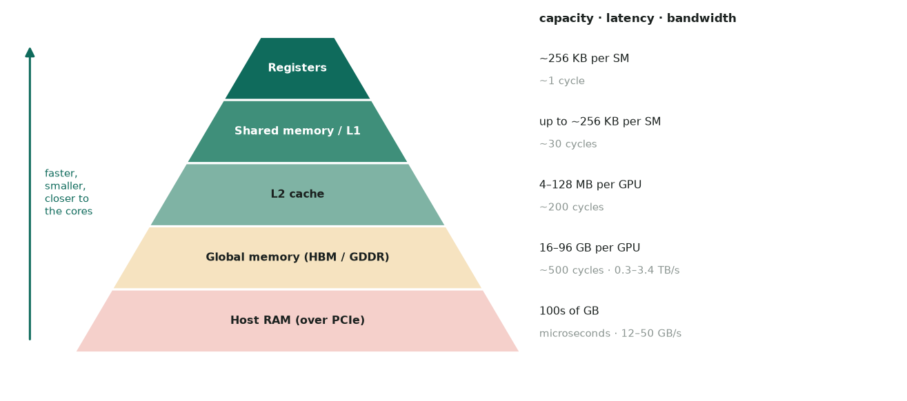
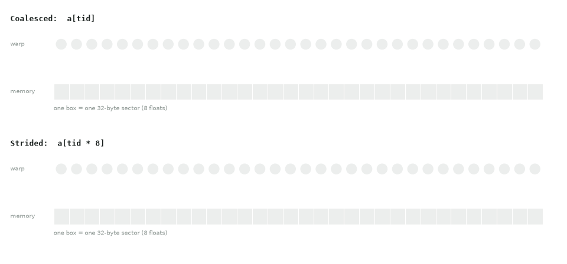
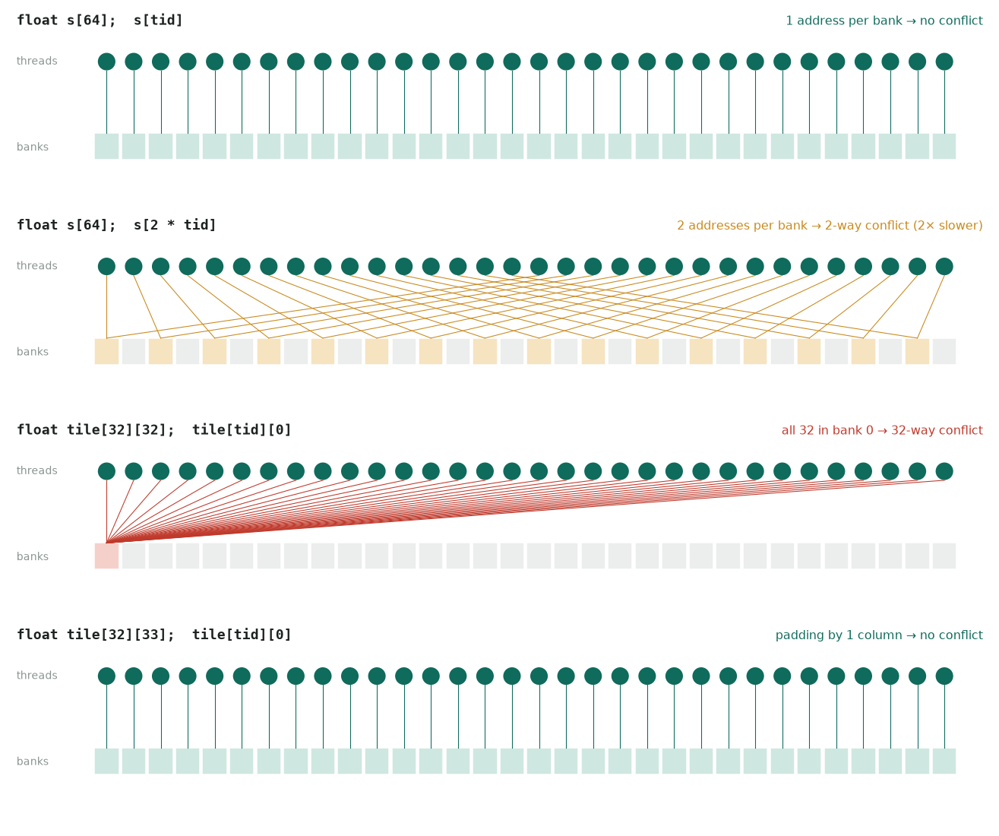

# 2. Memory hierarchy

## The levels



*Each level down is larger and slower. Keep hot data as high up as possible.*

| Memory | Scope | Lifetime | Approx. latency | Notes |
|---|---|---|---|---|
| Registers | thread | thread | ~1 cycle | 64K × 32-bit per SM; overflow spills to "local" memory |
| Shared memory | block | block | ~20–30 cycles | Shares on-chip SRAM with L1 (up to ~228 KB/SM on H100) |
| L1 cache | SM | — | ~30 cycles | Caches global/local loads |
| L2 cache | whole GPU | — | ~200 cycles | 4 MB (T4) to 128 MB (RTX PRO 6000) |
| Global (HBM/GDDR) | grid + host | allocation | ~400–800 cycles | Where `cudaMalloc` lives; bandwidth is the key spec |
| Constant | grid | program | cached | 64 KB; fast when all threads in a warp read the same address |
| Local | thread | thread | same as global | Register spills and dynamically indexed arrays |

## Global memory and coalescing

A warp's loads are combined into as few **32-byte sectors** as possible. If thread
`k` reads element `base + k`, the warp touches contiguous memory and gets full
bandwidth.

```cpp
// coalesced: consecutive threads -> consecutive addresses
float v = a[blockIdx.x * blockDim.x + threadIdx.x];

// strided: each thread touches a different sector -> up to 32x the traffic
float w = a[(blockIdx.x * blockDim.x + threadIdx.x) * stride];
```



*A coalesced warp touches 4 sectors for 128 useful bytes. A stride of 8 floats touches 32 sectors, which wastes 88% of the bandwidth.*

- Prefer **Structure of Arrays (SoA)** over Array of Structures (AoS). For LBM, store
  `f[q][z][y][x]` with `x` innermost, not `f[z][y][x][q]`.
- Align allocations (`cudaMalloc` gives ≥ 256-byte alignment). Pad row pitch with
  `cudaMallocPitch` / `cudaMalloc3D` for 2D/3D arrays.
- Use vector loads (`float4`, `double2`) when the data is aligned, to issue fewer
  instructions.

## Shared memory

Shared memory is a programmer-managed cache, used for data reuse (tiling) and for
reorganizing access patterns (for example, a transpose).

```cpp
__global__ void transpose(const float* in, float* out, int n) {
    __shared__ float tile[32][33];               // +1 column avoids bank conflicts
    int x = blockIdx.x * 32 + threadIdx.x;
    int y = blockIdx.y * 32 + threadIdx.y;
    tile[threadIdx.y][threadIdx.x] = in[y * n + x];          // coalesced read
    __syncthreads();
    x = blockIdx.y * 32 + threadIdx.x;
    y = blockIdx.x * 32 + threadIdx.y;
    out[y * n + x] = tile[threadIdx.x][threadIdx.y];         // coalesced write
}
```



*Threads mapped to banks for four access patterns. Padding a 32×32 tile to 32×33 removes the 32-way conflict.*

- 32 **banks**, each 4 bytes wide. When several threads in a warp hit different
  addresses in the same bank, the accesses serialize (a **bank conflict**). All
  threads reading the *same* address is a broadcast, which is free.
- Dynamic size: `extern __shared__ float buf[];` plus the third launch parameter
  `<<<g, b, bytes>>>`. To use more than 48 KB you must opt in with
  `cudaFuncSetAttribute(..., cudaFuncAttributeMaxDynamicSharedMemorySize, bytes)`.
- `__syncthreads()` must be reached by **every** thread of the block. Never put it in a
  divergent branch.

## Registers and spills

- Registers per thread × threads per block limits how many blocks fit on an SM.
- Check usage with `nvcc -Xptxas -v` (it prints registers and spill stores/loads).
- Cap registers with `__launch_bounds__(maxThreads, minBlocksPerSM)` or
  `-maxrregcount`. This trades spills for occupancy, so measure the result.

## Read-only and constant data

- `const __restrict__` pointers let the compiler use the read-only/texture path
  (`__ldg`).
- `__constant__` is for small parameter tables (e.g. LBM lattice weights and
  velocities) that every thread reads at the same index.

## Host ↔ device

| Mechanism | API | When to use |
|---|---|---|
| Pageable copy | `cudaMemcpy` | Simple, but synchronous and slower |
| Pinned (page-locked) host memory | `cudaMallocHost` / `cudaHostRegister` | Required for truly async copies; higher PCIe bandwidth |
| Unified memory | `cudaMallocManaged` | Prototyping, oversubscription; add `cudaMemPrefetchAsync` for performance |
| Zero-copy | mapped pinned memory | Data read once, small, or on integrated GPUs |

!!! warning "PCIe is the bottleneck"
    PCIe 4.0 x16 moves ~25 GB/s in practice, versus 1–3 TB/s for on-card memory.
    Keep data **device-resident** across time steps and copy back only what you need
    (diagnostics, checkpoints).

## Memory capacity planning

Work out the footprint **before** you allocate. Running out of memory partway through
a run wastes far more time than doing this arithmetic.

### The budget

Only part of the card's memory is available for your arrays:

$$
\text{usable} \approx \underbrace{0.85}_{\text{safety factor}} \times \text{device memory}
\;-\; \underbrace{\sim 0.5\ \text{GB}}_{\text{CUDA context}}
\;-\; \text{library workspaces}
$$

Library workspaces include cuBLAS/cuFFT scratch space, NCCL buffers, and the memory
pools of CuPy or PyTorch. Check what is actually free at runtime with
`cudaMemGetInfo(&free, &total)` or `cp.cuda.Device().mem_info`.

### LBM lattices

Each cell stores $Q$ populations. Most solvers keep two copies (A/B ping-pong
buffers):

$$
\text{bytes} = N_x N_y N_z \times Q \times \text{sizeof(real)} \times 2
$$

| Lattice, precision | Bytes per cell | 128³ | 256³ | 512³ |
|---|---:|---:|---:|---:|
| D3Q19, double | 304 | 0.64 GB | 5.1 GB | 40.8 GB |
| D3Q27, single | 216 | 0.45 GB | 3.6 GB | 29.0 GB |
| D3Q27, double | 432 | 0.91 GB | 7.25 GB | 58.0 GB |

Add any extra fields: macroscopic $\rho, \mathbf{u}$ in double is 32 B per cell,
and a flag/obstacle mask is 1 B per cell.

**Largest cubic D3Q27 grid that fits** (85% of memory, populations only):

| GPU | Memory | Double | Single |
|---|---:|---:|---:|
| T4 | 16 GB | 323³ | 407³ |
| A100 | 40 GB | 438³ | 552³ |
| L40S | 48 GB | 466³ | 587³ |
| H100 | 80 GB | 552³ | 696³ |
| RTX PRO 6000 | 96 GB | 587³ | 740³ |

Capacity grows with the cube of $N$: doubling the resolution needs **8×** the memory.

### Statevectors

A $W$-qubit statevector holds $2^W$ complex amplitudes:

$$
\text{bytes} = 2^W \times \begin{cases} 16 & \text{complex128} \\ 8 & \text{complex64} \end{cases}
$$

| Qubits | complex128 | complex64 |
|---:|---:|---:|
| 28 | 4 GiB | 2 GiB |
| 30 | 16 GiB | 8 GiB |
| 31 | 32 GiB | 16 GiB |
| 32 | 64 GiB | 32 GiB |
| 33 | 128 GiB | 64 GiB |

Every extra qubit **doubles** the memory, so a card twice as large buys you exactly
one more qubit. Simulators may also need a scratch buffer for some gates, which can
double the peak.

### Quick calculator

```python
def lbm_bytes(n, q=27, real=8, buffers=2):
    return n**3 * q * real * buffers

def statevector_bytes(qubits, complex_bytes=16):
    return 2**qubits * complex_bytes

def fits(nbytes, device_gb, safety=0.85):
    return nbytes <= safety * device_gb * 2**30

print(lbm_bytes(256) / 1e9)              # 7.25 GB
print(fits(statevector_bytes(32), 80))   # True:  64 GiB <= 0.85 x 80 GiB = 68 GiB
print(fits(statevector_bytes(33), 80))   # False: 128 GiB
```

!!! tip
    If it doesn't fit, you have four options, from simplest to hardest: drop to single
    precision, store fewer copies (in-place streaming such as AA-pattern or esoteric
    twist halves LBM memory), get a bigger card, or split the domain across GPUs
    ([multi-GPU](05-multi-gpu.md)).
