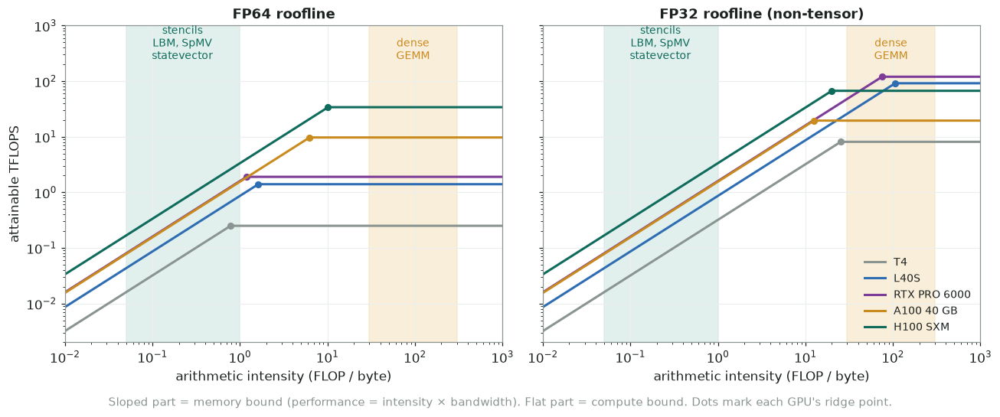

# 3. Performance optimization

## Start with the roofline

**Arithmetic intensity** $I = \frac{\text{FLOPs}}{\text{bytes moved to/from DRAM}}$.

Attainable performance $= \min(\text{peak FLOPS},\ I \times \text{peak bandwidth})$.

The **ridge point** $I^* = \text{peak FLOPS} / \text{peak BW}$ separates the two
regimes:

| GPU | FP64 ridge (FLOP/byte) | FP32 ridge (FLOP/byte) |
|---|---|---|
| A100 40 GB | 9.7e12 / 1.555e12 ≈ 6.2 | ≈ 12.5 |
| H100 SXM | 34e12 / 3.35e12 ≈ 10 | ≈ 20 |
| L40S | 1.4e12 / 0.864e12 ≈ 1.6 | ≈ 106 |



*Rooflines from the datasheet numbers. Low-intensity kernels (green band) sit on the sloped, bandwidth-limited part of every card.*

- Stencils, LBM, SpMV, and statevector gates have $I \lesssim 1$, so they are
  **memory bound** on every card. Optimize bytes, not FLOPs.
- Dense GEMM and convolutions have high $I$, so they are compute bound. Use the
  vendor libraries (cuBLAS, cuDNN, CUTLASS) and tensor cores.
- On cards with low FP64 throughput (T4, L40S, RTX PRO 6000) the FP64 ridge is
  low enough that some FP64 kernels become compute bound.

## Measure effective bandwidth

```text
effective BW = (bytes read + bytes written) / kernel time
```

Compare with the datasheet peak. 70–85% of peak is excellent for a streaming kernel.

**LBM example:** each cell reads Q populations and writes Q populations. For D3Q27
in double precision that is 27 × 8 × 2 = 432 bytes per cell-update, so

$$
\text{MLUPS}_{\max} \approx \frac{\text{BW}}{432\ \text{B}} \;\Rightarrow\;
\text{H100: } \frac{3.35\text{e}12}{432} \approx 7{,}750\ \text{MLUPS}
$$

If your MLUPS is far below this, find the extra traffic: uncoalesced access, spills,
redundant passes, or a separate collide and stream kernel when one fused kernel
would do.

## Optimization checklist (in order)

For the full playbook, with diagnosis by symptom and code for each strategy, see
**[Optimization strategies](09-optimization-strategies.md)**.

1. **Keep data on the device.** Eliminate per-step host↔device copies.
2. **Coalesce global accesses.** Use SoA layout with the innermost index mapped to
   `threadIdx.x`.
3. **Fuse kernels.** Every separate pass over the data reads and writes all of it
   again. Fusing collide + stream (+ boundary conditions) is the biggest LBM win.
4. **Reuse data from shared memory or registers** (tiling, register blocking).
5. **Get enough parallelism.** Fill all SMs, keep occupancy reasonable (often
   25–50% is enough for bandwidth-bound kernels), and increase ILP by processing
   several elements per thread.
6. **Avoid divergence and bank conflicts.**
7. **Choose precision.** FP32 halves the bytes moved compared with FP64. Use mixed
   precision when your accuracy contract allows it.
8. **Use libraries for standard operations:** cuBLAS, cuFFT, cuSPARSE, CUB/Thrust
   (scan, sort, reduce), cuStateVec.

## Occupancy

Occupancy = active warps per SM / maximum warps per SM. These limit it:

- registers per thread
- shared memory per block
- threads per block, and the cap on blocks per SM

Higher occupancy is **not always faster**. Its job is to hide latency. If ILP or
memory-level parallelism already hides the latency, lower occupancy with more
registers can win. Check "Achieved Occupancy" and "Warp State" in Nsight Compute.

## Reductions

Do the reduction hierarchically: first warp shuffles, then shared memory, then one
atomic or a second pass per block.

```cpp
__inline__ __device__ float warp_sum(float v) {
    for (int off = 16; off > 0; off >>= 1)
        v += __shfl_down_sync(0xffffffff, v, off);
    return v;
}
```

Or call `cub::DeviceReduce::Sum`, which is fast and well tested.

## Atomics

- Fast on modern GPUs when contention is low; slow on hot spots.
- Aggregate within a warp or block first, then issue one atomic.
- FP64 `atomicAdd` is native from sm_60 onward.
- Floating-point atomics are **non-deterministic** in summation order. Avoid them
  where you need bitwise reproducibility (parity tests).

## Tensor cores

- They do matrix multiply-accumulate (MMA) on small tiles. Reach them through
  cuBLAS/cuDNN/CUTLASS, WMMA, or `mma.sync` PTX.
- Formats depend on the generation: FP16/BF16 (sm_70+), TF32 (sm_80+), FP64 (A100/H100
  only), FP8 (sm_89+), FP4 (Blackwell).
- TF32 is enabled by default in some frameworks (PyTorch for convolutions, for
  example). Turn it off when you need full FP32 accuracy.

## Reproducibility and numerics

- Results can differ between CPU and GPU: FMA contraction, reduction order, fast-math.
- `--fmad=false` disables FMA contraction; `-use_fast_math` trades accuracy for speed.
- Define a tolerance contract (e.g. max abs error ≤ 1e-12 vs a reference) and test
  against it in CI.
