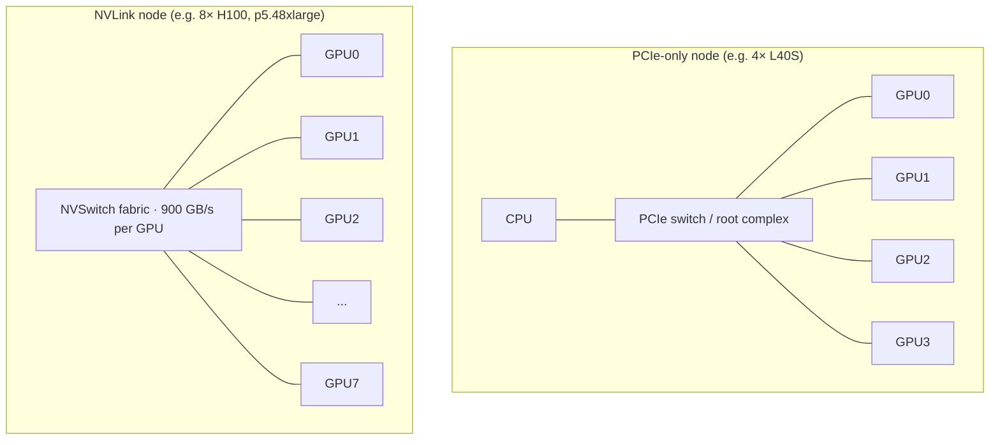
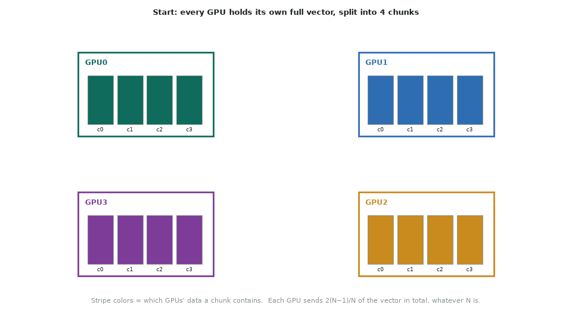
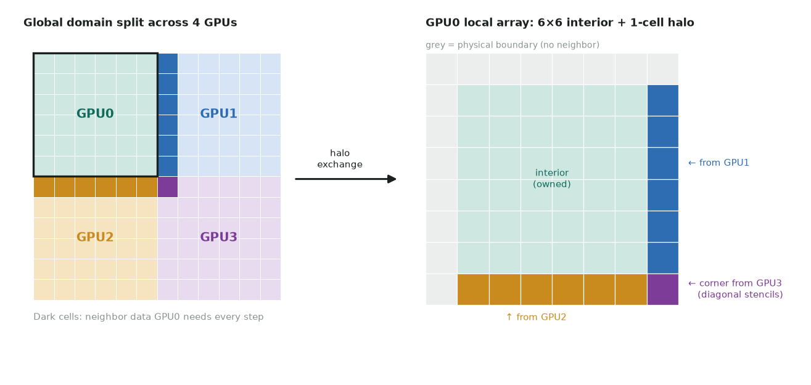

# 5. Multi-GPU and NCCL

The basics. For the full hardware and software stack (NVLink, NVSwitch, PCIe,
InfiniBand, NCCL vs RCCL vs MPI, NVIDIA vs AMD, and where data should and shouldn't
move), see [How GPUs talk to each other](10-multi-gpu-communication.md).

## Topology first

```bash
nvidia-smi topo -m      # NV# = NVLink, PIX/PXB/PHB/SYS = PCIe paths (worst: SYS)
```

| Interconnect | Bandwidth (per direction, approx.) | Seen on |
|---|---|---|
| PCIe 3.0 x16 | ~12 GB/s | T4 (g4dn) |
| PCIe 4.0 x16 | ~25 GB/s | L40S, A100 PCIe |
| PCIe 5.0 x16 | ~50 GB/s | H100 PCIe, RTX PRO 6000 |
| NVLink 3 (A100) | 600 GB/s total | p4d |
| NVLink 4 (H100) | 900 GB/s total | p5 |
| EFA (inter-node) | 400–3,200 Gb/s per node | p4d / p5 |



*On a PCIe-only node, GPU-to-GPU traffic shares ~25–50 GB/s links. NVLink gives each GPU an order of magnitude more.*

On cards connected only by PCIe (T4, L40S, RTX PRO 6000) halo exchange is expensive,
so overlap it with interior compute ([streams](04-streams.md)).

## Process/GPU mapping

- The usual model is **one MPI rank (or process) per GPU**.
- Bind each rank to its GPU (`cudaSetDevice(local_rank)`) and to the CPU cores and
  NIC nearest that GPU (NUMA affinity). With Slurm:
  `srun --gpus-per-task=1 --gpu-bind=closest`.
- `CUDA_VISIBLE_DEVICES` remaps device indices per process.

## Peer-to-peer (single node)

```cpp
int can; cudaDeviceCanAccessPeer(&can, 0, 1);
cudaSetDevice(0); cudaDeviceEnablePeerAccess(1, 0);
cudaMemcpyPeerAsync(dst_on_1, 1, src_on_0, 0, bytes, stream);
```

With P2P enabled, a kernel on GPU 0 can directly dereference a pointer that lives on
GPU 1, over NVLink or PCIe.

## NCCL

NCCL (NVIDIA Collective Communications Library) provides topology-aware collectives
over NVLink, PCIe, InfiniBand and EFA.



*Ring all-reduce: a reduce-scatter (each GPU ends up owning one fully summed chunk), then an all-gather. NCCL picks ring or tree algorithms from the topology.*

| Operation | Use |
|---|---|
| `ncclAllReduce` | global sums/norms, gradient averaging, convergence checks |
| `ncclBroadcast` | distribute parameters from rank 0 |
| `ncclReduceScatter` / `ncclAllGather` | sharded data, distributed statevector |
| `ncclSend` / `ncclRecv` (in `ncclGroupStart/End`) | halo exchange between neighbors |

```cpp
ncclComm_t comm;
ncclUniqueId id;                         // rank 0 creates, broadcast via MPI
if (rank == 0) ncclGetUniqueId(&id);
MPI_Bcast(&id, sizeof id, MPI_BYTE, 0, MPI_COMM_WORLD);
ncclCommInitRank(&comm, nranks, id, rank);

ncclAllReduce(d_buf, d_buf, n, ncclDouble, ncclSum, comm, stream);
cudaStreamSynchronize(stream);
```

- NCCL calls are **stream-ordered** and asynchronous. Every rank must call the same
  collectives in the same order, or the job hangs.
- Debugging: `NCCL_DEBUG=INFO` shows the transport chosen (P2P/NVLink, SHM, NET).
  On AWS EFA, also check the `aws-ofi-nccl` plugin is loaded.
- Validate the fabric with [nccl-tests](https://github.com/NVIDIA/nccl-tests)
  (`all_reduce_perf -b 8 -e 1G -f 2 -g <ngpus>`) before blaming your own code.

## CUDA-aware MPI

A CUDA-aware MPI (Open MPI built with UCX/CUDA) accepts device pointers directly in
`MPI_Send`/`MPI_Isend`/`MPI_Allreduce`, so you skip the staging copy through host
memory. Use it when your code is already structured around MPI. Use NCCL for heavy
collectives.

## Domain decomposition and halos



*Each GPU owns a sub-domain plus a one-cell halo, which it fills every step with its neighbors' edge cells. Diagonal stencils such as D2Q9 and D3Q27 also need the corner cells.*

- The halo grows with the **surface** of a sub-domain and the work with its **volume**,
  so larger sub-domains per GPU scale better.
- Pack faces into contiguous buffers, exchange them with `ncclSend`/`ncclRecv` (or
  P2P copies), and overlap them with the interior update.

## Scaling checks

- **Strong scaling:** fixed total problem size with more GPUs. Efficiency drops as
  the surface-to-volume ratio grows.
- **Weak scaling:** fixed problem per GPU. This should stay flat if communication is
  overlapped.
- Report parallel efficiency $E = \frac{T_1}{p\,T_p}$ (strong) or
  $E = \frac{T_1}{T_p}$ (weak), and measure the communication fraction with
  Nsight Systems.
