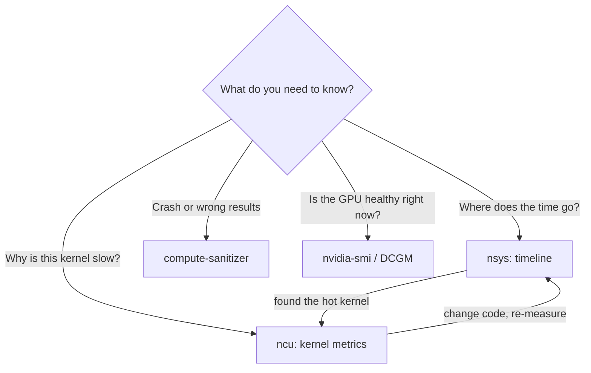

# 6. Profiling and debugging

## Which tool?

| Question | Tool |
|---|---|
| Where does wall time go? Is the GPU idle? Are copies overlapped? | **Nsight Systems** (`nsys`) |
| Why is *this kernel* slow? | **Nsight Compute** (`ncu`) |
| Out-of-bounds, races, uninitialized memory | **compute-sanitizer** |
| Live utilization, memory, clocks, power | `nvidia-smi`, `nvidia-smi dmon`, DCGM |



Always profile the **system** first, then individual **kernels**.

## Nsight Systems

```bash
nsys profile -t cuda,nvtx,osrt,mpi --cuda-memory-usage=true \
     -o run_%q{SLURM_PROCID} ./solver input.yaml
nsys stats run_0.nsys-rep            # kernel / memcpy summary tables
```

Look for:

- gaps between kernels on the timeline (launch overhead, host work, synchronization)
- `cudaMemcpy` inside the time loop
- copy and compute that should overlap but don't
- NCCL kernels on the critical path

### NVTX ranges

Add labels so the timeline shows your phases:

```cpp
#include <nvtx3/nvToolsExt.h>
nvtxRangePushA("collide_stream");
collide_stream<<<g, b, 0, s>>>(...);
nvtxRangePop();
```

```python
import nvtx  # or torch.cuda.nvtx
with nvtx.annotate("collide_stream", color="green"):
    step()
```

## Nsight Compute

```bash
ncu --set full -k regex:collide -c 5 -o collide ./solver   # 5 launches of matching kernels
ncu-ui collide.ncu-rep
```

Sections to read:

- **GPU Speed of Light**: % of peak memory and compute throughput. Tells you which
  bound you are hitting.
- **Memory Workload Analysis**: DRAM bytes, L2/L1 hit rates, sectors per request
  (higher than 4 for 4-byte loads means poor coalescing).
- **Occupancy**: theoretical vs achieved, and the limiting resource.
- **Warp State Statistics**: why warps stall (long scoreboard = waiting on memory).
- **Source** view: per-line SASS, to find the hot loads.

!!! note
    `ncu` replays each kernel many times, so it is very slow. Restrict it with `-k`,
    `-c` and `--launch-skip`. On cloud VMs you may need to run as root or set
    `NVreg_RestrictProfilingToAdminUsers=0`.

## compute-sanitizer

```bash
compute-sanitizer --tool memcheck  ./solver   # OOB + misaligned access
compute-sanitizer --tool racecheck ./solver   # shared-memory races
compute-sanitizer --tool initcheck ./solver   # reads of uninitialized device memory
compute-sanitizer --tool synccheck ./solver   # invalid __syncthreads usage
```

Build with `-lineinfo` (and `-G` for full device debug) to get source lines.

## Common failures

| Symptom | Likely cause |
|---|---|
| `illegal memory access` at a later, unrelated call | An earlier async kernel faulted. Run with `CUDA_LAUNCH_BLOCKING=1` or under memcheck |
| `too many resources requested for launch` | Registers × threads exceed the SM limit. Lower the block size or use `__launch_bounds__` |
| `no kernel image is available for execution` | Binary not compiled for this `sm_XX` (e.g. sm_120 needs CUDA ≥ 12.8) |
| Results differ run-to-run | Atomics/reduction order, race conditions, uninitialized memory |
| GPU at 100% "utilization" but slow | `nvidia-smi` utilization only means *a kernel was running*. Check SM throughput in ncu |
| Hang in multi-GPU job | Mismatched NCCL/MPI collectives across ranks |

## Benchmarking hygiene

- Warm up (the first launch includes JIT compilation and context setup).
- Time with CUDA events or `nsys` over many iterations, and report median and spread.
- Lock clocks for stable numbers if you are allowed: `nvidia-smi -lgc <min,max>`.
- Record the GPU model, driver, CUDA version, clocks and problem size with every
  result.
