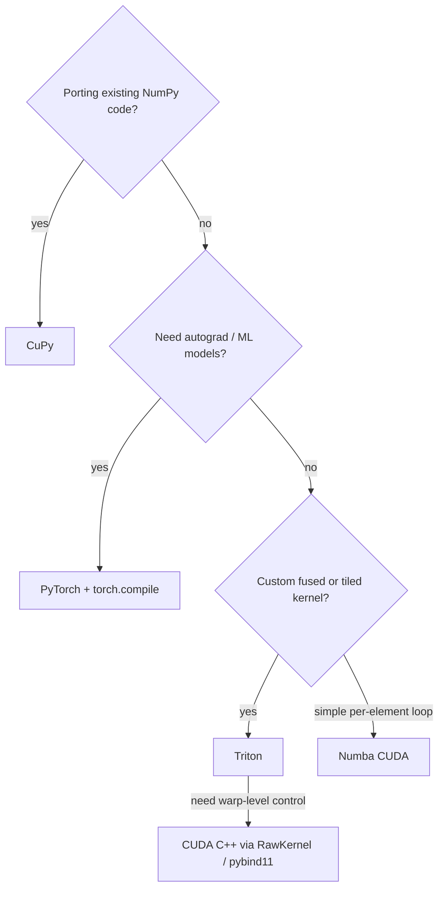

# 7. GPU from Python

## Choosing a tool

| Tool | Write kernels in | Best for |
|---|---|---|
| **CuPy** | NumPy API; `RawKernel` / `ElementwiseKernel` for CUDA C | Porting NumPy code nearly unchanged |
| **Numba CUDA** | Python subset (`@cuda.jit`) | Custom kernels without leaving Python |
| **Triton** | Python block-level DSL | Fused, tiled kernels; ML-style ops; auto-tuning |
| **PyTorch** | Tensor ops, `torch.compile` | Autograd, ML, quick prototypes |
| **cuda-python / CUDA C++ + pybind11** | CUDA C++ | Full control, existing C++ kernels |



## CuPy

```python
import cupy as cp

x = cp.asarray(np_array)            # H2D copy
y = cp.sqrt(x) * 2 + 1              # each op is a kernel launch
out = cp.asnumpy(y)                 # D2H copy (synchronizes)

# fuse an elementwise expression into one kernel
axpy = cp.ElementwiseKernel("T a, T x, T y", "T z", "z = a * x + y", "axpy")

# raw CUDA C
kern = cp.RawKernel(r'''
extern "C" __global__ void scale(double* a, double s, int n) {
    int i = blockIdx.x * blockDim.x + threadIdx.x;
    if (i < n) a[i] *= s;
}''', "scale")
kern(((n + 255) // 256,), (256,), (d_a, cp.float64(2.0), cp.int32(n)))
```

- Each NumPy-style op is a separate kernel and a separate pass over memory. Fuse
  with `cp.fuse`, `ElementwiseKernel` or `RawKernel` for bandwidth-bound loops.
- Use `cp.get_array_module(x)` to write code that runs on both CPU and GPU.
- The memory pool caches allocations. Call `cp.get_default_memory_pool().free_all_blocks()`
  when you need the memory back.

## Numba

```python
from numba import cuda

@cuda.jit
def saxpy(a, x, y):
    i = cuda.grid(1)
    if i < x.size:
        y[i] = a * x[i] + y[i]

d_x, d_y = cuda.to_device(x), cuda.to_device(y)
saxpy[(n + 255) // 256, 256](2.0, d_x, d_y)
y = d_y.copy_to_host()
```

`cuda.shared.array`, `cuda.syncthreads()` and `cuda.atomic.add` map directly onto the
CUDA concepts in the earlier notes.

## Triton

```python
import triton, triton.language as tl

@triton.jit
def add_kernel(x_ptr, y_ptr, out_ptr, n, BLOCK: tl.constexpr):
    pid = tl.program_id(0)
    offs = pid * BLOCK + tl.arange(0, BLOCK)
    mask = offs < n
    tl.store(out_ptr + offs, tl.load(x_ptr + offs, mask=mask) + tl.load(y_ptr + offs, mask=mask), mask=mask)

add_kernel[(triton.cdiv(n, 1024),)](x, y, out, n, BLOCK=1024)
```

- You program **blocks**, not threads. Triton handles coalescing, vectorization and
  shared memory.
- Use `@triton.autotune` over `BLOCK` sizes and `num_warps`.
- FP64 is supported but less tuned than FP32/FP16.

See **[Programming with Triton](08-triton.md)** for the full guide.

## Interop (zero-copy between libraries)

DLPack and `__cuda_array_interface__` let arrays move between libraries without
copies:

```python
t = torch.from_dlpack(cupy_array)
c = cp.from_dlpack(torch_tensor)
```

## Pitfalls

- **Implicit synchronization:** `float(x)`, `.item()`, `print(x)` and `cp.asnumpy`
  all block until the GPU is done. Keep them out of hot loops.
- **Timing:** use `cupyx.profiler.benchmark`, `torch.cuda.Event`, or call
  `cp.cuda.Stream.null.synchronize()` before stopping a CPU timer.
- **dtype drift:** a Python float scalar can promote float32 arrays to float64
  (NumPy rules), which doubles the traffic.
- **Small arrays:** the ~5–10 µs launch overhead per op dominates. Batch work or use
  CUDA Graphs.
