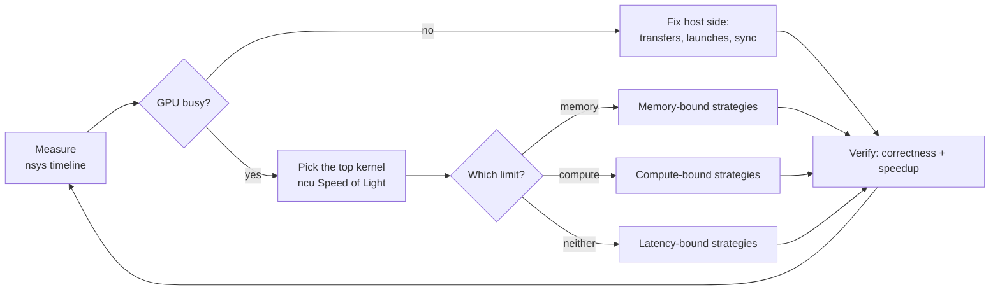
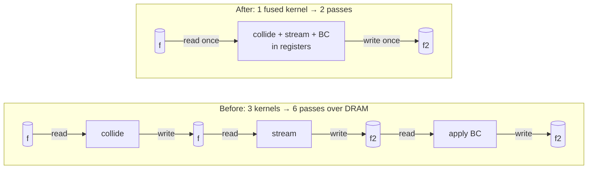

# 9. Optimization strategies

[Performance optimization](03-performance.md) covers the concepts. This page is the
**playbook**: how to find the bottleneck, and which strategy fixes each kind.

## The loop



1. **Measure end-to-end first** (Nsight Systems). Optimizing a kernel that is 5% of
   wall time gains at most 5%; this is Amdahl's law.
2. **Classify the hot kernel** with Nsight Compute's *GPU Speed of Light*:

    | Memory throughput | Compute (SM) throughput | Diagnosis |
    |---|---|---|
    | high (> 60% of peak) | low | **memory bound** |
    | low | high (> 60%) | **compute bound** |
    | low | low | **latency bound** (not enough parallelism, or stalls) |
    | high | high | close to the hardware limit, so change the algorithm |

3. **Apply one change at a time**, check the results still match, and keep a log of
   time per change.
4. **Stop** when you reach ~80% of the relevant roofline. Beyond that, gains come from
   the algorithm, not from tuning.

## Memory-bound strategies

This is the most common case for scientific code (stencils, LBM, SpMV, statevector
updates). The goal is **fewer bytes**, moved **more efficiently**.

| Strategy | What it fixes | Typical impact |
|---|---|---|
| Keep data device-resident | per-step PCIe copies | often the biggest single win |
| Coalesce (SoA layout, `x` → `threadIdx.x`) | wasted sectors | up to 32× less traffic for strided access |
| **Kernel fusion** | re-reading/writing arrays between kernels | ≈ number of fused passes |
| Lower precision (FP64 → FP32, FP16 storage) | bytes per element | ~2× |
| In-place / single-buffer algorithms | second copy of the state | 2× less memory, often less traffic |
| Vectorized loads (`float4`, `double2`) | instruction overhead | 5–20% |
| Shared-memory tiling | repeated neighbor loads | depends on reuse |
| Temporal blocking | one sweep per time step | multiple steps per DRAM pass |
| L2 persistence (sm_80+) | small hot arrays evicted from L2 | workload-dependent |
| Compute instead of load | small lookup tables, recomputable fields | removes the traffic |

### Fusion



```cpp
// Before: 3 kernels, each reads and writes the whole field -> 6 passes over memory
collide<<<g, b>>>(f);  stream<<<g, b>>>(f, f2);  apply_bc<<<g, b>>>(f2);

// After: 1 kernel, pull-scheme streaming + collision + BC -> 2 passes (read f, write f2)
collide_stream_bc<<<g, b>>>(f, f2, flags);
```

The fused kernel reads each population once, does all the work in registers, and
writes once.

### Vectorized access

```cpp
// Requires 16-byte alignment and n % 4 == 0 (handle the tail separately)
const float4* in4 = reinterpret_cast<const float4*>(in);
float4*       out4 = reinterpret_cast<float4*>(out);
int i = blockIdx.x * blockDim.x + threadIdx.x;
if (i < n / 4) {
    float4 v = in4[i];
    v.x *= s; v.y *= s; v.z *= s; v.w *= s;
    out4[i] = v;
}
```

### L2 persistence for hot data (sm_80+)

```cpp
cudaDeviceSetLimit(cudaLimitPersistingL2CacheSize, persist_bytes);
cudaStreamAttrValue attr = {};
attr.accessPolicyWindow.base_ptr  = d_hot;             // e.g. flags, lookup tables
attr.accessPolicyWindow.num_bytes = hot_bytes;
attr.accessPolicyWindow.hitRatio  = 1.0f;
attr.accessPolicyWindow.hitProp   = cudaAccessPropertyPersisting;
attr.accessPolicyWindow.missProp  = cudaAccessPropertyStreaming;
cudaStreamSetAttribute(stream, cudaStreamAttributeAccessPolicyWindow, &attr);
```

This works well when a small array is re-read every step while a large array streams
past it. Cards with very large L2 (96–128 MB on L40S and RTX PRO 6000) can hold
whole small problems.

### Diagnosing it in Nsight Compute

- **Memory Workload Analysis → sectors per request.** About 4 for 4-byte loads (8 for
  8-byte loads) means coalesced. Much higher means strided or scattered access.
- **DRAM bytes vs. your estimate.** If the measured traffic is 2× what you counted,
  something is being re-read, or spilled registers are going to local memory.
- **L2 hit rate.** Low for a stencil means neighbor reuse isn't happening. Try tiling.

## Latency-bound strategies

Neither memory nor compute is saturated, so warps sit stalled waiting.

| Strategy | How |
|---|---|
| More parallelism | more blocks (≥ 4 × SM count), more elements per launch |
| More occupancy | fewer registers (`__launch_bounds__`), less shared memory per block, smaller blocks |
| More ILP | each thread handles 2–8 independent elements; unroll (`#pragma unroll`) |
| Asynchronous copies | `cuda::memcpy_async` / `cp.async` (sm_80+), TMA (sm_90) to prefetch the next tile while computing the current one |
| Avoid serial dependencies | tree reductions instead of chained adds; split long dependency chains |
| Fix tail effects | grid-stride or persistent kernels so the last wave isn't mostly empty |

```cpp
// ILP: each thread processes 4 independent elements -> 4 loads in flight
#pragma unroll
for (int k = 0; k < 4; ++k) {
    int i = base + k * blockDim.x;          // stride by blockDim keeps coalescing
    if (i < n) out[i] = f(in[i]);
}
```

In ncu, **Warp State Statistics** shows the stall reasons. *Long scoreboard* means
waiting on global memory, so add ILP or prefetching. *Barrier* means waiting at
`__syncthreads` (rebalance the work). *Not selected* means there are plenty of ready
warps, which is a good sign.

## Compute-bound strategies

| Strategy | How |
|---|---|
| Use tensor cores | express the work as GEMM (cuBLAS, CUTLASS, `tl.dot`); TF32/BF16/FP16/FP8 where accuracy allows |
| Mixed precision | store and compute in FP32/FP16, accumulate in FP32/FP64 |
| Cheaper math | multiply by a reciprocal instead of dividing; `rsqrtf`; `__expf` / `--use_fast_math` when tolerances allow |
| Strength reduction | hoist invariants out of loops; precompute constants into `__constant__` memory |
| Avoid FP64 on consumer-class parts | T4, L40S and RTX PRO 6000 run FP64 at 1/32–1/64 rate; use A100/H100, or restructure into FP32 + compensation |
| Reduce divergence | sort or bin work by type; branchless `fma`/`select` |
| Use the libraries | cuBLAS, cuFFT, cuSPARSE, CUB are usually hard to beat |

!!! example "Moments as a GEMM"
    In LBM, computing moments from populations ($M \cdot f$ for all cells) can be
    expressed as one matrix–matrix product over a batch of cells. That moves the work
    onto cuBLAS/tensor cores instead of a hand-written loop. Check precision: FP64
    tensor cores exist only on A100 and H100.

## Host-side and launch overhead

The symptom is gaps between kernels on the nsys timeline, or low GPU utilization.

| Strategy | When |
|---|---|
| Keep everything on the GPU | any host↔device copy in the time loop |
| **CUDA Graphs** | many small kernels per step ([streams notes](04-streams.md#cuda-graphs)) |
| Fuse small kernels | launches of ~µs each dominate tiny kernels |
| Persistent kernel | one launch loops over work items/steps with a grid-wide sync |
| Remove implicit syncs | `cudaMalloc`/`cudaFree`, `.item()`, `print`, pageable `cudaMemcpy` in the loop |
| Pinned memory + async copies on side streams | copies you can't avoid (I/O, checkpoints) |
| Reduce output frequency | write diagnostics every N steps, on device-side reductions |

## Atomics and reductions

```cpp
#include <cooperative_groups.h>
namespace cg = cooperative_groups;

// Warp-aggregated atomic: one atomic per warp instead of one per thread
__device__ int atomic_inc_aggregated(int* ctr) {
    auto g = cg::coalesced_threads();
    int base;
    if (g.thread_rank() == 0) base = atomicAdd(ctr, g.size());
    return g.shfl(base, 0) + g.thread_rank();
}
```

- Reduce hierarchically: warp shuffle → shared memory → one atomic or second pass
  per block. Or use `cub::DeviceReduce`.
- For reproducible results, use a fixed-order two-pass reduction instead of
  floating-point atomics.

## Multi-GPU strategies

| Strategy | How |
|---|---|
| Overlap comm with compute | boundary first → start halo exchange → interior → join ([streams](04-streams.md#overlapping-communication-and-computation)) |
| Minimize surface/volume | decompose along the axis giving the smallest halos; prefer slabs or pencils per topology |
| Pack halos | gather non-contiguous faces into one buffer before sending |
| Use the topology | NVLink/P2P within a node, NCCL/EFA across nodes; bind ranks to the nearest CPU/NIC |
| Fewer, larger messages | combine fields in one exchange; batch collectives |
| Load balance | equal work per GPU, not equal cells, when solid/fluid ratio varies |

## Strategy by symptom

| You see… | Try… |
|---|---|
| `cudaMemcpy` in every step | keep data resident, copy only diagnostics |
| Gaps between kernels | CUDA Graphs, fusion, remove syncs |
| DRAM throughput > 80%, still slow | fewer bytes: fusion, precision, in-place algorithms |
| Sectors/request ≫ 4 | fix the layout (SoA) and index mapping |
| Register spills in `-Xptxas -v` | `__launch_bounds__`, split the kernel, fewer live variables |
| Low achieved occupancy | check the limiter: registers, shared memory, or block size |
| *Long scoreboard* stalls | ILP, async prefetch, more warps |
| SM throughput high, FP64 pipe saturated | different GPU, FP32 + compensation, tensor-core FP64 |
| Multi-GPU scaling flat | overlap halos, check `nvidia-smi topo -m`, `NCCL_DEBUG=INFO` |
| Results change between runs | atomics / reduction order, races (`compute-sanitizer --tool racecheck`) |

## Optimization log template

Record every step with its number. It keeps you honest and makes regressions obvious.

| # | Change | Time/step | Speedup vs baseline | Achieved BW | Parity |
|---|---|---:|---:|---:|---|
| 0 | baseline | | 1.0× | | ✓ |
| 1 | device-resident | | | | |
| 2 | SoA layout | | | | |
| 3 | fused collide+stream | | | | |
| 4 | FP32 storage | | | | |
| 5 | CUDA Graph | | | | |
