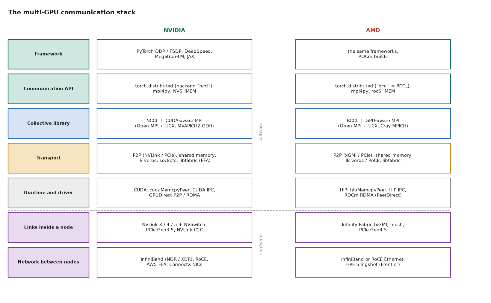
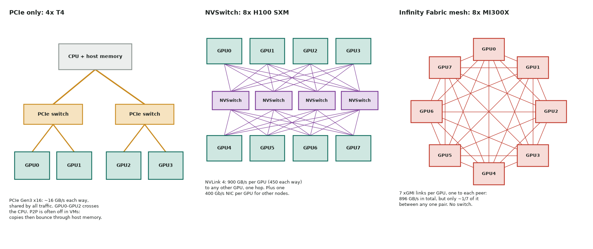
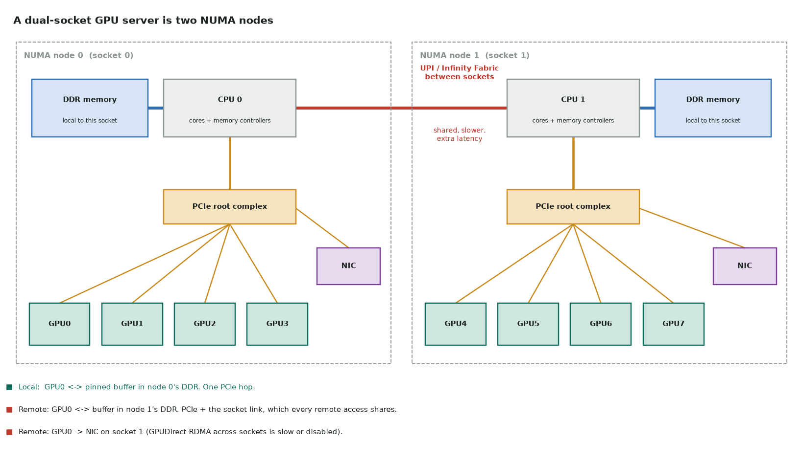
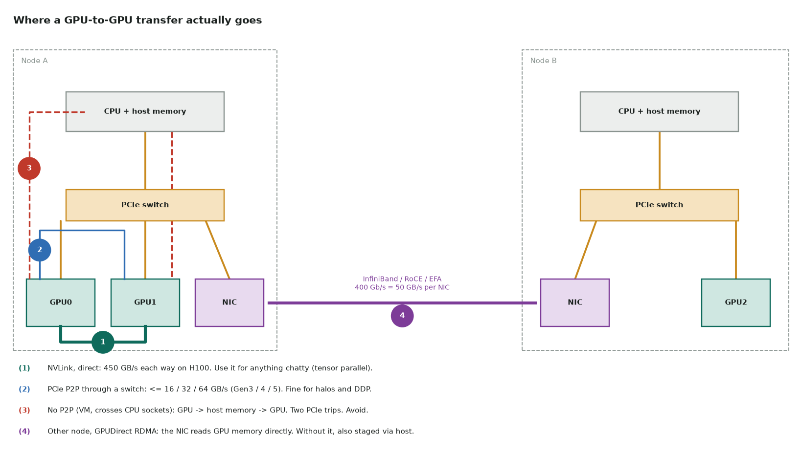

# 10. How GPUs talk to each other

[Multi-GPU and NCCL](05-multi-gpu.md) covers the basics. This page goes one level down:

- what each hardware link is and how fast it is;
- how the CPU sockets (NUMA) decide which host memory and NIC each GPU should use;
- what each software layer does, on NVIDIA and on AMD;
- which path a transfer really takes, and where data should not go.



Read the stack from the top down. Your code calls a **framework** (`DistributedDataParallel`),
which calls a **communication API** (`torch.distributed.all_reduce`). That API hands the
work to a **collective library** (NCCL, RCCL, MPI), which chooses a **transport** for each
pair of GPUs. The transport uses the **runtime and driver** to map memory between
devices, and the bytes finally move over a **physical link**: inside a node, or across the
network to another node.

## Hardware: the links

### Bandwidth at a glance

| Link | Per direction | Both directions | Where |
|---|---|---|---|
| HBM3, for comparison (H100 SXM) | — | 3,350 GB/s | inside one GPU |
| NVLink 5 (B200) | 900 GB/s | 1,800 GB/s per GPU | HGX B200, GB200 NVL72 |
| NVLink 4 (H100) | 450 GB/s | 900 GB/s per GPU (18 links) | HGX/DGX H100 |
| NVLink 3 (A100) | 300 GB/s | 600 GB/s per GPU (12 links) | HGX/DGX A100 |
| AMD Infinity Fabric (MI300X) | — | 896 GB/s per GPU (7 links × 128 GB/s) | 8-GPU MI300X platform |
| PCIe 5.0 x16 | ~64 GB/s (~50 in practice) | ~128 GB/s | H100 PCIe, MI300X host link |
| PCIe 4.0 x16 | ~32 GB/s (~25 in practice) | ~64 GB/s | A100 PCIe, L40S |
| PCIe 3.0 x16 | ~16 GB/s (~12 in practice) | ~32 GB/s | T4, V100 PCIe |
| InfiniBand NDR / XDR, one port | 50 / 100 GB/s (400 / 800 Gb/s) | | between nodes |
| 100 GbE Ethernet | 12.5 GB/s | | commodity clusters |

Two ratios to remember:

- **NVLink is ~10× PCIe.** On a PCIe-only node, GPU-to-GPU bandwidth is ~1/100 of HBM.
- **A node's network is ~10× slower than its NVLink.** An H100 has 450 GB/s each way
  to its NVLink peers and ~50 GB/s each way to the outside world.
  Every distributed-training design follows from this.

Network figures are in **bits** (Gb/s), GPU figures in **bytes** (GB/s). Divide by 8.

### PCIe

PCIe connects the GPU to the CPU, and it is the fallback link between GPUs.

- **Topology.** GPUs hang off the CPU's root complex, often through PCIe switches.
  Two GPUs under the same switch can do **P2P** through it without touching the CPU.
  GPUs under different CPU sockets go through the socket interconnect (Intel UPI or
  AMD Infinity Fabric between CPUs), which is slower still.
- **P2P can be disabled.** In many VMs and containers the IOMMU or PCIe ACS blocks
  direct P2P. Copies then **bounce through host memory**: GPU → host → GPU, two PCIe trips
  plus a host memory copy. A T4 on a cloud VM often behaves like this.
- **Shared.** Host-to-device copies, P2P and NIC traffic all share the same lanes.

### NVLink and NVSwitch (NVIDIA)

**NVLink** is a direct GPU-to-GPU link, separate from PCIe. Each GPU has a fixed number of
links (18 on an H100).

- **Without a switch** (e.g. 2–4 GPUs bridged), the links are split between peers, so each
  pair gets only part of the total.
- **With NVSwitch**, every GPU connects all of its links to a set of switch chips. Any
  GPU can then reach any other at its **full NVLink bandwidth**, in one hop. An HGX H100
  board has 8 GPUs and 4 NVSwitch chips. GB200 NVL72 extends one NVLink domain to 72 GPUs
  in a rack.
- **NVLink SHARP (NVLS).** Third-generation NVSwitch (H100) can do reductions **inside
  the switch**. NCCL's NVLS algorithm uses this for all-reduce, which roughly halves the
  data each GPU has to send.
- **NVLink-C2C** connects a Grace CPU to a Hopper GPU (GH200) at 900 GB/s, so host memory
  stops being a PCIe-sized bottleneck on those systems.

### Infinity Fabric (AMD)

AMD Instinct GPUs talk over **Infinity Fabric** links (xGMI) instead of NVLink.

- **MI300X:** 8 GPUs on a board, **fully connected with no switch**. Each GPU has 7
  links, one to each peer, 896 GB/s in total. Any pair is one hop, but a single pair only
  gets ~1/7 of it (~128 GB/s). Collectives that use all peers at once (all-reduce,
  all-to-all) use every link; a plain ring between two GPUs does not. RCCL runs several
  rings over different links for this reason.
- **MI250X:** each package holds two dies (GCDs) that appear as **two separate GPUs**,
  joined by Infinity Fabric. Frontier nodes have 4 packages, so 8 visible GPUs.
- **MI300A** is an APU: CPU and GPU cores share the same HBM, so there is no host-to-device
  copy at all.
- **UALink** is an open, industry scale-up standard (AMD among its founders) meant as an
  alternative to NVLink across vendors. Treat it as emerging.



### Between nodes

- **InfiniBand** (NVIDIA ConnectX NICs and Quantum switches): EDR 100, HDR 200, NDR 400,
  XDR 800 Gb/s per port. **SHARP** in the switches can do reductions in the network.
- **RoCE v2**: RDMA over Ethernet. It is common in AMD clusters and in hyperscalers. It needs
  a lossless (or congestion-managed) Ethernet fabric to perform well.
- **AWS EFA**: AWS's own RDMA-like transport, used by NCCL through the `aws-ofi-nccl` plugin.
- **HPE Slingshot**: Frontier, El Capitan and other Cray systems.
- **Rail-optimized** clusters give **one NIC per GPU** (DGX H100: 8 × 400 Gb/s), and wire
  GPU *k* of every node to the same leaf switch. Then GPU *k* talks to GPU *k* elsewhere in
  one switch hop.

### Reading the topology

```bash
nvidia-smi topo -m          # NVIDIA: matrix of how every GPU / NIC pair is connected
nvidia-smi nvlink -s        # NVLink status and per-link speed
rocm-smi --showtopo         # AMD: link type and hops between GPUs (also: amd-smi topology)
lspci -tv                   # the PCIe tree, any vendor
```

| `nvidia-smi topo` | Path between the two devices | Expect |
|---|---|---|
| `NV#` | # NVLink links | best |
| `PIX` | one PCIe switch | good P2P |
| `PXB` | several PCIe switches, no CPU | good P2P |
| `PHB` | through the CPU's PCIe host bridge | P2P may be slow or off |
| `NODE` | across host bridges inside one NUMA node | slower |
| `SYS` | across CPU sockets (UPI / Infinity Fabric) | worst: keep chatty traffic off it |

The same matrix shows which **NIC** is closest to each GPU. GPUDirect RDMA is only fast
when the GPU and NIC share a PCIe switch (`PIX`/`PXB`).

For the actual wiring of AWS's g6e, p4d, p5, p5en and p6-b200 instances, see
[Inside AWS GPU instances](11-aws-gpu-instances.md).

## NUMA: the CPU side of the topology

GPUs and NICs don't float free in a server. Each one is attached to a **CPU socket**, and
the sockets are not equal. That is **NUMA** (Non-Uniform Memory Access).

- Every socket has its **own memory controllers and DRAM**, and its own **PCIe root
  complex**.
- Memory on your own socket is **local**. Memory on the other socket is **remote**: it is
  reached over the socket interconnect (Intel **UPI**, or **Infinity Fabric** between AMD
  EPYC sockets). That costs extra latency, often ~1.5–2× local, and the bandwidth is shared
  by all cross-socket traffic.
- The OS exposes each socket (or part of one) as a **NUMA node**, with its cores, its
  memory, and the PCIe devices under its root complex.



A typical 8-GPU, dual-socket server puts GPUs 0–3 and their NICs on node 0, and GPUs 4–7 on
node 1. **Check, don't assume.** Some boards interleave, and the CUDA device order can
differ from the PCIe order (set `CUDA_DEVICE_ORDER=PCI_BUS_ID` to make them match).

### More NUMA nodes than sockets

- **AMD EPYC NPS** (nodes per socket: NPS1, NPS2, NPS4) and **Intel Sub-NUMA Clustering**
  (SNC2, SNC4) split each socket into 2–4 NUMA nodes. These are BIOS settings.
- More nodes give lower local latency, but more ways to be remote. Many GPU servers run
  NPS1 or SNC off for simplicity. `lscpu` shows what you have.

The GPU can be a NUMA node too:

- **Grace Hopper (GH200):** the GPU's HBM appears to Linux as its **own NUMA node**, with
  memory and no CPUs, reachable by the CPU over NVLink-C2C.
- **MI300A:** CPU and GPU share one pool of HBM.
- **MI300X:** can partition its own HBM into NUMA domains (memory partition modes NPS1 /
  NPS4, alongside the compute partition modes).

### Why it matters for GPU work

With NVLink or NVSwitch, GPU-to-GPU traffic never touches the CPUs, so NUMA doesn't
affect it. NUMA matters for everything that goes **through the host or the PCIe tree**:

| What | If it is on the wrong NUMA node | Effect |
|---|---|---|
| Pinned host buffers (`pin_memory=True`, `cudaHostAlloc`) | the DMA crosses the socket link | lower, noisier host↔device bandwidth |
| The rank's main thread (kernel launches) | it runs on the far socket | launch latency jitter, slower Python overhead |
| DataLoader workers and preprocessing | they read and write remote memory | the input pipeline slows; the GPU waits |
| NCCL `SHM` transport, host bounce copies | the staging buffer is remote | slower intra-node fallback paths |
| GPUDirect RDMA | the NIC is on the other socket | NCCL may disable GDR and stage through host memory (`NCCL_NET_GDR_LEVEL`) |
| GPU ↔ GPU over PCIe, no NVLink | `SYS` path through both sockets | P2P slow, or turned off entirely |

**Placement follows first touch.** Linux puts a page on the NUMA node of the CPU that
**first writes it**, not the one that allocated it. Whatever thread first fills or pins a
buffer decides where it lives. So **bind the process before it allocates**. Binding
afterwards moves the threads, not the memory already in place.

**Automatic NUMA balancing** (`/proc/sys/kernel/numa_balancing`) migrates pages towards
the threads using them. On GPU servers it can add latency spikes, and AMD's MI300X tuning
guide recommends turning it off. Measure before and after rather than taking it on
faith.

### Inspecting NUMA

```bash
lscpu | grep -i numa                 # NUMA nodes and which cores belong to each
numactl --hardware                   # memory per node and the distance matrix (10 = local)
nvidia-smi topo -m                   # last columns: CPU Affinity and NUMA Affinity per GPU
cat /sys/bus/pci/devices/0000:18:00.0/numa_node   # node of any PCIe device; -1 = unknown
lstopo                               # hwloc: draws sockets, caches, NUMA nodes and PCIe devices
rocm-smi --showtoponuma              # AMD: NUMA node of each GPU
```

### Binding each rank to its GPU's NUMA node

The rule: **one process per GPU, running on the cores of the GPU's NUMA node, with its
memory there too.** DataLoader workers are forked from the rank and inherit its CPU
binding, so binding the rank binds them as well. Keep `num_workers` × ranks per node within
that node's cores.

```bash
# Slurm: each task gets one GPU and the cores closest to it
srun --gpus-per-task=1 --gpu-bind=closest --cpu-bind=cores python train.py

# Open MPI: 4 ranks per NUMA node, each bound to it (GPUs 0-3 on node 0, 4-7 on node 1)
mpirun -np 8 --map-by ppr:4:numa --bind-to numa python train.py

# One process by hand
numactl --cpunodebind=0 --membind=0 python train.py

# torchrun: wrap each rank with the script below
torchrun --nproc_per_node=8 --no-python docs/notes/numa_bind.sh python train.py
```

The wrapper looks up the GPU's NUMA node from its PCI address, then runs the rank under
`numactl`:

```bash
--8<-- "docs/notes/numa_bind.sh"
```

Its fallback paths were tested in Docker: no GPU, no NUMA support, and under `torchrun`.
The binding path itself needs a real multi-socket machine.

To check that binding helped, compare host-to-device bandwidth from a pinned buffer with
the rank bound to the GPU's node and to the other node. The far node should be
measurably slower and noisier. If it isn't, the server may be single-node (NPS1 on one
socket), or the platform may hide NUMA (many VMs).

## Software: the layers

### Runtime and driver

The vendor runtime gives the primitives every library builds on:

| | NVIDIA (CUDA) | AMD (HIP / ROCm) |
|---|---|---|
| Can GPU *a* map GPU *b*'s memory? | `cudaDeviceCanAccessPeer` | `hipDeviceCanAccessPeer` |
| Enable it | `cudaDeviceEnablePeerAccess` | `hipDeviceEnablePeerAccess` |
| Copy between GPUs | `cudaMemcpyPeerAsync` | `hipMemcpyPeerAsync` |
| Share memory between processes | CUDA IPC (`cudaIpcGetMemHandle`) | HIP IPC (`hipIpcGetMemHandle`) |
| NIC reads/writes GPU memory directly | **GPUDirect RDMA** (`nvidia-peermem` or dma-buf) | ROCm RDMA / PeerDirect (dma-buf) |
| Storage straight into GPU memory | GPUDirect Storage (cuFile) | — |

With peer access enabled, a **kernel** on GPU 0 can load and store through a pointer to
GPU 1's memory. The traffic goes over NVLink or PCIe. This is the transport NCCL's P2P path and
NVSHMEM build on.

### NCCL (NVIDIA) and RCCL (AMD)

NCCL is the standard GPU collective library. **RCCL is AMD's port of it, with the same API**.
It reads the same `NCCL_*` environment variables and is what PyTorch's `"nccl"` backend
calls on ROCm builds.

How a collective runs:

1. **Communicator setup.** Each rank calls `ncclCommInitRank` with a shared unique id
   (broadcast by MPI, or by `torchrun`'s rendezvous). NCCL detects the topology:
   the PCIe tree, NVLinks, NICs and NUMA.
2. **Transport per peer pair.**
    - `P2P`: NVLink, xGMI or PCIe, direct;
    - `SHM`: through host shared memory, when P2P is unavailable;
    - `NET`: InfiniBand verbs, RoCE, sockets, or a plugin (EFA);
    - `NVLS` / `CollNet`: in-switch reduction (NVSwitch, IB SHARP).
3. **Algorithm.**
    - **Ring**: bandwidth-optimal. Each GPU sends $2\frac{p-1}{p}S$ bytes for an
      all-reduce of $S$ bytes, but the latency grows with $p$.
    - **Tree**: $\log p$ latency, better for small messages and many nodes.
    - **NVLS**, **CollNet**: offload the reduction to switches.
4. **Protocol.** `LL` and `LL128` are low-latency (small messages), `Simple` gives the
   highest bandwidth (large messages).
5. **Kernels.** The collective is a **CUDA/HIP kernel on your stream**. It is
   asynchronous like any kernel, and it **occupies SMs** (or CUs) while it runs. That is
   why overlapping communication with compute is never entirely free.

Useful environment variables, honoured by both NCCL and RCCL:

| Variable | Use |
|---|---|
| `NCCL_DEBUG=INFO` | print the topology, transports and rings/trees chosen. Start every investigation here |
| `NCCL_DEBUG_SUBSYS=INIT,GRAPH` | narrow the output |
| `NCCL_P2P_DISABLE=1` | force SHM/host path: confirms whether P2P is the problem |
| `NCCL_IB_DISABLE=1` | force sockets instead of InfiniBand |
| `NCCL_SOCKET_IFNAME=eth0` | which network interface to use for bootstrap and sockets |
| `NCCL_IB_HCA=mlx5_0,mlx5_1` | which InfiniBand NICs to use |
| `NCCL_ALGO=Ring` / `Tree`, `NCCL_PROTO=Simple` | pin the algorithm or protocol while benchmarking |

### MPI

MPI (Open MPI, MPICH, MVAPICH, Cray MPICH, Intel MPI) is the general HPC message-passing
standard. It provides point-to-point (`MPI_Send`/`MPI_Isend`), collectives
(`MPI_Allreduce`), one-sided operations and process launch (`mpirun`/`srun`).

- A **CUDA-aware / GPU-aware MPI** accepts device pointers. Underneath it uses UCX or
  libfabric, which use GPUDirect P2P and RDMA, so the data never stages through host
  memory. Open MPI + UCX built with CUDA or ROCm, MVAPICH2-GDR and Cray MPICH
  (`MPICH_GPU_SUPPORT_ENABLED=1`) all do this.
- A **non-GPU-aware MPI** needs `cudaMemcpy` to the host first, then send, then copy back.
  That is path 3 in the figure below, and it is slow.
- MPI operations are **host-driven**: the CPU issues them, and they are not ordered with
  your CUDA stream. Synchronize the stream before `MPI_Send` of data a kernel produced.

| | NCCL / RCCL | MPI |
|---|---|---|
| Designed for | dense GPU collectives (all-reduce, all-gather, reduce-scatter) | general messaging, any data, any process |
| Runs as | GPU kernels on a stream | host calls (GPU-aware ones drive DMA engines / RDMA) |
| Ordering | stream-ordered with your kernels | you synchronize the stream yourself |
| Best at | large collectives; topology-aware rings/trees, NVLS | point-to-point halos, irregular patterns, CPU+GPU codes, job launch |
| Typical HPC pattern | MPI launches ranks and broadcasts the NCCL id; NCCL moves the bulk data | |

**Gloo** is PyTorch's CPU collective backend. Use it for CPU tensors and for testing
without GPUs, never for GPU tensors in production.

### NVSHMEM and rocSHMEM

NVSHMEM (NVIDIA) and rocSHMEM (AMD) implement OpenSHMEM-style one-sided `put`/`get` that a
**kernel issues directly** to another GPU's memory, with no CPU involvement and no
kernel boundary. Use them for fine-grained or irregular communication fused into
compute (MoE all-to-all, pipelined halo exchange). NCCL and MPI are host-initiated
and work best with fewer, larger messages.

### Frameworks

- **`torch.distributed`** is the API: `init_process_group("nccl")`, `all_reduce`,
  `all_gather_into_tensor`, `reduce_scatter_tensor`, `batch_isend_irecv`. Launch with
  `torchrun --nproc_per_node=N` (one process per GPU).
- **DDP** all-reduces gradients in **buckets** (~25 MB) *during* the backward pass. A
  bucket's all-reduce starts as soon as its gradients are ready, overlapping the
  rest of the backward.
- **FSDP / ZeRO** shard parameters, gradients and optimizer state: all-gather the
  parameters before a layer, reduce-scatter its gradients after.
- **Tensor parallel** (Megatron) splits each matmul across GPUs: an all-reduce or
  all-gather **inside every layer**, forward and backward.
- **Pipeline parallel** splits layers across GPUs: point-to-point sends of activations
  between stages.
- **Expert parallel** (MoE): two all-to-alls per MoE layer.

## NVIDIA vs AMD

| | NVIDIA | AMD |
|---|---|---|
| Programming model | CUDA | HIP (CUDA-like; `hipify` converts most CUDA source) on ROCm |
| SIMD group | warp = 32 threads | wavefront = 64 on CDNA (Instinct); 32 or 64 on RDNA |
| Compute unit | SM | CU (MI300X: 304 CUs) |
| On-chip scratchpad | shared memory (≤ 228 KB/SM on H100) | LDS, local data share (64 KB/CU on MI300X) |
| Matrix units | Tensor Cores (`mma`, `wgmma`) | Matrix Cores (MFMA instructions) |
| Flagship memory (this generation) | H100: 80 GB HBM3, 3.35 TB/s; H200: 141 GB | MI300X: 192 GB HBM3, 5.3 TB/s |
| Scale-up link | NVLink + NVSwitch (switched, full bandwidth to every peer) | Infinity Fabric mesh (direct, bandwidth split across peers) |
| Collective library | NCCL | RCCL (NCCL API) |
| Libraries | cuBLAS, cuDNN, CUTLASS | rocBLAS / hipBLASLt, MIOpen, Composable Kernel |
| Profilers | Nsight Systems, Nsight Compute | rocprof / rocprofv3, ROCm Systems & Compute Profiler |
| Triton | yes | yes (ROCm backend) |
| PyTorch | `torch.cuda` | the same `torch.cuda` API on ROCm builds |

Practical consequences when porting:

- **Wavefront 64**: code that assumes 32 lanes breaks. This includes warp shuffles, ballot
  masks (`__ballot` returns 64 bits) and `tid % 32` tricks. Triton hides this.
- **Larger memory, mesh topology**: MI300X fits bigger models on one GPU (less
  parallelism needed), but per-pair bandwidth is lower than through NVSwitch. Prefer
  collectives that use all peers over point-to-point between two GPUs.
- Tuning knobs carry over by name (`NCCL_*` for RCCL). The `nvidia-smi` commands become
  `rocm-smi` / `amd-smi`, and Nsight becomes rocprof.

## Where data should move, and where not



| Path | Bandwidth (each way) | Verdict |
|---|---|---|
| Stay in the GPU (registers, shared, L2, HBM) | TB/s | always first choice: fuse, recompute, don't move |
| (1) NVLink / Infinity Fabric | 100s of GB/s | tensor parallel, sequence/context parallel, MoE all-to-all inside a node |
| (2) PCIe P2P through a switch | 12–50 GB/s | data parallel, halos, pipeline sends; overlap it with compute |
| (3) bounce through host memory | < PCIe, plus CPU copies | avoid: enable P2P, use GPU-aware MPI, fix the topology |
| (4) another node, GPUDirect RDMA | 12–100 GB/s per NIC | data parallel / FSDP across nodes, pipeline stages; overlap it |
| GPU ↔ CPU (`.cpu()`, `.item()`, `print(t)`) | ≤ PCIe, **and it synchronizes** | only at the edges: logging, checkpointing, I/O |

Rules:

1. **Don't move it at all if you can avoid it.** Bytes moved inside the GPU are 10–100× cheaper.
2. **Match the parallelism to the link.**

    | Parallelism | Communication | Put it on |
    |---|---|---|
    | Tensor (TP) | all-reduce every layer, on the critical path | NVLink / NVSwitch only: **one node** |
    | Context / sequence | ring exchange of K/V every layer | NVLink |
    | Expert (MoE) | all-to-all every MoE layer | NVLink, or a strong network with good bisection |
    | Pipeline (PP) | activations between stages, small | across nodes is fine |
    | Data (DDP) / FSDP | gradients once per step (FSDP: per layer, overlappable) | across nodes |

    This is why large-model jobs use TP = 8 (one NVLink domain) × PP × DP.
3. **Never let GPU data bounce through the host by accident.** Check
   `NCCL_DEBUG=INFO` for `via P2P` / `via NVLS` vs `via SHM`. Use a GPU-aware MPI. Inside
   a node, never copy device → host → device yourself.
4. **Keep chatty pairs close.** Put ranks that talk most under the same PCIe switch or
   NVLink domain, and bind each rank to the CPU socket and NIC nearest its GPU
   (`srun --gpu-bind=closest`, `numactl`). Avoid `SYS` paths.
5. **Send fewer, larger messages.** Every collective has a latency term (µs within a
   node, 10s of µs across nodes). Bucket gradients, batch `isend`/`irecv` with
   `batch_isend_irecv`, and pack halos into contiguous buffers.
6. **Overlap.** Start communication as soon as its data is ready (DDP buckets, FSDP
   prefetch, interior-then-boundary stencils), on a separate stream.
7. **Send fewer bytes.** BF16 instead of FP32 gradients halves the traffic. Use
   reduce-scatter + all-gather (FSDP) instead of replicating everything, and top-k/sparse
   only when convergence allows.
8. **Host ↔ device:** pinned memory (`pin_memory=True`) and `non_blocking=True` copies,
   overlapped on their own stream. Nothing per-step in the training loop should call
   `.item()`.
9. **Keep the host side local.** Bind each rank, its pinned buffers and its DataLoader
   workers to its GPU's NUMA node, and use the NIC on the same socket. See
   [NUMA](#numa-the-cpu-side-of-the-topology).

### Worked estimate: all-reduce 1 GB of gradients

A ring all-reduce sends $2\frac{p-1}{p}S$ bytes per GPU, so $t \approx 2\frac{p-1}{p}\frac{S}{B}$
plus latency:

| System | Link B (each way) | Bytes per GPU | Floor |
|---|---|---|---|
| 8 × H100, NVSwitch | 450 GB/s | 1.75 GB | ~3.9 ms (NVLS can roughly halve this) |
| 8 × MI300X, xGMI mesh | ~7 × 64 GB/s, all links busy | 1.75 GB | ~4 ms with every link used; ~27 ms over one link |
| 4 × T4, PCIe Gen3, P2P on | ~12 GB/s | 1.5 GB | ~125 ms |
| 2 nodes × 8 H100, one 400 Gb/s NIC per GPU | 450 GB/s inside, ~50 GB/s per NIC between | reduce-scatter inside the node, then S/8 = 125 MB per GPU across the network, then all-gather | ~2.5 ms network + ~4 ms NVLink ≈ 6–7 ms. With **one** NIC per node, the network part alone is ~20 ms |

The two-node row shows why clusters give each GPU its own NIC: NCCL reduces inside the
node over NVLink first, so only 1/8 of the data has to cross each NIC. These are floors
from the link speed, not measurements. Measure with the script below or
with nccl-tests. A 1 GB all-reduce is ~3 % of a 100 ms step on NVSwitch, but longer
than the whole step on a PCIe T4 box. That is why the parallelism has to match the link.

## Try it: verified probe

The script checks an all-reduce and a ring send/recv, then measures all-reduce bandwidth.
It picks NCCL on NVIDIA, RCCL on AMD (ROCm build of PyTorch) and Gloo on a CPU-only machine.
It was run with 2 and 4 CPU processes (Gloo). The GPU paths use the same calls, but have
not been run here.

```python
--8<-- "docs/notes/multi_gpu_comm.py"
```

```bash
torchrun --nproc_per_node=8 docs/notes/multi_gpu_comm.py
NCCL_DEBUG=INFO torchrun --nproc_per_node=8 docs/notes/multi_gpu_comm.py 2>&1 | grep -E "via|Channel|NVLS"
NCCL_P2P_DISABLE=1 torchrun --nproc_per_node=8 docs/notes/multi_gpu_comm.py   # see what the host path costs

# Vendor benchmarks: the reference numbers to compare against
./build/all_reduce_perf -b 8 -e 4G -f 2 -g 8    # nccl-tests (NVIDIA) and rccl-tests (AMD), same flags
```

`busbw` from nccl-tests and from the script is comparable to the link bandwidth above. On a
healthy 8 × H100 NVSwitch node, large all-reduces should approach the NVLink figure. On
PCIe nodes, expect roughly the PCIe figure. Much less means a topology or configuration
problem, not your code.

## When it hangs or is slow

- **Hang at init:** ranks can't reach each other. Check `MASTER_ADDR`/`MASTER_PORT` (or the
  rendezvous endpoint), the firewall, and `NCCL_SOCKET_IFNAME`.
- **Hang mid-run:** ranks called different collectives, or the same ones in a different
  order. Common causes: a rank skipped a step, data-dependent control flow, or an
  exception on one rank. Set `TORCH_NCCL_ASYNC_ERROR_HANDLING=1` and a timeout in
  `init_process_group` so the job fails instead of hanging. `TORCH_DISTRIBUTED_DEBUG=DETAIL`
  reports mismatched collectives.
- **Slow:** `NCCL_DEBUG=INFO` → is it `SHM` instead of `P2P`, or `Socket` instead of
  `IB`? `nvidia-smi topo -m` → are pairs on `SYS`? Run nccl-tests → is the fabric itself
  slow? Then Nsight Systems: is communication overlapping compute, or serialized after it?
- **Scaling cliff from 8 to 16 GPUs:** you just crossed from NVLink to the network.
  Expected. Shrink TP to fit within a node, overlap DP communication, or compress gradients.

## Reading and talks

- [NCCL user guide](https://docs.nvidia.com/deeplearning/nccl/user-guide/docs/index.html) and its [environment variables](https://docs.nvidia.com/deeplearning/nccl/user-guide/docs/env.html)
- [RCCL documentation](https://rocm.docs.amd.com/projects/rccl/en/latest/) · [RCCL source](https://github.com/ROCm/rccl)
- [nccl-tests](https://github.com/NVIDIA/nccl-tests) · [rccl-tests](https://github.com/ROCm/rccl-tests)
- [GPUDirect RDMA](https://docs.nvidia.com/cuda/gpudirect-rdma/index.html) · [GPU-enabled MPI on ROCm](https://rocm.docs.amd.com/en/latest/how-to/gpu-enabled-mpi.html) · [NVSHMEM API](https://docs.nvidia.com/nvshmem/api/index.html)
- [NVLink and NVSwitch](https://www.nvidia.com/en-us/data-center/nvlink/) · [AMD Instinct MI300X](https://www.amd.com/en/products/accelerators/instinct/mi300/mi300x.html) · [UALink Consortium](https://ualinkconsortium.org/)
- [PyTorch distributed](https://docs.pytorch.org/docs/stable/distributed.html) · [FSDP](https://docs.pytorch.org/docs/stable/fsdp.html) · [aws-ofi-nccl](https://github.com/aws/aws-ofi-nccl)
- Talk: [Scaling Deep Learning Training: Fast Inter-GPU Communication with NCCL (GTC 2023)](https://www.nvidia.com/en-us/on-demand/session/gtcspring23-s51111/)
- GPU MODE Lecture 17: GPU Collective Communication (NCCL): [code and notes](https://github.com/gpu-mode/lectures/tree/main/lecture_017). The video is on the [GPU MODE channel](https://www.youtube.com/@GPUMODE)
