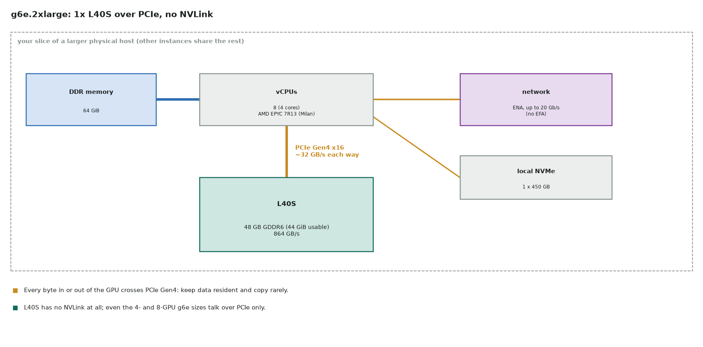
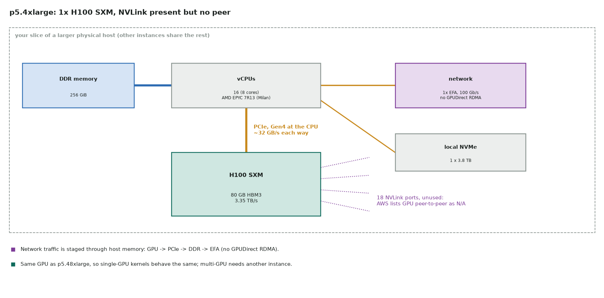
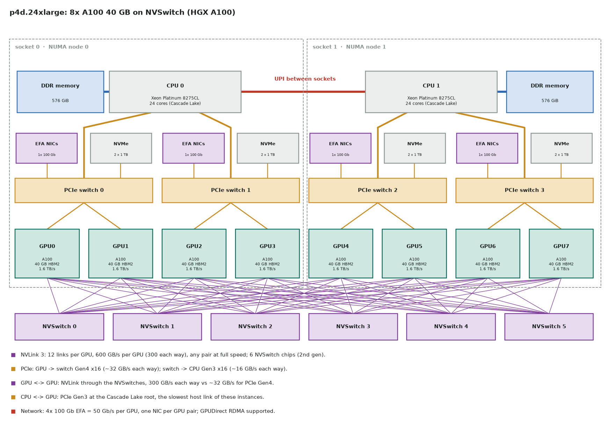
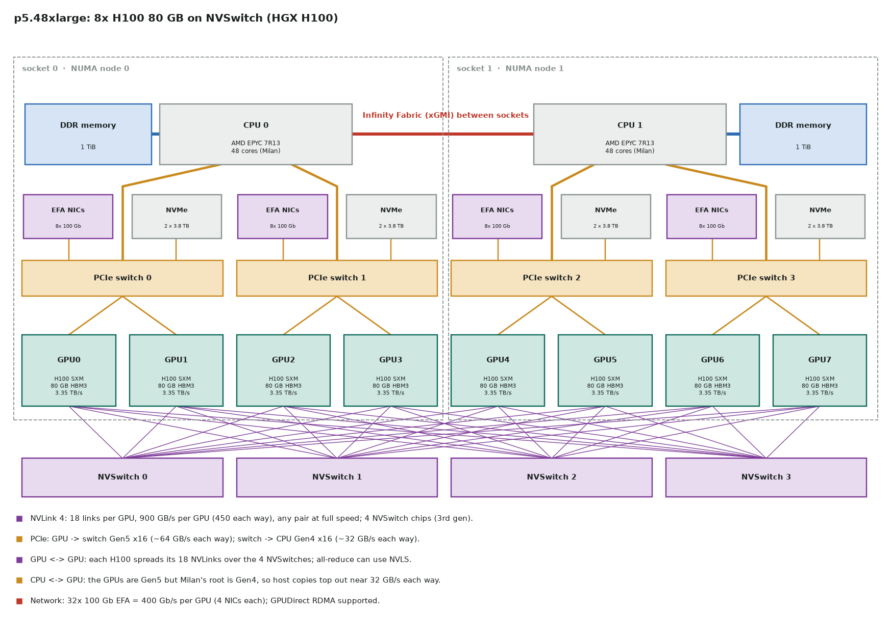
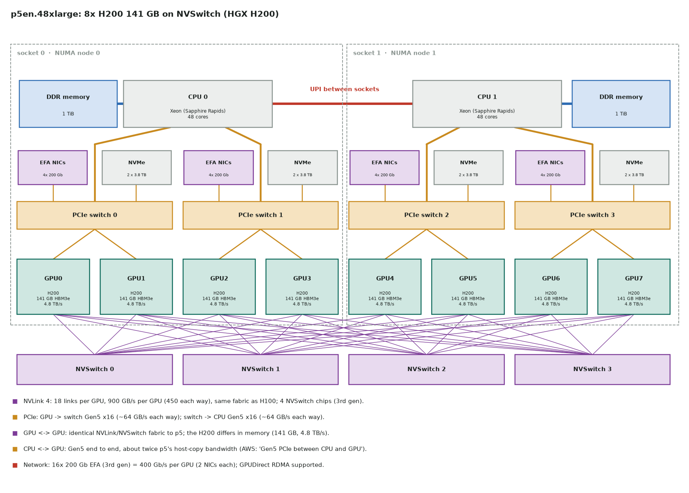
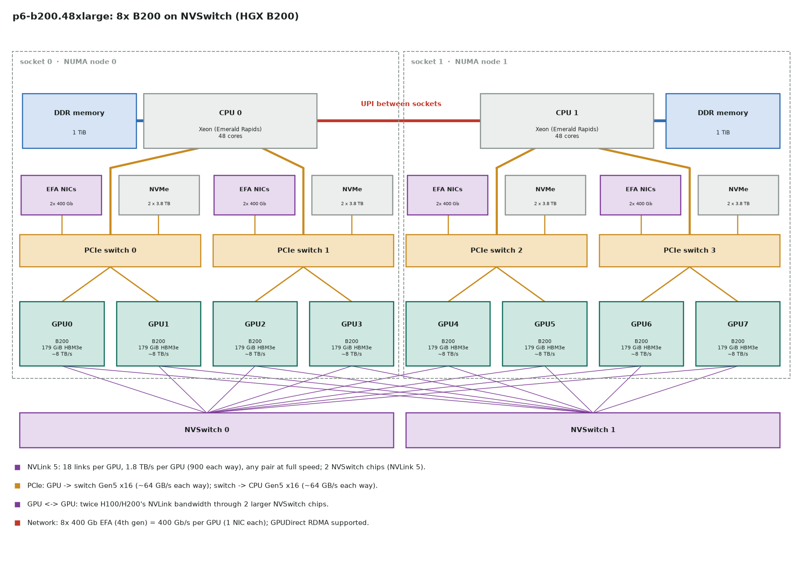

# 11. Inside AWS GPU instances

What is wired to what inside six AWS GPU instances, from a single L40S to eight B200s: the
GPUs, NVLink and NVSwitch, the PCIe switches, the two CPU sockets, the EFA network cards
and the local NVMe. Each diagram is followed by what it means for where your data should
move. The general rules behind this are on
[How GPUs talk to each other](10-multi-gpu-communication.md).

!!! note "Where the numbers come from"
    Counts, CPUs, memory, NICs and NVMe are from AWS's
    [accelerated-computing instance specifications](https://docs.aws.amazon.com/ec2/latest/instancetypes/ac.html)
    and the [P5](https://aws.amazon.com/ec2/instance-types/p5/) and
    [P6](https://aws.amazon.com/ec2/instance-types/p6/) pages. NVSwitch counts and link speeds
    are NVIDIA's HGX board specs. AWS does not publish its exact PCIe switch wiring, so the
    8-GPU diagrams use the HGX reference shape: one PCIe switch per GPU pair, with that
    pair's NICs and NVMe drives on it. Check the real layout with `nvidia-smi topo -m`
    ([below](#check-it-on-the-instance)).

## At a glance

| Instance | GPUs | GPU memory | GPU ↔ GPU | CPU ↔ GPU (host root) | Network per GPU | CPU | On-demand $/h (approx.) |
|---|---|---|---|---|---|---|---|
| g6e.2xlarge | 1× L40S | 48 GB GDDR6 (44 GiB usable) | none | PCIe Gen4 x16, ~32 GB/s | up to 20 Gb/s ENA, no EFA | EPYC 7R13, 8 vCPU | 2.24 |
| p5.4xlarge | 1× H100 SXM | 80 GB HBM3 | none (P2P N/A) | PCIe Gen4, ~32 GB/s | 100 Gb/s EFA, no GPUDirect RDMA | EPYC 7R13, 16 vCPU | 6.88 |
| p4d.24xlarge | 8× A100 | 8 × 40 GB HBM2 | NVLink 3 + 6 NVSwitch, 600 GB/s | PCIe Gen3, ~16 GB/s | 50 Gb/s (4 × 100 Gb shared) | 2× Xeon 8275CL, 96 vCPU | 21.96 |
| p5.48xlarge | 8× H100 SXM | 8 × 80 GB HBM3 | NVLink 4 + 4 NVSwitch, 900 GB/s | PCIe Gen4, ~32 GB/s | 400 Gb/s (32 × 100 Gb) | 2× EPYC 7R13, 192 vCPU | 55.04 |
| p5en.48xlarge | 8× H200 | 8 × 141 GB HBM3e | NVLink 4 + 4 NVSwitch, 900 GB/s | PCIe Gen5, ~64 GB/s | 400 Gb/s (16 × 200 Gb) | 2× Sapphire Rapids, 192 vCPU | 63.30 |
| p6-b200.48xlarge | 8× B200 | 8 × 179 GiB HBM3e | NVLink 5 + 2 NVSwitch, 1.8 TB/s | PCIe Gen5, ~64 GB/s | 400 Gb/s (8 × 400 Gb) | 2× Emerald Rapids, 192 vCPU | 113.93 |

GPU ↔ GPU figures are per GPU, both directions added (half each way). PCIe figures are each
way for one x16 link. Prices are on-demand Linux and change; check the
[EC2 pricing page](https://aws.amazon.com/ec2/pricing/on-demand/).

Three things set the shape of each box:

- **NVLink or not.** Only the 8-GPU P instances have it. The single-GPU sizes have no peer,
  and the L40S has no NVLink at all.
- **The host PCIe root.** The GPUs are Gen4 (A100, L40S) or Gen5 (H100, H200, B200), but
  the CPU decides the host link: Cascade Lake is Gen3, EPYC Milan is Gen4, Sapphire and
  Emerald Rapids are Gen5.
- **NICs per GPU.** All three current 8-GPU instances give each GPU 400 Gb/s of EFA, split
  over 4, 2 or 1 cards; p4d gives each GPU pair one 100 Gb card.

## g6e.2xlarge: 1× L40S



- Everything goes over one PCIe Gen4 x16 link (~32 GB/s each way at best). The GPU's own memory is 864 GB/s, so a kernel that re-reads host data
  every step runs at PCIe speed, not GDDR6 speed.
- No EFA, so this is a single-node instance. Larger g6e sizes add GPUs, still with no
  NVLink: GPU-to-GPU traffic goes over PCIe, through the host if the GPUs sit under
  different roots.

## p5.4xlarge: 1× H100



- It is the same H100 SXM (80 GB HBM3, 3.35 TB/s) as in p5.48xlarge, so single-GPU kernel
  timings carry over directly.
- The GPU's NVLink ports have no peer in the instance: AWS lists GPU peer-to-peer as N/A.
- It has a 100 Gb EFA card, but **no GPUDirect RDMA**. Multi-node traffic is copied
  GPU → host memory → NIC, so NCCL across several p5.4xlarge instances is limited by those
  PCIe copies. For multi-GPU work, use one 8-GPU instance instead of several of these.

## p4d.24xlarge: 8× A100 40 GB



- Every A100 has 12 NVLink 3 links, two to each of the 6 NVSwitch chips. Any two GPUs talk
  at the full 600 GB/s (300 each way), so the topology is flat: no "near" or "far" GPU.
- The host side is the weak link. Cascade Lake roots are PCIe Gen3 (~16 GB/s each way),
  half what the A100's Gen4 port can do. Keep the data on the GPUs and stage input with
  pinned memory and overlap ([streams](04-streams.md)).
- There are 4 × 100 Gb EFA cards, one per PCIe switch, so two GPUs share each card
  (50 Gb/s per GPU). Across nodes, p4d is network-bound much sooner than p5.

## p5.48xlarge: 8× H100 80 GB



### How the eight H100s connect

- Each H100 has 18 NVLink 4 links, split over the 4 NVSwitch chips in groups of
  5 + 4 + 4 + 5. Every GPU reaches every other GPU in one switch hop at 900 GB/s
  (450 each way). `nvidia-smi topo -m` shows `NV18` for every GPU pair.
- Third-generation NVSwitch can add up data inside the switch (NVLink SHARP). NCCL uses it
  for all-reduce with the NVLS algorithm, which roughly halves the bytes each GPU has to
  send: each byte goes up once instead of about twice in a ring.
- GPU-to-GPU never touches PCIe or the CPUs. A tensor-parallel group of 8 lives entirely
  on NVLink.

### Host and network

- The H100s are PCIe Gen5, but the EPYC Milan roots are Gen4, so host ↔ GPU copies top
  out near 32 GB/s each way. That is ~14× slower than NVLink's 450 GB/s each way:
  never route GPU-to-GPU data through host memory.
- There are 32 × 100 Gb EFA cards, 4 per GPU, on the same PCIe switch as their GPU.
  GPUDirect RDMA sends straight from HBM to the NIC without the CPU. Bind each rank to its
  socket's cores and memory (GPUs 0–3 on socket 0 and 4–7 on socket 1 in this layout;
  confirm with `nvidia-smi topo -m`; [NUMA](10-multi-gpu-communication.md#numa-the-cpu-side-of-the-topology)).

## p5en.48xlarge: 8× H200



### How the eight H200s connect

- **The GPU-to-GPU fabric is the same as on p5**: 18 NVLink 4 links per GPU over
  4 NVSwitch chips, 900 GB/s per GPU, `NV18` between every pair. NCCL collectives inside
  the node run at the same speed as on p5.
- The H200 is the same Hopper chip with more and faster memory: 141 GB of HBM3e at
  4.8 TB/s, compared with 80 GB at 3.35 TB/s. Memory-bound kernels speed up about 1.4×,
  and bigger models or batches fit per GPU, which often means less tensor parallelism and
  less NVLink traffic.

### What changes from p5

- The CPUs are Sapphire Rapids, so the host root is PCIe Gen5 end to end (~64 GB/s each
  way), about twice p5's host-copy bandwidth. AWS calls this out as Gen5 PCIe between
  CPU and GPU.
- There are 16 × 200 Gb third-generation EFA cards, 2 per GPU, for the same 400 Gb/s per
  GPU as p5 with fewer cards.

## p6-b200.48xlarge: 8× B200



- Each B200 has 18 NVLink 5 links at twice the speed: 1.8 TB/s per GPU (900 each way),
  through 2 larger NVSwitch chips. Still one hop between any pair.
- Each GPU has 179 GiB of HBM3e at about 8 TB/s.
- Gen5 to the Emerald Rapids CPUs; 8 × 400 Gb fourth-generation EFA cards, one per GPU.
- The ratio that matters: NVLink is now 900 GB/s each way, while the network stays at
  400 Gb/s (50 GB/s) each way per GPU, an 18× gap. Keep tensor and expert parallelism inside the node and
  send only data-parallel gradients (or pipeline activations) across nodes.

## Where data should move on these instances

| Path | g6e.2xlarge | p5.4xlarge | p4d | p5 / p5en | p6-b200 |
|---|---|---|---|---|---|
| GPU ↔ GPU, same instance | — | — | NVLink, 300 GB/s each way | NVLink, 450 GB/s | NVLink, 900 GB/s |
| Host ↔ GPU | Gen4, ~32 GB/s | Gen4, ~32 GB/s | Gen3, ~16 GB/s | Gen4 (p5) / Gen5 (p5en) | Gen5, ~64 GB/s |
| GPU ↔ another instance | not for multi-node | EFA via host memory, 12.5 GB/s | EFA + GPUDirect, 6.25 GB/s per GPU | EFA + GPUDirect, 50 GB/s per GPU | EFA + GPUDirect, 50 GB/s per GPU |

Rules that follow:

1. Inside an 8-GPU P instance, put the chattiest parallelism (tensor, expert, sequence) on
   NVLink. It is 9× (p5) to 18× (p6) faster per GPU than EFA, and ~50× on p4d.
2. Never bounce GPU-to-GPU data through the host on an NVLink instance. Check that
   `NCCL_P2P_DISABLE` is unset and that `NCCL_DEBUG=INFO` shows P2P or NVLS channels
   inside the node, not SHM.
3. Across instances, use EFA with the AWS OFI NCCL plugin, one rank per GPU, each bound to
   the NUMA node of its GPU and NICs.
4. On the single-GPU sizes, the host link is your only link: load the working set once and
   keep it resident.

## Check it on the instance

```bash
nvidia-smi topo -m                 # NV12 (p4d) or NV18 (p5, p5en, p6) between every GPU pair;
                                   # PIX/PXB = same PCIe switch, SYS = across sockets
nvidia-smi nvlink --status -i 0    # per-link speed for GPU 0
lscpu | grep -i numa               # NUMA nodes and which CPUs belong to each
fi_info -p efa -t FI_EP_RDM        # EFA devices visible to libfabric / NCCL
NCCL_DEBUG=INFO torchrun --nproc_per_node=8 docs/notes/multi_gpu_comm.py   # transport chosen + busbw
```

The probe script is explained on
[How GPUs talk to each other](10-multi-gpu-communication.md#try-it-verified-probe). On
p5.48xlarge, an 8-GPU all-reduce of large buffers should approach NVLink-limited bus
bandwidth (several hundred GB/s). If it reports PCIe-like numbers (tens of GB/s), P2P is
off or the GPUs are not where you think they are.

Regenerate the diagrams with `python scripts/make_instance_figures.py`.
