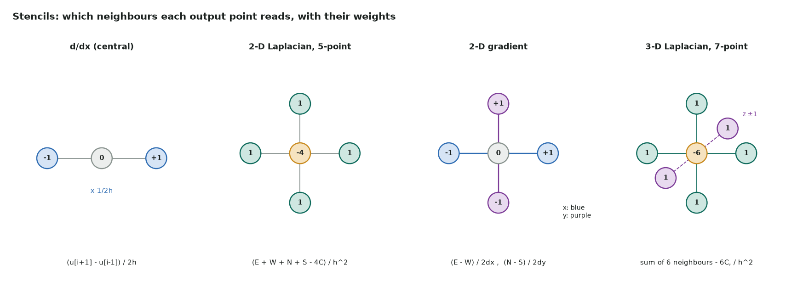
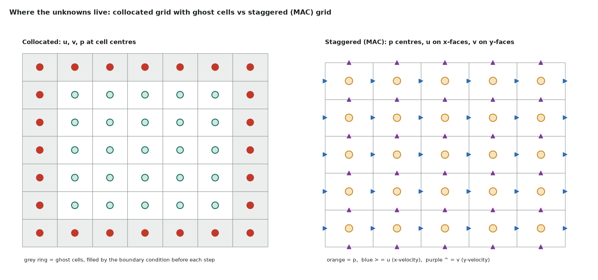
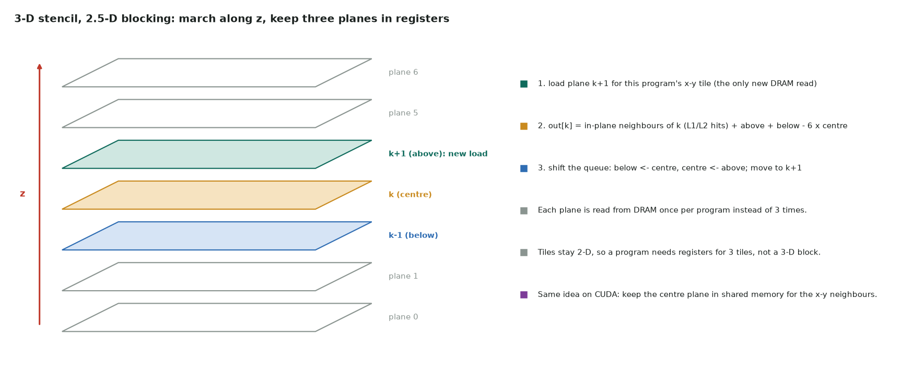

# 12. Gradient, divergence and stencils

How the operators of a PDE (gradient, divergence, Laplacian, curl) become **stencils** on
a grid, how to lay out and index multi-dimensional fields, what a stencil costs on a GPU,
and how to make it run near memory bandwidth. Tested Triton and CUDA C++ implementations are at the end.
Halo exchange across GPUs is on [Multi-GPU](05-multi-gpu.md#domain-decomposition-and-halos),
and a single 2-D Jacobi kernel is worked through on
[LeetGPU 14](../leetgpu/14-jacobi-stencil-2d.md).

## From derivatives to stencils

Expand $u$ around a grid point with spacing $h$ (Taylor series):

$$u(x \pm h) = u \pm h u' + \tfrac{h^2}{2} u'' \pm \tfrac{h^3}{6} u''' + \tfrac{h^4}{24} u'''' + \dots$$

Adding or subtracting the two expansions gives the standard central differences:

| Derivative | Stencil | Leading error | Order |
|---|---|---|---|
| $u'$, forward | $(u_{i+1} - u_i)/h$ | $\tfrac{h}{2} u''$ | 1 |
| $u'$, central | $(u_{i+1} - u_{i-1})/2h$ | $\tfrac{h^2}{6} u'''$ | 2 |
| $u''$, central | $(u_{i+1} - 2u_i + u_{i-1})/h^2$ | $\tfrac{h^2}{12} u''''$ | 2 |
| $u'$, 4th order | $(-u_{i+2} + 8u_{i+1} - 8u_{i-1} + u_{i-2})/12h$ | $O(h^4)$ | 4 |
| $u''$, 4th order | $(-u_{i+2} + 16u_{i+1} - 30u_i + 16u_{i-1} - u_{i-2})/12h^2$ | $O(h^4)$ | 4 |

"Order 2" means halving $h$ cuts the error by about 4×. A higher order needs a **wider
stencil**: radius 2 instead of 1, so two ghost layers and twice the halo per exchange.

In several dimensions, apply the 1-D formulas along each axis and combine them:

| Operator | Math | Second-order stencil (uniform $h$) | Reads per point (naive) |
|---|---|---|---|
| Gradient | $\nabla u = (\partial_x u, \partial_y u, \partial_z u)$ | central difference on each axis | 2 per axis, writes 1 per axis |
| Divergence | $\nabla\cdot\mathbf{v} = \partial_x v_x + \partial_y v_y + \partial_z v_z$ | $\partial_x$ of $v_x$ + $\partial_y$ of $v_y$ + … | 2 per component |
| Laplacian | $\nabla^2 u = \nabla\cdot\nabla u$ | 5-point (2-D), 7-point (3-D): neighbours minus $2d \cdot u_c$, over $h^2$ | 5 or 7 |
| Curl (2-D) | $\omega = \partial_x v - \partial_y u$ | central differences, mixed components | 4 |
| Advection | $\mathbf{v}\cdot\nabla\phi$ | upwind (1st/2nd order) chooses the side from the sign of $\mathbf{v}$ | 2–3 per axis |
| Variable diffusion | $\nabla\cdot(\kappa \nabla u)$ | flux form: $[\kappa_{i+\frac12}(u_{i+1}-u_i) - \kappa_{i-\frac12}(u_i-u_{i-1})]/h^2$ per axis | 3 of $u$, 2 of $\kappa$ per axis |



*Each output point is a weighted sum of a fixed neighbourhood. Diagonal ("box") stencils,
such as the 9-point 2-D and 27-point 3-D Laplacians, also read the corners. They are more
isotropic but cost more reads and need corner ghost cells.*

!!! warning "Truncation vs round-off"
    A difference of nearby values loses precision. For a central first derivative the total
    error is about $\tfrac{h^2}{6}|u'''| + \epsilon |u| / h$, which is smallest near
    $h \approx (3\epsilon)^{1/3}$ for $O(1)$ solutions. In FP32 ($\epsilon \approx 6\times10^{-8}$)
    that is $h \approx 6\times10^{-3}$: refining further makes first derivatives *worse*.
    In FP64 it is $\approx 7\times10^{-6}$. Run convergence tests in FP64, and think twice
    before running a fine-grid solver in FP32.

## Multi-dimensional fields in memory

### Index order and coalescing

Store 3-D fields row-major with **x fastest**:

$$\text{idx}(i, j, k) = (k \cdot N_y + j) \cdot N_x + i$$

where $N_x, N_y$ include the ghost layers. Neighbours in x are adjacent in memory, in y
$N_x$ elements apart, in z $N_x N_y$ apart. Map consecutive threads (or the inner
dimension of a Triton block) to **i**, so every warp reads one contiguous row segment. Put
the thread index on y or z and every load becomes a strided gather.

### Vector fields: structure of arrays

Store $\mathbf{v} = (v_x, v_y, v_z)$ as three separate arrays (SoA), not as one array of
`(vx, vy, vz)` triples (AoS). With SoA, each component is read with unit stride; with AoS,
a warp reading $v_x$ skips over the other two components and wastes two-thirds of every
cache line. LBM codes follow the same rule: one array per lattice direction.

### Ghost cells and boundary conditions

Give each field a ring of **ghost cells** as wide as the stencil radius. Before applying an
operator, fill the ring from the boundary condition. The operator then treats every
interior point the same, with no branches on the GPU:

| Boundary condition | Ghost value (cell-centred grid, wall halfway to the ghost) |
|---|---|
| Periodic | copy of the opposite edge |
| Dirichlet $u = g$ | $2g - u_{\text{first interior}}$ (second order at the wall) |
| Neumann $\partial u/\partial n = 0$ | $u_{\text{first interior}}$ (mirror) |
| Neumann $\partial u/\partial n = q$ | $u_{\text{first interior}} + h q$ |

Ghosts go stale after every update, so refill them before each operator application. On
several GPUs, the halo exchange *is* the ghost fill for internal boundaries. Corner ghosts
matter only for diagonal stencils; filling axis by axis, as the code below does, sets them
correctly for periodic boundaries.

### Collocated vs staggered grids



On a **collocated** grid all variables share the cell centres. It is simple, but has a
known trap: the divergence of a central-difference gradient is **not** the compact
Laplacian. It is a Laplacian with spacing $2h$,
$(u_{i+2} - 2u_i + u_{i-2})/4h^2$, which never compares a point with its direct
neighbours. A checkerboard pattern (+1, −1, +1, …) has zero gradient and zero
"div grad" everywhere. In incompressible flow solvers this shows up as odd-even pressure
oscillations that the equations can't see. The test script demonstrates it: on a
checkerboard, `div2d(grad2d(u))` returns exactly 0, while the 5-point Laplacian returns
$-8/h^2$.

The **staggered (MAC)** grid fixes this by placing pressure at cell centres and each
velocity component on the faces normal to it. The divergence of face velocities lands on
the centre, and the pressure gradient lands on the faces, both with compact $h$-spaced
stencils. The price is bookkeeping: $u$ is $(N_x{+}1) \times N_y$, $v$ is
$N_x \times (N_y{+}1)$, and every operator has its own index offsets. Collocated
solvers instead add Rhie–Chow interpolation to suppress the checkerboard.

## What a stencil costs on a GPU

Stencils do very little arithmetic per byte. In FP32, with ideal caching (each input read
once from DRAM, each output written once):

| Kernel | DRAM bytes per point | FLOPs per point | FLOP/byte |
|---|---|---|---|
| 2-D gradient | 4 read + 8 write = 12 | ~4 | ~0.3 |
| 2-D divergence | 8 read + 4 write = 12 | ~5 | ~0.4 |
| 3-D 7-point Laplacian | 4 + 4 = 8 | ~10–14 | ~1.5 |
| 3-D 27-point Laplacian | 4 + 4 = 8 | ~30 | ~4 |

An H100 needs about 20 FLOP/byte (67 TFLOPS FP32 ÷ 3.35 TB/s) before compute becomes the
limit; a T4 about 25. Every stencil here is **memory bound** by an order of magnitude,
so the time per sweep is set by bytes moved
([performance](03-performance.md#start-with-the-roofline)). For example, one 7-point Laplacian
over $512^3$ FP32 moves at least 1.07 GB: about 0.32 ms on an H100 and 3.4 ms on a T4 at
peak bandwidth.

Two consequences:

- **The target is one DRAM read per input point.** The naive kernel issues 7 loads per
  point for a 7-point stencil; the caches must turn the other 6 into hits. Measure
  DRAM bytes with Nsight Compute (`dram__bytes_read.sum`). Much more than 4 bytes read
  per point means neighbours are being re-fetched from DRAM.
- **Fewer passes beat faster arithmetic.** Fusing operators so intermediates never reach
  DRAM is the main optimization.

## Making stencils fast

### 2-D: wide tiles

Give each program (or thread block) a tile that is wide in x, at least 128 elements, so
each row is a 512-byte coalesced access. The halo re-read per tile is
$(B_x + 2r)(B_y + 2r) / (B_x B_y)$: 1.14× for a 16 × 128 tile with radius 1, which L2
mostly absorbs. In CUDA you can load tile plus halo into shared memory once; Triton has
no shared-memory API and relies on L1/L2 for the overlapping loads.

### 3-D: march along z (2.5-D blocking)

A full 3-D tile wastes reads: an 8 × 8 × 8 block with a one-cell halo loads
$10^3 = 1000$ values to update 512, nearly 2×. Instead, give each program a 2-D x-y tile
and **loop over z**, keeping planes $k-1$, $k$, $k+1$ in registers:



Each step loads one new plane. The in-plane neighbours of plane $k$ overlap the centre
tile and hit L1/L2, and each plane is read from DRAM once per program. This is the
classic scheme from Micikevicius, *3D Finite Difference Computation on GPUs using CUDA*
(GPGPU 2009). The CUDA version keeps the centre plane in shared memory and the z-neighbours
in registers. `lap3d_kernel` below is the Triton version. For a radius-$r$ stencil the
queue holds $2r + 1$ planes.

### Fuse operators

- **Don't store intermediates.** For $\nabla\cdot(\kappa\nabla u)$, compute the face
  fluxes $\kappa_{i+\frac12}(u_{i+1}-u_i)/h$ inside the kernel and difference them
  directly, instead of writing $\nabla u$ to memory and reading it back. That saves two
  (2-D) or three (3-D) full arrays of writes and reads per step.
- **Fuse the update.** Compute the right-hand side and the time step (for example
  $u^{n+1} = u^n + \Delta t\, \nabla^2 u^n$) in one kernel: 8 bytes per point instead of 16.
- **Fuse the ghost fill** into the operator kernel when the boundary is simple, or fill
  all fields' ghosts in one small kernel to avoid many tiny launches.
- **Temporal blocking** (several time steps per tile, with a halo $r$ cells wider per
  step) trades redundant computation for fewer DRAM passes; see
  [LeetGPU 14](../leetgpu/14-jacobi-stencil-2d.md).

### Stencils as convolutions

A constant-coefficient stencil is a convolution with a fixed kernel, so
`torch.nn.functional.conv2d` / `conv3d` can apply it with no custom code, which is handy
for prototypes. It is still bandwidth bound: tensor cores don't help a 3 × 3 × 3 kernel
with one input and one output channel. Custom kernels win once you fuse the update,
boundary handling or several operators.

### Across GPUs

Split the domain into slabs (1-D), pencils (2-D) or blocks (3-D). The halo width equals
the stencil radius, and the halo grows with the sub-domain's **surface** while the work
grows with its **volume**. Update the boundary layer first, start the halo exchange, then
update the interior while it is in flight
([streams](04-streams.md), [multi-GPU](05-multi-gpu.md#domain-decomposition-and-halos)).
Keep the exchange on NVLink where you can
([how GPUs talk to each other](10-multi-gpu-communication.md)).

## Code: gradient, divergence and Laplacian in Triton and CUDA

`stencil_ops.py` implements a 2-D gradient, a 2-D divergence and a 3-D 7-point Laplacian
with 2.5-D blocking. It also has ghost-cell fills for periodic, Dirichlet and Neumann
boundaries, and four tests:

1. Every kernel matches PyTorch on random fields, including sizes that are not multiples
   of the tile.
2. The ghost fills are correct.
3. **Order of accuracy:** a manufactured periodic solution shows the error falling 4× per
   halving of $h$ (order ≈ 2) for the gradient, div(grad) and the 3-D Laplacian.
4. **The checkerboard pitfall:** div(grad u) is blind to the checkerboard, while the
   compact Laplacian isn't.

=== "Triton"

    ```python
    --8<-- "docs/notes/stencil_ops.py"
    ```

=== "CUDA C++"

    ```cuda
    --8<-- "docs/notes/stencil_ops.cu"
    ```

    The same three operators and ghost-cell convention. `lap3d_kernel` is the classic
    CUDA form of 2.5-D blocking: the centre plane and its x-y halo sit in shared memory
    for the in-plane neighbours, and the planes below and above sit in registers, so each
    plane is read from DRAM once. It is tested against the same PyTorch references by
    `tests/cuda/run_tests.py`
    ([running the CUDA versions](../leetgpu/index.md#running-the-cuda-versions)).

Output under the Triton interpreter (CPU, `TRITON_INTERPRET=1`); on a CUDA GPU it also
prints effective bandwidth:

```text
convergence (float64, periodic):
  n  16 ->  32: order grad 1.95  div(grad) 1.94  lap3d 1.93
  n  32 ->  64: order grad 1.99  div(grad) 1.98  lap3d 1.98
checkerboard mode:
  div(grad u) max |value| = 0.0  (blind to it)
  5-point lap max |value| = 2048.0  (sees it: -8/h^2)
all checks passed
```

## Checklist

- x is the fastest index, and threads (or the inner block dimension) run along x.
- Vector fields are stored as separate arrays (SoA).
- Ghost layers are as wide as the stencil radius and are refilled before every
  operator application, with corners if the stencil is diagonal.
- Collocated pressure–velocity coupling uses a staggered grid or Rhie–Chow.
- A convergence test in FP64 shows the expected order.
- DRAM bytes per point (Nsight Compute) are close to the ideal in the cost table.
- Intermediates (gradients, fluxes) stay in registers, fused into the consumer.
- 3-D stencils march along z; tiles are wide in x.
- Across GPUs: halo = radius, decomposition minimizes surface, and the exchange
  overlaps the interior update.

Regenerate the figures with `python scripts/make_stencil_figures.py`.
