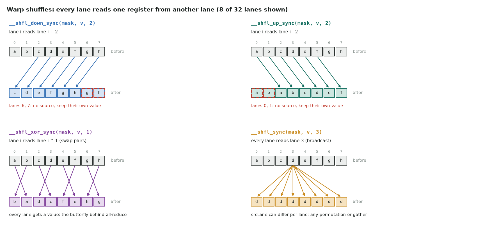
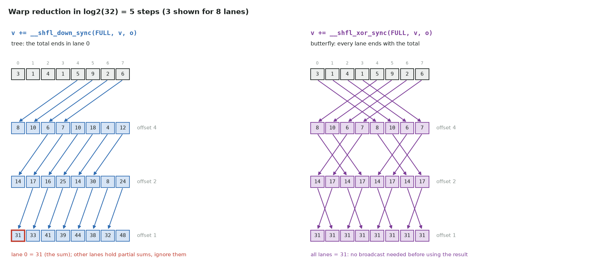
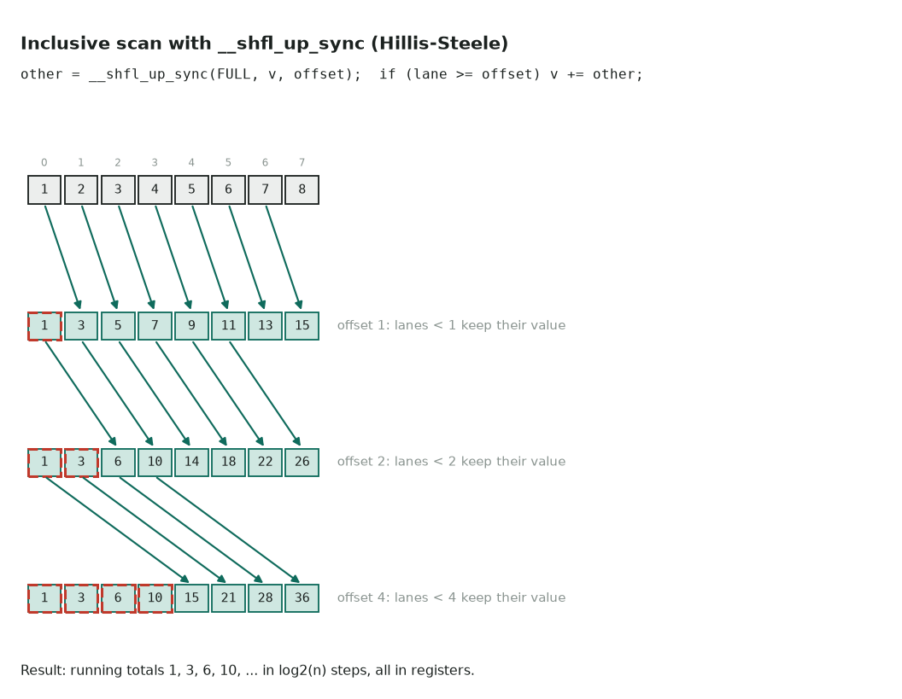
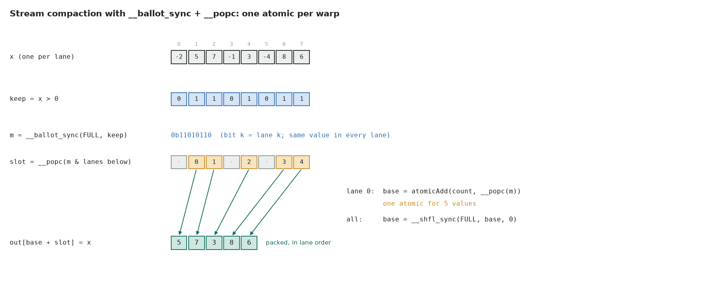
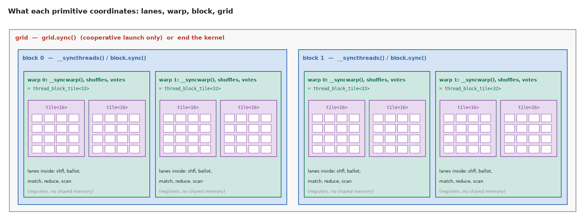

# 13. Warp primitives and cooperative groups

How threads inside a GPU talk to each other without going through memory. This page covers:

- **Warp shuffles** (`__shfl_sync`, `__shfl_up_sync`, `__shfl_down_sync`, `__shfl_xor_sync`):
  read a register from another lane.
- **Votes** (`__ballot_sync`, `__any_sync`, `__all_sync`, `__activemask`): every lane
  contributes one bit.
- **Match** (`__match_any_sync`, `__match_all_sync`) and **warp reduce**
  (`__reduce_add_sync` …): find equal values, or reduce integers in one instruction.
- **Barriers and fences** (`__syncwarp`, `__syncthreads` and its counting forms,
  `__threadfence*`): who waits for whom, and what memory they see afterwards.
- **Cooperative groups**: the same operations on named group objects (tiles, blocks,
  clusters, the whole grid), plus `cg::reduce` and `cg::inclusive_scan`.

These are the building blocks inside fast reductions, scans, softmax, layer norm, top-k,
histograms and stream compaction. Every example on this page is in
[`warp_primitives.cu`](#code-every-primitive-tested) and is tested.

## The warp, lanes and the mask

A **warp** is 32 threads that share one instruction stream; a thread's position in it is
its **lane**, `threadIdx.x & 31` for 1-D blocks (more generally, the linear thread index
in the block, mod 32). See [Execution model](01-execution-model.md#sms-warps-and-simt).

Since Volta (sm_70), each thread has its own program counter (**independent thread
scheduling**). Lanes of a warp usually run together, but the hardware no longer promises
it, so a warp-level operation must say which lanes take part. That is the `mask` argument
of every `*_sync` intrinsic:

- Bit *k* set means lane *k* participates.
- **Every non-exited lane named in the mask must execute the same intrinsic with the same
  mask** (for shuffles: the same intrinsic, at the same point). The hardware waits for the
  named lanes, then exchanges.
- A lane may only read from a lane that is in the mask. Reading from a lane outside it
  returns an undefined value.
- `0xffffffff` (all 32 lanes) is right when the whole warp reaches the call, which is the
  normal case. It is wrong in divergent code or after some lanes have returned.

The simplest way to stay correct: **don't let lanes leave early**. Threads past the end of
the data keep running with a neutral value (0 for sums, `-inf` for max) and only skip the
final store. Every kernel on this page and in the LeetGPU solutions follows that rule.

### All the primitives at a glance

| Family | Intrinsic / API | What it does | Since |
|---|---|---|---|
| Shuffle | `__shfl_sync(m, v, src, w)` | Read `v` from lane `src` (broadcast, gather, permute) | sm_30, `_sync` form sm_70 / CUDA 9 |
| | `__shfl_up_sync(m, v, d, w)` | Read from lane `i - d` (scans) | |
| | `__shfl_down_sync(m, v, d, w)` | Read from lane `i + d` (tree reductions) | |
| | `__shfl_xor_sync(m, v, x, w)` | Read from lane `i ^ x` (butterfly all-reduce) | |
| Vote | `__ballot_sync(m, p)` | 32-bit mask: bit *k* = lane *k*'s predicate | |
| | `__any_sync(m, p)`, `__all_sync(m, p)` | Any / all participating lanes true | |
| | `__activemask()` | Which lanes are executing this line right now (not a barrier) | |
| Match | `__match_any_sync(m, v)` | Mask of lanes holding the same `v` as me | sm_70 |
| | `__match_all_sync(m, v, &pred)` | Mask if all lanes hold the same `v`, else 0 | sm_70 |
| Warp reduce | `__reduce_add_sync`, `_min`, `_max` (int, unsigned); `_and`, `_or`, `_xor` (unsigned) | Reduce 32-bit integers across the warp in one instruction; every lane gets the result | sm_80 |
| Barrier | `__syncwarp(m)` | Lanes in `m` wait for each other; orders their memory accesses | sm_70 semantics |
| | `__syncthreads()` | Whole block waits; shared and global writes before it are visible after it | all |
| | `__syncthreads_count(p)`, `_and(p)`, `_or(p)` | `__syncthreads` that also combines one predicate per thread | sm_20 |
| Fence | `__threadfence_block()`, `__threadfence()`, `__threadfence_system()` | Order *this thread's* writes as seen by its block / the GPU / the GPU and host and peers. Does not wait for anyone. | all |
| Bit tricks | `__popc`, `__ffs`, `__clz`, `__brev` | Count bits, first set bit (1-based), leading zeros, reverse | all |
| Groups | `cooperative_groups` | Typed groups: tile, block, cluster, grid; `sync`, `shfl`, `ballot`, `reduce`, `scan` | CUDA 9+ |

## Warp shuffles

A shuffle moves a **register** value from one lane to another, in one instruction, with no
shared memory and no `__syncthreads`. All shuffles share one shape:

```cpp
T __shfl_sync     (unsigned mask, T var, int      srcLane, int width = warpSize);
T __shfl_up_sync  (unsigned mask, T var, unsigned delta,   int width = warpSize);
T __shfl_down_sync(unsigned mask, T var, unsigned delta,   int width = warpSize);
T __shfl_xor_sync (unsigned mask, T var, int      laneMask, int width = warpSize);
```

- `T` can be `int`, `unsigned`, `long`, `long long` (and unsigned versions), `float`,
  `double`, `__half`, `__half2`, `__nv_bfloat16`, `__nv_bfloat162`. A 64-bit value costs
  two shuffles. For anything bigger (a `float4`, a struct), shuffle each field.
- Every lane passes its own `var`; every lane gets back the `var` of its source lane.
- `width` (a power of two, at most 32) splits the warp into independent segments of that
  many lanes. Lane numbers in `srcLane`, `delta` and `laneMask` are then relative to the
  segment. Useful when one warp handles several short rows, e.g. 4 rows of 8.



*Down and up shift by `delta`. Lanes whose source would fall outside the warp (or segment)
get their own value back. Xor pairs lanes whose numbers differ in the given bits. The
indexed form reads any lane, and different lanes may name different sources.*

```cpp
int lane = threadIdx.x & 31;
int value = lane;

int a = __shfl_down_sync(0xffffffff, value, 1);   // lanes 0..30: lane + 1;   lane 31: 31
int b = __shfl_up_sync  (0xffffffff, value, 1);   // lanes 1..31: lane - 1;   lane 0: 0
int c = __shfl_xor_sync (0xffffffff, value, 1);   // 1, 0, 3, 2, 5, 4, ...
int d = __shfl_sync     (0xffffffff, value, 0);   // 0 in every lane (broadcast lane 0)
int e = __shfl_sync     (0xffffffff, value, 3, 8);// 3, 3, ..., 11, 11, ..., 19, ..., 27: lane 3 of each 8-lane segment
```

### Reduction: `__shfl_down_sync` or `__shfl_xor_sync`



```cpp
// Tree: the sum ends in lane 0; the other lanes hold partial sums.
__device__ float warp_sum(float v) {
    for (int offset = 16; offset > 0; offset >>= 1)
        v += __shfl_down_sync(0xffffffff, v, offset);
    return v;                      // valid in lane 0
}

// Butterfly: every lane ends with the full result.
__device__ float warp_max(float v) {
    for (int mask = 16; mask > 0; mask >>= 1)
        v = fmaxf(v, __shfl_xor_sync(0xffffffff, v, mask));
    return v;                      // valid in every lane
}
```

Both take 5 steps for 32 lanes and cost the same. Pick **xor** when every lane needs the
result afterwards. Softmax needs the row max in every lane to compute `exp(x - max)`;
layer norm needs the mean in every lane. Pick **down** when only one lane writes the result,
or when you go on to combine warps through shared memory.

Floating-point note: the two orders add the numbers in different trees, so their last bits
can differ. Each is deterministic run to run, which `atomicAdd` on floats is not.

### Prefix sum: `__shfl_up_sync`



```cpp
__device__ int warp_inclusive_scan(int v) {
    int lane = threadIdx.x & 31;
    for (int offset = 1; offset < 32; offset <<= 1) {
        int other = __shfl_up_sync(0xffffffff, v, offset);
        if (lane >= offset) v += other;     // lanes below `offset` have no source
    }
    return v;                               // [1, 2, 3, 4, ...] -> [1, 3, 6, 10, ...]
}
// exclusive scan: warp_inclusive_scan(v) - v   (or shuffle the inclusive result up by 1)
```

The `if (lane >= offset)` guard is essential. Without it, low lanes add their *own* value
again, because `__shfl_up_sync` returns the caller's value when there is no source. Note
that the shuffle itself is outside the `if`: every lane in the mask must call it.

A scan across a whole block is three steps. Scan each warp, scan the 32 warp totals with
one more warp scan, then add each warp's offset (`block_scan_kernel` in the
[code](#code-every-primitive-tested)). A scan across the whole array adds one more level:
a decoupled look-back or a second kernel
([segmented prefix sum](../leetgpu/16-segmented-prefix-sum.md)).

### Broadcast, gather and transpose: `__shfl_sync`

- **Broadcast:** `__shfl_sync(FULL, v, 0)`. One lane loads or computes a value (an atomic's
  result, a row pointer), and the others get it without shared memory.
- **Gather:** each lane names its own source, `__shfl_sync(FULL, v, perm[lane])`, which gives
  any permutation within the warp.
- **Register transpose:** `n` shuffles with `srcLane = (lane + k) % 32` rotate data
  between lanes, used in some FFT and GEMM epilogues to avoid a trip through shared
  memory.

## Votes: one bit per lane

```cpp
unsigned m   = __ballot_sync(0xffffffff, x > 0.0f);   // bit k = lane k's predicate
int any_neg  = __any_sync   (0xffffffff, x < 0.0f);   // 1 if any lane's predicate is true
int all_pos  = __all_sync   (0xffffffff, x > 0.0f);   // 1 if all lanes' predicates are true
unsigned now = __activemask();                        // lanes executing this line now
```

A ballot is the same in every participating lane. Combined with bit operations it answers
"how many", "which", and "how many before me":

| Question | Expression |
|---|---|
| How many lanes are true? | `__popc(m)` |
| Lowest true lane (leader) | `__ffs(m) - 1` (−1 if none) |
| Highest true lane | `31 - __clz(m)` |
| How many true lanes are below me? | `__popc(m & ((1u << lane) - 1))` |
| Am I the leader? | `lane == __ffs(m) - 1` |

**Early exit for the whole warp:** `if (!__any_sync(FULL, needs_work)) return;` skips a
branch only when no lane needs it. That is how a warp avoids [divergence](01-execution-model.md#warp-divergence)
on rare paths: everyone skips together, or everyone runs it together.

### Stream compaction and warp-aggregated atomics



```cpp
bool keep = i < n && x[i] > 0.0f;
unsigned m = __ballot_sync(FULL, keep);
int base = 0;
if (lane == 0 && m) base = atomicAdd(count, __popc(m));       // one atomic per warp
base = __shfl_sync(FULL, base, 0);                           // ...shared with all lanes
if (keep) out[base + __popc(m & ((1u << lane) - 1))] = x[i]; // my slot
```

32 lanes that each `atomicAdd(count, 1)` make 32 atomics on one address, and they
serialize. The ballot version makes one. This is **warp aggregation**. Recent compilers do it automatically for
some simple patterns, such as `atomicAdd(p, 1)` with an unused result, but not for anything
more involved, such as computing each lane's slot as above.

`__activemask()` is **not** a way to build the mask for this. It reports which lanes happen
to be converged at that instant, which may be fewer than the lanes that will eventually
reach the line. Use a ballot over the full warp *before* the branch, or cooperative
groups' `coalesced_threads()` ([below](#coalesced-groups-work-on-whoever-arrived)).

## Match and warp reduce

**`__match_any_sync(mask, v)`** (sm_70+) returns the mask of lanes whose `v` equals mine.
It groups lanes by key in one instruction. For example, in a histogram several lanes often hit
the same bin; only one lane per bin needs to do the atomic:

```cpp
int b = i < n ? bins[i] : -1;                    // tail lanes: their own key, never written
unsigned peers = __match_any_sync(FULL, b);      // lanes with the same bin as me
if (b >= 0 && lane == __ffs(peers) - 1)          // the lowest of them...
    atomicAdd(&hist[b], __popc(peers));          // ...adds for the whole group
```

On skewed data (a few hot bins) this replaces up to 32 colliding atomics with one. On
uniform data with many bins it gains little, because the lanes rarely match. The same trick
aggregates scatter-adds into embedding gradients ([scatter-add](../leetgpu/11-scatter-add.md)).
`__match_all_sync(mask, v, &pred)` says whether *every* lane holds the same value, for
example "is this whole warp working on the same row?".

**`__reduce_add_sync(mask, v)`** and the `min`, `max`, `and`, `or`, `xor` forms (sm_80+)
reduce a **32-bit integer** across the warp in one instruction. Every lane gets the
result. There are no float versions, so float sums still use the shuffle loop. Guard the
call for older targets:

```cpp
__device__ int warp_add(int v) {
#if !defined(__CUDA_ARCH__) || __CUDA_ARCH__ >= 800
    return __reduce_add_sync(0xffffffff, v);
#else
    for (int o = 16; o > 0; o >>= 1) v += __shfl_xor_sync(0xffffffff, v, o);
    return v;
#endif
}
```

## Masks and convergence: what goes wrong

**1. Old "warp-synchronous" code.** Before Volta, code assumed the 32 lanes of a warp ran in
lock-step, so the last steps of a reduction dropped `__syncthreads()`:

```cpp
// WRONG on Volta and later: nothing orders lane i's read of s[i + 16] after lane i+16's write
if (tid < 32) {
    volatile float* s = sdata;
    s[tid] += s[tid + 32]; s[tid] += s[tid + 16]; s[tid] += s[tid + 8];
    s[tid] += s[tid + 4];  s[tid] += s[tid + 2];  s[tid] += s[tid + 1];
}
```

With independent thread scheduling the lanes can drift apart, and the result is
occasionally wrong. That is the worst kind of bug. Fix it with shuffles (keep the data in
registers), or with `__syncwarp()` between a read and the next write:

```cpp
if (tid < 32) {
    float v = sdata[tid] + sdata[tid + 32];
    for (int o = 16; o > 0; o >>= 1) v += __shfl_down_sync(0xffffffff, v, o);
    if (tid == 0) out[blockIdx.x] = v;
}
```

The old intrinsics without `_sync` (`__shfl`, `__ballot`, `__any`) are deprecated and are
not available when compiling for sm_70 and later.

**2. Full mask in divergent code.**

```cpp
if (i < n) {                                       // lanes with i >= n skip the block...
    v += __shfl_down_sync(0xffffffff, v, 16);      // ...but the mask says all 32 come: undefined
}
```

Either keep all lanes (`v = i < n ? x[i] : 0` before any branch), or compute the exact
mask with `__ballot_sync(FULL, i < n)` *before* the branch. Even then, a lane must only
read from lanes inside the mask, which `shfl_down` by 16 doesn't guarantee for the tail.
Keeping all lanes is simpler and is what fast kernels do.

**3. `__syncthreads()` in a branch** that not all threads of the block reach is undefined
behaviour: a hang, or silent garbage. The same is true for `__syncwarp(mask)` with lanes
in the mask that never arrive.

**4. Early `return` before a collective.** A lane that returns has exited. Exited lanes are
fine for `__syncthreads` (Volta+ ignores them), but a shuffle that reads from an exited
lane gets garbage. The rule from the top of the page avoids this.

## Synchronization and memory ordering

A **shuffle** moves registers and implies nothing about memory. A **barrier** makes threads
wait and makes their earlier memory writes visible to each other. A **fence** orders one
thread's own writes and waits for nobody. These are three different tools.



| Primitive | Who waits | Memory guarantee |
|---|---|---|
| shuffles, votes, match, `__reduce_*_sync` | The lanes in the mask (they converge to exchange) | None: register exchange only |
| `__syncwarp(mask)` / `tile.sync()` | Lanes in the mask / tile | Shared and global accesses before it are visible to those lanes after it |
| `__syncthreads()` / `block.sync()` | Every thread of the block | Same, for the whole block |
| `__syncthreads_count/and/or(p)` | Every thread of the block | Same, and returns the combined predicate |
| `cluster.sync()` (sm_90+) | Every thread of a thread-block cluster | Same, across the cluster's shared memory |
| `grid.sync()` | Every thread of the grid (cooperative launch only) | Global memory, across all blocks |
| end of kernel | Everything | Everything, for the next kernel in the stream |
| `__threadfence_block()` | No one | My writes are seen in order by my block |
| `__threadfence()` | No one | My writes are seen in order by the whole GPU |
| `__threadfence_system()` | No one | Also by the host and peer GPUs (mapped / NVLink memory) |

`__syncthreads_count(p)` returns how many threads of the block had `p` true, from one
barrier and with no shared-memory counter. It is handy for "how many elements survived the
filter in this block". `__syncthreads_or(p)` is a block-wide "did anyone…?", useful as
the stop test of an iterative loop.

A fence is what makes the classic **"last block finishes the job"** reduction work. Each
block writes its partial result, calls `__threadfence()`, then increments a counter with
`atomicAdd`. The block that sees the final count knows that all partials are visible, and
sums them. Without the fence, the counter can become visible before the partial does.

## Cooperative groups

`cooperative_groups` (header `<cooperative_groups.h>`) wraps the same operations in
**group objects**. A function takes a group and works for whichever group you pass, a
16-lane tile or a whole block. You stop computing masks and lane numbers by hand.

```cpp
#include <cooperative_groups.h>
#include <cooperative_groups/reduce.h>   // cg::reduce
#include <cooperative_groups/scan.h>     // cg::inclusive_scan, cg::exclusive_scan
namespace cg = cooperative_groups;

__global__ void block_sum(const float* x, float* per_block, int n) {
    cg::thread_block block = cg::this_thread_block();
    cg::thread_block_tile<32> warp = cg::tiled_partition<32>(block);
    __shared__ float warp_sum[32];

    int i = blockIdx.x * blockDim.x + threadIdx.x;
    float s = cg::reduce(warp, i < n ? x[i] : 0.0f, cg::plus<float>());  // all lanes get it
    if (warp.thread_rank() == 0) warp_sum[warp.meta_group_rank()] = s;
    block.sync();
    if (warp.meta_group_rank() == 0) {
        float t = warp.thread_rank() < warp.meta_group_size() ? warp_sum[warp.thread_rank()] : 0.0f;
        t = cg::reduce(warp, t, cg::plus<float>());
        if (warp.thread_rank() == 0) per_block[blockIdx.x] = t;
    }
}
```

### Group types

| Group | How you get it | Size | What it can do |
|---|---|---|---|
| `thread_block` | `cg::this_thread_block()` | The block | `sync`, `thread_rank`, `size`, `group_index`, `thread_index` |
| `thread_block_tile<N>` | `cg::tiled_partition<N>(parent)`, N = 1, 2, 4, 8, 16, 32 | N, known at compile time | Everything a warp can do: `sync`, `shfl`, `shfl_up/down/xor`, `ballot`, `any`, `all`, `match_any/all`, `meta_group_rank/size`; works with `cg::reduce` and scans |
| `thread_block_tile<N>` with N = 64…1024 | `tiled_partition<N>(block)` (CUDA 11.1+; before sm_80 it also needs a `block_tile_memory` scratch area) | N | `sync`, `thread_rank`, meta-group queries; no shuffles |
| `thread_group` | `cg::tiled_partition(parent, n)` (size at run time) | n | `sync`, `thread_rank`, `size` only |
| `coalesced_group` | `cg::coalesced_threads()` | The lanes of my warp that are here now | Shuffles and votes with ranks renumbered 0…size−1 |
| `labeled_partition`, `binary_partition` | `cg::labeled_partition(tile, label)` | Lanes of a tile with the same label | Splits a warp by key (sm_70+) |
| `cluster_group` | `cg::this_cluster()` (sm_90+) | The blocks of a cluster | `sync`, `block_rank`, `map_shared_rank` (read another block's shared memory) |
| `grid_group` | `cg::this_grid()` | Every thread of the launch | `sync` (cooperative launch only), `thread_rank`, `size` |

Collectives on tiles:

- `cg::reduce(tile, v, op)`, where `op` is `cg::plus<T>`, `cg::less<T>` (min),
  `cg::greater<T>` (max), `cg::bit_and/or/xor<T>`, or your own functor. On sm_80+ it uses
  `__reduce_*_sync` for integers.
- `cg::inclusive_scan(tile, v[, op])` and `cg::exclusive_scan(tile, v[, op])`.
- `cg::memcpy_async(group, dst_shared, src_global, bytes)` followed by `cg::wait(group)`
  (header `<cooperative_groups/memcpy_async.h>`):
  the group copies global memory to shared without staging it through registers. It is
  hardware-accelerated on sm_80+ and is the building block of software pipelining
  ([asynchronous copies](09-optimization-strategies.md)).

### Coalesced groups: work on whoever arrived

Inside a divergent branch you often don't know which lanes are present.
`coalesced_threads()` builds a group of exactly those lanes, renumbered from 0:

```cpp
__device__ int atomic_inc_aggregated(int* counter) {
    cg::coalesced_group active = cg::coalesced_threads();   // the lanes that reached this line
    int base = 0;
    if (active.thread_rank() == 0) base = atomicAdd(counter, (int)active.size());
    base = active.shfl(base, 0);                             // leader's result to the group
    return base + (int)active.thread_rank();                 // a distinct slot per lane
}

__global__ void filter_positive(const float* x, float* out, int* count, int n) {
    int i = blockIdx.x * blockDim.x + threadIdx.x;
    if (i < n && x[i] > 0.0f)                                // divergent: any subset of lanes
        out[atomic_inc_aggregated(count)] = x[i];
}
```

The group is the lanes converged at that point, so it is a *performance* tool: it gives
fewer atomics when lanes happen to be together. It is not a correctness guarantee. The
result is still correct if the warp arrives in pieces; each piece just does its own atomic.

### Grid-wide sync: `grid.sync()`

`grid.sync()` makes every thread of the grid wait, so one kernel can do phase 1, sync, then
phase 2, keeping registers and saving a launch. It has strict requirements:

1. Launch with **`cudaLaunchCooperativeKernel`** (or `cudaLaunchKernelEx` with the
   cooperative attribute), not `<<<>>>`. Check `cudaDevAttrCooperativeLaunch` first.
2. **All blocks must be resident at once**: grid size ≤ (blocks per SM from
   `cudaOccupancyMaxActiveBlocksPerMultiprocessor`) × (number of SMs). Larger grids fail
   to launch with `cudaErrorCooperativeLaunchTooLarge`, so loop over the data with a
   grid-stride loop instead.
3. Since CUDA 11 it no longer needs `-rdc=true`. (The file below links without it.)

```cpp
__global__ void normalize_kernel(const float* x, float* y, float* partial, int n) {
    cg::grid_group grid = cg::this_grid();
    auto warp = cg::tiled_partition<32>(cg::this_thread_block());
    float s = 0.0f;
    for (long long i = grid.thread_rank(); i < n; i += grid.size()) s += x[i];
    s = cg::reduce(warp, s, cg::plus<float>());
    if (warp.thread_rank() == 0) partial[grid.thread_rank() / 32] = s;

    grid.sync();                                         // every partial is written

    float total = 0.0f;
    for (int w = 0; w < (int)(grid.size() / 32); ++w) total += partial[w];
    for (long long i = grid.thread_rank(); i < n; i += grid.size()) y[i] = x[i] / total;
}

// host
int per_sm, sms;
cudaOccupancyMaxActiveBlocksPerMultiprocessor(&per_sm, normalize_kernel, 128, 0);
cudaDeviceGetAttribute(&sms, cudaDevAttrMultiProcessorCount, 0);
void* args[] = {&x, &y, &partial, &n};
cudaLaunchCooperativeKernel(normalize_kernel, per_sm * sms, 128, args, 0, 0);
```

When it's worth it: iterative solvers and other multi-phase kernels where per-phase work
is small and launch overhead dominates, or where state in registers or shared memory must
survive between phases. Otherwise two ordinary kernels are simpler, run on any grid size,
and are often just as fast. Measure. [CUDA Graphs](04-streams.md#cuda-graphs) are the other way to
cut launch cost.

### Clusters (Hopper and later)

On sm_90+ a **thread-block cluster** groups up to 8 blocks (16 with opt-in) that run on
neighbouring SMs. They can sync with each other and read each other's shared memory
(**distributed shared memory**):

```cpp
__global__ void __cluster_dims__(2, 1, 1) pair_sum(const float* x, float* out) {
    cg::cluster_group cluster = cg::this_cluster();
    __shared__ float part;
    if (threadIdx.x == 0) part = x[blockIdx.x];              // stand-in for a block's partial
    cluster.sync();                                          // both blocks' `part` written
    if (cluster.block_rank() == 0 && threadIdx.x == 0) {
        float other = *cluster.map_shared_rank(&part, 1);    // block 1's shared memory
        out[blockIdx.x / 2] = part + other;
    }
    cluster.sync();                                          // keep block 1 alive until read
}
```

The second `cluster.sync()` matters: a block's shared memory disappears when the block
exits, so the owner must wait until its neighbours have finished reading.

## Which one to use

| Task | Primitive |
|---|---|
| Sum / max / min within a warp, result in one lane | `__shfl_down_sync` loop, or `cg::reduce` |
| Same, result needed by every lane (softmax, norms) | `__shfl_xor_sync` loop, or `cg::reduce` |
| Integer sum / min / max within a warp, sm_80+ | `__reduce_*_sync` |
| Prefix sum within a warp | `__shfl_up_sync` loop with the `lane >= offset` guard, or `cg::inclusive_scan` |
| Share one lane's value (atomic result, pointer) | `__shfl_sync(mask, v, src)` |
| Several short rows per warp | any shuffle with `width` = 8 or 16, or `tiled_partition<8/16>` |
| Count / locate lanes meeting a condition | `__ballot_sync` + `__popc` / `__ffs` |
| Skip a rare path unless some lane needs it | `__any_sync` |
| One atomic per warp instead of 32 | ballot + popc + shuffle, or `coalesced_threads()` |
| One atomic per distinct key | `__match_any_sync` + leader |
| Data through shared memory between lanes of a warp | `__syncwarp()` between write and read |
| Data through shared memory across a block | `__syncthreads()` / `block.sync()` |
| Count a predicate across the block | `__syncthreads_count` |
| Across blocks | end the kernel; or `grid.sync()` with a cooperative launch; or atomics + `__threadfence()` |
| Between neighbouring blocks on Hopper | clusters, `map_shared_rank` |

**In Triton** you don't write any of these. `tl.sum`, `tl.max` and `tl.reduce` compile to
shuffle trees plus a shared-memory step, and `tl.cumsum` and `tl.associative_scan` to
shuffle scans. There is no ballot, match or grid sync. When a kernel needs those, that is a
reason to write it in CUDA ([Triton vs CUDA](08-triton.md)).

## Code: every primitive, tested

`warp_primitives.cu` has one small kernel per idea, each behind an `extern "C"` host
function. `tests/cuda/run_tests.py` checks all of them against PyTorch for sizes from 1 to
100 003, including sizes that leave a partial last warp:

| # | Function | Shows |
|---|---|---|
| 1 | `warp_sums` | `__shfl_down_sync` tree reduction |
| 2 | `warp_max` | `__shfl_xor_sync` butterfly, result in every lane |
| 3 | `segment_broadcast` | `__shfl_sync` with `width` 4, 8, 32 |
| 4 | `warp_scan` | `__shfl_up_sync` inclusive scan, segments of 8 and 32 |
| 5 | `block_scan` | Warp scans → scan of warp totals → carry across chunks |
| 6 | `warp_votes` | `__any_sync`, `__all_sync`, `__ballot_sync` |
| 7 | `compact_positive` | Ballot + popc compaction, one atomic per warp |
| 8 | `histogram_match` | `__match_any_sync` aggregated histogram |
| 9 | `int_sum_max` | `__reduce_add_sync` / `__reduce_max_sync` (shuffle fallback below sm_80) |
| 10 | `count_positive` | `__syncthreads_count` |
| 11 | `cg_block_sum` | `tiled_partition<32>`, `cg::reduce`, `block.sync()` |
| 12 | `cg_tile_scan` | `cg::inclusive_scan` / `exclusive_scan` on 16-lane tiles |
| 13 | `normalize_by_sum` | `grid.sync()` with a cooperative launch |

```cuda
--8<-- "docs/notes/warp_primitives.cu"
```

**How it was verified (no GPU here):**

- **CPU emulator, 123 checks, all passing.** The emulator runs each thread as an OS thread
  and implements shuffles, votes, match and `__reduce_*_sync` as real exchanges through a
  per-warp barrier, so lanes that drift apart give wrong answers instead of lucky right
  ones.
- **The checks do catch bugs.** Removing one `__syncthreads()` from the block scan,
  deleting `grid.sync()`, or dropping the `lane >= offset` guard each made tests fail.
- **Real nvcc 12.6.** The file compiles for sm_75, sm_80 and sm_90 with warnings as
  errors, and with no register spills. It also links as a shared library without `-rdc`. The
  `coalesced_threads`, cluster and fixed-reduction snippets above were compiled the same
  way (the cluster one for sm_90).
- Not yet run on a GPU. `python tests/cuda/run_tests.py --gpu warp_primitives` does that
  on a machine with one ([running the CUDA versions](../leetgpu/index.md#running-the-cuda-versions)).

## Checklist

- Lanes past the end of the data stay in the warp with a neutral value; only the store is
  guarded.
- Every `*_sync` call is reached by every lane named in its mask, and lanes only read from
  lanes in the mask.
- No code relies on implicit warp lock-step; shared memory between lanes goes through
  `__syncwarp()`.
- `__syncthreads()` is never inside a branch that some threads of the block skip.
- xor reductions when every lane needs the result; down reductions when one lane writes it.
- Scans guard the add with `lane >= offset`, but call the shuffle unconditionally.
- Hot atomics are aggregated per warp (ballot, `coalesced_threads`, or `match_any`).
- `grid.sync()` only with `cudaLaunchCooperativeKernel` and a grid sized from the
  occupancy calculator.

Regenerate the figures with `python scripts/make_warp_figures.py`.
